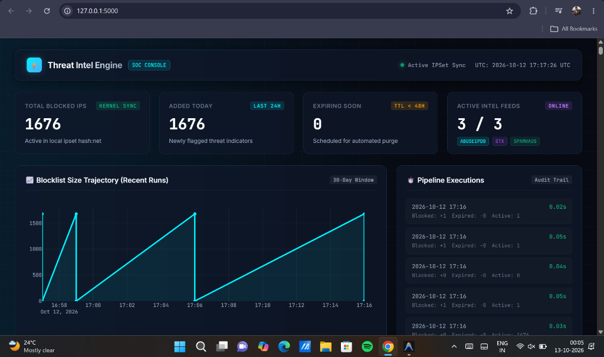
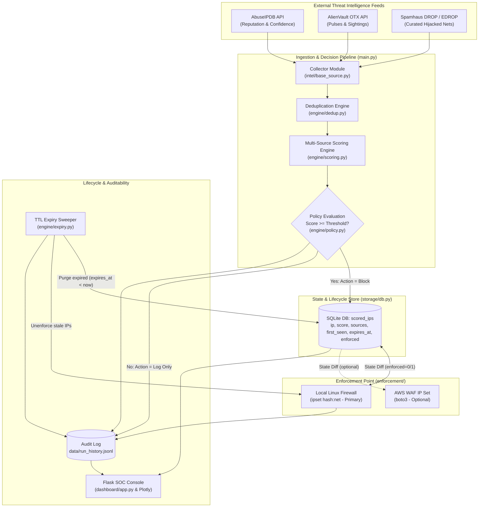
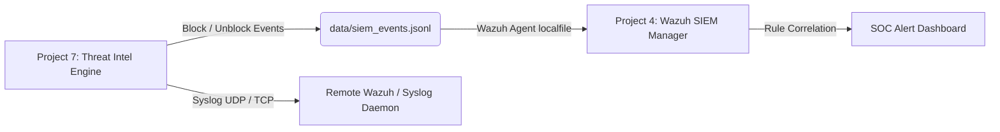

# Automated Threat Intelligence & IP Blacklisting Engine

[](https://www.python.org/)
[](https://pytest.org/)
[](LICENSE)
[](https://flask.palletsprojects.com/)
[](https://ipset.netfilter.org/)

> **Security Engineering Portfolio — Project 7**  
> An automated, production-grade Cyber Threat Intelligence (CTI) pipeline that aggregates malicious indicators from free-tier threat feeds, deduplicates and corroborates scores, applies threshold policies, synchronizes an active Linux firewall blocklist (`ipset`) or AWS WAF IP set, auto-expires stale indicators using dynamic TTL, and maintains a complete JSONL audit trail with an interactive SOC dashboard.

<p align="center">
  
</p>

---

## 1. High-Level Architecture



---

## 2. Core Security & Engineering Highlights

### 🛡️ Multi-Source Corroboration Scoring
Single threat intelligence feeds suffer from false positives, benign scanning noise, and CDN misclassifications. This engine solves this by calculating a **weighted confidence average** across multiple reporting feeds and awarding an automated **multi-source corroboration bonus** when 2 or more independent intelligence sources corroborate the threat:

$$\text{Combined Score} = \min\left(100.0, \frac{\sum (\text{Confidence}_i \times \text{Weight}_i)}{\sum \text{Weight}_i} + \text{MultiSourceBonus}\right)$$

* **Default Feed Weights:** AbuseIPDB (`1.0`), AlienVault OTX (`0.8`), Spamhaus DROP (`0.6`).
* **Multi-Source Bonus:** `+10.0` points applied when flagged by 2+ independent feeds.
* **Threshold Gating:** Only indicators with a combined score $\ge 60$ trigger kernel-level firewall enforcement. Indicators scoring below threshold are recorded in the audit trail as `log_only` to maintain situational awareness without risking network disruption.

---

### ⏳ TTL-Based Expiry Lifecycle
> [!IMPORTANT]
> **TTL-based expiry avoids the common real-world mistake of ever-growing, stale blocklists.**
> Threat actors constantly abandon command-and-control (C2) hosts, cloud IPs are dynamically reassigned to legitimate businesses, and static blocklists quickly degrade kernel packet filtering performance.

* **Automated Expiry Sweeper (`engine/expiry.py`)**: Runs every execution cycle, finding records where `expires_at < now` (UTC).
* **Synchronized Teardown**: Expired IPs are pulled from active enforcement (`ipset del threat-intel-blocklist <ip>`) and purged from the database.
* **TTL Renewal on Re-Flagging**: If an active malicious IP is re-reported in a subsequent run, its `expires_at` is automatically extended, keeping ongoing adversaries blocked while allowing inactive ones to age out cleanly.

---

### 🔌 Pluggable Strategy Enforcement Pattern
Enforcement targets inherit from [`BaseEnforcer`](file:///c:/Users/yoges/Documents/Security-Engineering-Portfolio/Automated%20Threat%20Intelligence%20&%20IP%20Blacklisting%20Engine/enforcement/base_adapter.py) to provide adapter-agnostic integration:

1. **`LocalFirewallAdapter` (Primary — Fully Implemented & Cost-Free)**:
   - Manages a high-performance Linux kernel `ipset hash:net` set (supports both single IPv4 hosts and CIDR prefixes like `/24`, `/16`).
   - Uses `ipset create threat-intel-blocklist hash:net -exist` for idempotent initialization.
   - Command injection defense: passes arguments as discrete arrays directly to `subprocess.run` (never `shell=True`).
2. **`AWSWAFAdapter` (Secondary — Optional Cloud Adapter)**:
   - Synchronizes CIDR-normalized addresses (`ip/32`) with an AWS WAFv2 regional or CloudFront IP set via `boto3`.
   - **Hardcoded Cost Guard**: Emits a mandatory `WARNING` log whenever instantiated to prevent unintentional AWS billing.
   - **Enforcement Priority**: If both local firewall and AWS WAF are enabled, `LocalFirewallAdapter` takes precedence to prevent dual-enforcement and accidental spend.

---

### 🔒 Idempotence & Dry-Run Safety
* **State Bridge via `enforced` Flag**: SQLite tracks whether an indicator has been synced to the firewall (`enforced = 1`) or is pending (`enforced = 0`). Subsequent pipeline runs perform lightweight relational diffs without querying kernel state over subprocesses.
* **Safe by Default**: `dry_run: true` is configured out-of-the-box. In dry-run mode, all firewall and WAF actions are logged as `[DRY-RUN] ipset add ...` without altering kernel state or database records, allowing development and testing on Windows, macOS, or CI without root privileges.

---

### 📜 Append-Only Audit Trail (`run_history.jsonl`)
Every pipeline execution appends a single, self-contained JSON record to `data/run_history.jsonl` detailing:
* **Run Metadata**: Unique `uuid4` run ID, timestamp, and duration.
* **Decision Attribution**: IP, policy action (`block` vs `log_only`), combined score, reporting feeds, category, and evaluation rationale.
* **Expirations**: Stale IPs purged during the cycle.
* **Enforcement Metrics**: Counts for added, removed, and skipped indicators.

---

### 💻 Modern Dark-Themed SOC Dashboard
Built with Flask, Jinja2, Vanilla CSS, and Plotly:
* **Dark Mode CTI Aesthetic**: Deep slate surface (`#070A12`), 14px backdrop blur glassmorphism, glowing status dots, and `Inter` + `JetBrains Mono` typography.
* **Top Metric Cards**: Total Blocked IPs, Added Today (<24h), Expiring Soon (<48h), and Active Feeds.
* **Dynamic Plotly Trend Chart**: Interactive 30-day blocklist trajectory line/area chart.
* **Searchable & Sortable Table**: Colored threat badges (Crimson $\ge 80$, Amber $50\text{–}79$, Yellow $<50$), source tags, category pills, copy-to-clipboard, and instant client-side search filtering.
* **REST APIs**: Programmatic endpoints (`/api/stats`, `/api/indicators`, `/api/runs`, `/api/chart`) for integration into external SIEM/SOAR platforms.

---

## 3. Project Structure

```
Automated Threat Intelligence & IP Blacklisting Engine/
├── config.py                 # Hierarchical YAML & environment variable configuration loader
├── config.yaml.example       # Template configuration with placeholder API keys & safe defaults
├── config.yaml               # Active runtime config (excluded from version control)
├── models.py                 # Dataclasses: RawIndicator and ScoredIP
├── main.py                   # Master orchestrator: collect -> score -> decide -> enforce -> expire -> audit
├── pyproject.toml            # Project build & tool metadata
├── requirements.txt          # Python dependencies (pyyaml, httpx, requests, flask, plotly, pandas)
├── intel/                    # Threat intelligence feed collector modules
│   ├── base_source.py        # BaseIntelSource ABC & SourceFetchError
│   ├── abuseipdb.py          # AbuseIPDB API v2 blacklist collector
│   ├── otx.py                # AlienVault OTX recent pulses collector
│   └── spamhaus.py           # Spamhaus DROP & EDROP text feed parser
├── engine/                   # Analytics, scoring, and policy engines
│   ├── dedup.py              # Multi-source indicator deduplication & bucket grouping
│   ├── scoring.py            # Weighted average scoring & corroboration bonus logic
│   ├── policy.py             # Confidence threshold policy evaluation & TTL window calculation
│   └── expiry.py             # TTL expiry sweeper & database/firewall cleanup
├── storage/                  # Relational state store
│   ├── db.py                 # ThreatIntelDB SQLite CRUD interface
│   └── schema.sql            # SQLite DDL schema (scored_ips table & indexes)
├── enforcement/              # Firewall & WAF strategy adapters
│   ├── base_adapter.py       # BaseEnforcer ABC & EnforcerError
│   ├── result.py             # EnforcementResult dataclass
│   ├── local_firewall.py     # Primary Linux ipset hash:net adapter
│   └── aws_waf.py            # Optional AWS WAFv2 IPSet boto3 adapter
├── audit/                    # Execution auditing
│   └── logger.py             # AuditLogger writing append-only run_history.jsonl
├── dashboard/                # SOC management console
│   ├── app.py                # Flask application factory, REST APIs, Plotly chart generator
│   ├── templates/            # Jinja2 HTML templates
│   │   ├── base.html.j2      # Base layout & font typography
│   │   └── index.html.j2     # Main dashboard interface
│   └── static/               # Frontend assets
│       ├── css/dashboard.css # Glassmorphic dark theme stylesheet
│       └── js/dashboard.js   # Client-side search, column sorting, clipboard utility
├── scheduler/                # Production automated scheduling
│   ├── threat-intel.service  # Systemd service unit definition
│   ├── threat-intel.timer    # Systemd timer unit (6-hour recurring trigger)
│   └── crontab.example       # Crontab schedule definition
└── tests/                    # Comprehensive unit & integration test suite (159 tests)
    ├── test_phase0_config.py
    ├── test_phase1_sources.py
    ├── test_phase2_dedup.py
    ├── test_phase2_scoring.py
    ├── test_phase2_policy.py
    ├── test_phase2_storage.py
    ├── test_phase2_pipeline.py
    ├── test_phase3_enforcement.py
    ├── test_phase4_expiry_audit.py
    └── test_phase5_dashboard.py
```

---

## 4. Verification & Sample Evidence

### Sample `run_history.jsonl` Audit Excerpt

Every execution logs complete attribution for additions and expirations:

```json
{
  "run_id": "8fa19c22-b5b6-455c-b172-8d77d7045bcf",
  "timestamp": "2026-10-12T16:00:00+00:00",
  "duration_seconds": 2.14,
  "summary": {
    "collected_raw": 1676,
    "unique_ips": 1676,
    "blocked": 45,
    "log_only": 1631,
    "enforced_added": 45,
    "enforced_removed": 1,
    "enforced_skipped": 0,
    "expired_count": 1,
    "total_active_in_db": 45
  },
  "decisions": [
    {
      "ip": "198.51.100.42",
      "action": "block",
      "score": 92.5,
      "sources": ["abuseipdb", "otx"],
      "category": "brute_force",
      "reason": "Confidence 92.5 >= threshold 60.0"
    }
  ],
  "expirations": [
    {
      "ip": "203.0.113.88",
      "score": 80.0,
      "sources": ["spamhaus"],
      "category": "spam",
      "expired_at": "2026-10-12T15:30:00+00:00",
      "reason": "TTL expired"
    }
  ],
  "errors": []
}
```

### Linux Firewall Verification (`ipset list`)

On a live Linux host with `dry_run: false`, inspect the active kernel blocklist:

```bash
$ sudo ipset list threat-intel-blocklist
Name: threat-intel-blocklist
Type: hash:net
Revision: 6
Header: family inet hashsize 1024 maxelem 65536
Size in memory: 1848
References: 1
Number of entries: 4
Members:
198.51.100.42
192.0.2.0/24
203.0.113.15
198.51.100.0/24
```

To verify that kernel iptables rules route traffic into the blocklist:

```bash
$ sudo iptables -I INPUT -m set --match-set threat-intel-blocklist src -j DROP
```

---

## 5. Quickstart Guide

### 1. Prerequisites
* Python 3.11+
* (Optional for live Linux enforcement): `ipset` and `iptables`

### 2. Installation
```bash
# Clone the repository
git clone https://github.com/Yogesht1520/Security-Engineering-Portfolio.git
cd "Security-Engineering-Portfolio/Automated Threat Intelligence & IP Blacklisting Engine"

# Create and activate virtual environment
python -m venv venv
source venv/bin/activate    # On Windows: venv\Scripts\activate

# Install dependencies
pip install -r requirements.txt
```

### 3. Configuration
Copy the template configuration file:
```bash
cp config.yaml.example config.yaml
```
Open `config.yaml` and configure your API keys (both feeds offer generous free tiers):
* **AbuseIPDB**: Sign up at [abuseipdb.com](https://www.abuseipdb.com/) (Free: 1,000 checks/day).
* **AlienVault OTX**: Sign up at [otx.alienvault.com](https://otx.alienvault.com/) (Free).
* **Spamhaus DROP**: Ready out-of-the-box (no API key required).

*Optional*: Set keys via environment variables:
```bash
export THREAT_INTEL_API_KEYS_ABUSEIPDB="your_abuseipdb_api_key_here"
export THREAT_INTEL_API_KEYS_OTX="your_otx_api_key_here"
```

### 4. Execute the Pipeline
Run a threat intelligence collection and blacklisting cycle:
```bash
# Preview decisions safely without modifying firewall or DB
python main.py --dry-run

# Execute live evaluation and firewall enforcement
python main.py --apply

# Rollback to Last-Known-Good (LKG) enforcement state
python main.py --rollback

# Audit & reconcile database desired state vs. active kernel firewall
python main.py --reconcile

# Explain decisions and evidence for a specific IP indicator
python main.py --explain 203.0.113.10
```

### 5. Launch the SOC Dashboard
Start the local management console:
```bash
python dashboard/app.py
```
Open **[http://127.0.0.1:5000](http://127.0.0.1:5000)** in your browser to view:
* Real-time KPI summary cards
* Threat feed health telemetry cards (AbuseIPDB, AlienVault OTX, Spamhaus)
* 30-day blocklist trajectory trend chart
* Filterable indicators table with copy-to-clipboard utilities
* Historical audit run logs

---

## 6. SIEM & Wazuh Detection Lab Integration (Portfolio Bridge)

This project directly connects with **Project 4 (Wazuh SIEM Detection Lab)** by exporting telemetry, policy decisions, and enforcement alerts in real-time.



### Supported Ingestion Modes:
1. **Wazuh Agent Localfile (Zero Overhead)**:
   Configure the Wazuh agent in `/var/ossec/etc/ossec.conf` to monitor the JSON lines file:
   ```xml
   <localfile>
     <log_format>json</log_format>
     <location>/path/to/threat-intel/data/siem_events.jsonl</location>
   </localfile>
   ```
2. **Network Syslog (UDP / TCP)**:
   Stream CEF (Common Event Format) or RFC 5424 syslog packets directly to an external SIEM collector on port `514`.

### Example Wazuh Event Structure:
```json
{
  "timestamp": "2026-10-14T17:15:00.000000Z",
  "integration": "threat_intel_engine",
  "event_type": "threat_intel.block",
  "severity": "high",
  "summary": "Threat intelligence block enforced for 198.51.100.42",
  "data": {
    "action": "block",
    "src_ip": "198.51.100.42",
    "confidence_score": 87.54,
    "category": "brute-force",
    "threat_sources": ["abuseipdb", "otx"],
    "reason": "Corroborated high-confidence threat",
    "details": {
      "evidence_items": [
        {"source": "abuseipdb", "conf": 90, "freshness_factor": 1.0}
      ]
    }
  }
}
```

---

## 7. Production Automated Scheduling

### Systemd Timer (Recommended on Linux)

Install the service and timer units:
```bash
sudo cp scheduler/threat-intel.service /etc/systemd/system/
sudo cp scheduler/threat-intel.timer /etc/systemd/system/

sudo systemctl daemon-reload
sudo systemctl enable --now threat-intel.timer
```

Verify timer status:
```bash
systemctl list-timers --all | grep threat-intel
```

### Crontab (Alternative)
Edit system crontab (`sudo crontab -e`):
```bash
0 */6 * * * root cd /opt/threat-intel-blacklister && /opt/threat-intel-blacklister/venv/bin/python main.py --apply >> /var/log/threat-intel.log 2>&1
```

---

## 8. Test Suite

Execute the comprehensive test suite across all architectural modules and hardening phases:

```bash
pytest -v
```

```
============================= 187 passed in 4.10s =============================
```

### Coverage by Component
| Test Module | Coverage Domain | Tests |
|---|---|---|
| `test_phase0_config.py` | Config loading, schema validation, fallback defaults, data models | 23 |
| `test_phase1_sources.py` | AbuseIPDB, AlienVault OTX, Spamhaus DROP API clients & parsers | 44 |
| `test_phase2_dedup.py` | IP indicator deduplication & multi-source bucket grouping | 6 |
| `test_phase2_scoring.py` | Weighted confidence math, normalization, corroboration bonuses | 6 |
| `test_phase2_policy.py` | Confidence threshold policies, TTL calculations, renewal | 7 |
| `test_phase2_storage.py` | SQLite schema, idempotence, first_seen preservation, state flags | 7 |
| `test_phase3_enforcement.py` | `LocalFirewallAdapter`, `AWSWAFAdapter`, diffing, dry-run safety | 31 |
| `test_phase4_expiry_audit.py` | TTL expiry sweep, synchronized teardown, JSONL audit trails | 18 |
| `test_phase5_dashboard.py` | Flask factory, REST APIs, Plotly charts, search filter, scheduler units | 17 |
| `test_v1_validator.py` | Dual-stack IPv4/IPv6, CIDR, RFC 1918 bogons, custom allowlist | 8 |
| `test_v1_scoring_provenance.py` | Upstream de-aliasing, freshness decay, clamped score | 4 |
| `test_v1_failsafe_safety.py` | Fail-safe states (HEALTHY/DEGRADED/FAIL_SAFE), circuit breakers, LKG rollback | 5 |
| `test_v1_lifecycle_feed_health.py` | Extended lifecycle timestamps, feed health recording, `/api/feed-health` | 4 |
| `test_v1_siem_forwarder.py` | Wazuh JSON formatting, CEF export, Syslog UDP/TCP, fault tolerance | 7 |
| **Total** | **Full System Pipeline** | **187** |

---

## 9. License

This project is licensed under the MIT License — see the [LICENSE](LICENSE) file for details.
