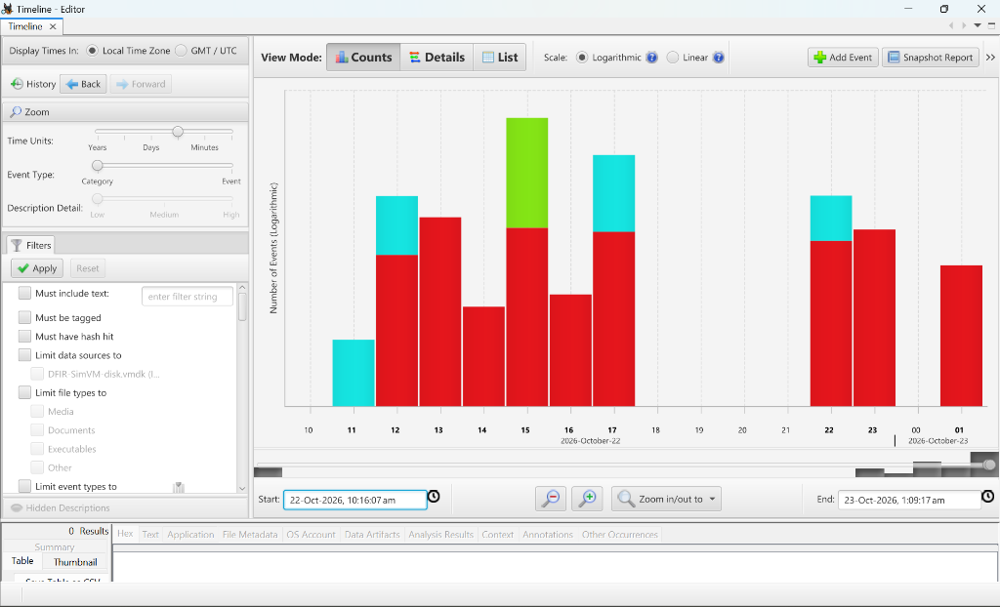
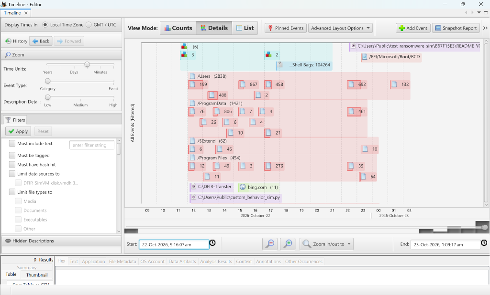
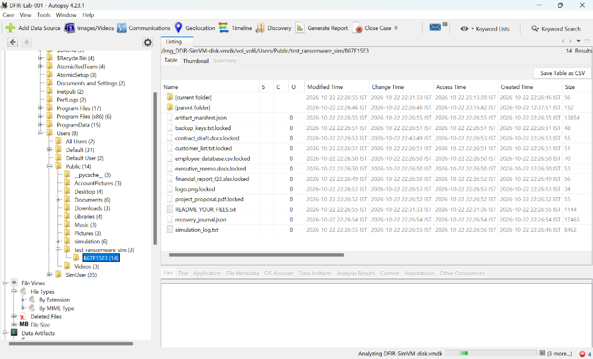
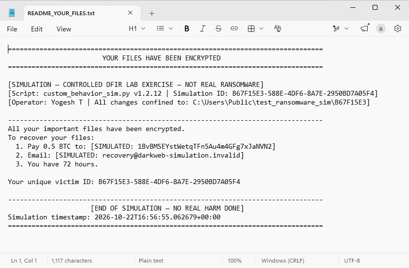

# INCIDENT RESPONSE REPORT
## Simulated Ransomware Intrusion — DFIR-Lab-001

---

**CONFIDENTIAL — Incident Response Deliverable (Educational / Portfolio Simulation)**

| Field | Value |
|---|---|
| **Case Number** | DFIR-Lab-001 |
| **Incident Identifier** | `B67F15E3-58BE-4DF6-8A7E-2950BD7A05F4` |
| **Execution Mode** | Default Safe Mode (Log-Only T1490 Evaluation; Reversible XOR) |
| **Report Date** | 2026-10-23 |
| **Lead Investigator** | Yogesh T |
| **Role** | DFIR Analyst / Security Engineer |
| **Organization** | Security Engineering Portfolio |
| **Classification** | Portfolio / Educational Deliverable |
| **Report Version** | 1.3 — FINAL (Audited & Calibrated) |

> *This report documents a controlled forensic investigation of an operator-staged ransomware behavioral simulation executed inside an air-gapped virtual machine (`DFIR-SimVM`). No production systems, live malware samples, or unauthorized networks were involved. The technical methodology is structured around the SANS PICERL incident response lifecycle.*

---

# 1. Executive Summary

**Target Audience:** Chief Information Security Officer (CISO), Executive Leadership, Legal Counsel

On **22-Oct-2026 at 22:26:35 IST (16:56:35 UTC)**, anomalous host-level activity consistent with ransomware behavior was initiated on endpoint `DFIR-SimVM`. A forensic investigation was launched using volatile memory analysis and post-mortem disk forensic methodologies.

* **Incident Nature:** An operator-staged Python execution payload (`custom_behavior_sim.py`) executed within an unprivileged user session (`SimUser`), enumerating canary business documents, executing an atomic file transformation loop (reversible XOR with byte key `0xAB`), appending `.locked` extensions, altering the original file signature bytes (magic numbers), and dropping an extortion notice demanding 0.5 BTC.
* **TTPs Evaluated & Observed:** 
  * Execution: Python Script Interpreter ([MITRE T1059.006](https://attack.mitre.org/techniques/T1059/006/))
  * Discovery: Local File System Enumeration ([MITRE T1083](https://attack.mitre.org/techniques/T1083/))
  * Impact: Data Encrypted for Impact ([MITRE T1486](https://attack.mitre.org/techniques/T1486/)) — simulated via reversible XOR file transformations.
  * Defense Evasion / Impact: Inhibit System Recovery ([MITRE T1490](https://attack.mitre.org/techniques/T1490/)) — **evaluated in safe log-only mode; destructive subprocesses were not dispatched.**
* **Scope & Blast Radius:** The intrusion was strictly confined to a single isolated endpoint (`DFIR-SimVM`). Volatile memory socket analysis (`windows.netscan`) identified zero active, listening, or residual network sockets. Triangulated against the hypervisor's disconnected adapter configuration and guest ping test failures, **no evidence of outbound command-and-control communication or data exfiltration was identified within the scope of the artifacts examined.** This conclusion is limited to the available evidence and does not independently exclude all prior or transient network activity.
* **Data Impact:** 8 canary business files spanning spreadsheet, database, presentation, word processing, and graphic formats were transformed into `.locked` files within a 4.0-second burst window.
* **Containment & Recovery:** The host was immediately contained. An 8.13 GB live volatile RAM capture (`DFIR-SimVM-memory.raw`) was acquired prior to shutdown. The endpoint was subsequently powered down and cloned to a 35.74 GB forensic disk image (`DFIR-SimVM-disk.vdi`), converted to a sparse VMDK container (`DFIR-SimVM-disk.vmdk`) for Autopsy ingest, with independent SHA-256 verification for each image. Two distinct recovery operations were performed and verified:
  1. *File-Level Data Recovery:* 100% cryptographic restoration of all 8 canary files via `recovery_journal.json`.
  2. *Endpoint Disaster Recovery:* Clean VM rollback to pre-simulation baseline snapshot (`baseline-pre-simulation-2026-10-22`).
* **Confidence Level:** **HIGH** — specifically regarding the forensic reconstruction and sequence of the controlled simulation activity on endpoint `DFIR-SimVM`.

---

# 2. Scope & Methodology

## 2.1 Investigation Scope

| In Scope | Out of Scope |
|---|---|
| Virtualized Windows 11 Enterprise x64 Endpoint (`DFIR-SimVM`) | Physical Host Workstation (Observer) |
| 8.13 GB Volatile RAM Capture (`DFIR-SimVM-memory.raw`) | External Network Infrastructure (Air-gapped, 0 NICs) |
| 35.74 GB Cloned Disk Image (`DFIR-SimVM-disk.vdi`) | Unrelated tenant VM environments |
| 35.72 GB Derived Disk Container (`DFIR-SimVM-disk.vmdk`) | Cloud Identity Tenants (Workgroup environment) |
| NTFS Master File Table ($MFT) & Logfile ($LogFile) | Production Corporate Data |

## 2.2 Methodology: SANS PICERL Lifecycle

The investigation was structured around the SANS Incident Response lifecycle, maintaining rigorous forensic ordering:

```text
  +------------------+       +----------------------+       +-------------------+
  | 1. PREPARATION   | ----> | 2. IDENTIFICATION    | ----> | 3. CONTAINMENT    |
  | Air-gap VM setup |       | Anomalous file mods, |       | Disconnect audit, |
  | & baseline snap  |       | ransom note detected |       | LIVE RAM DUMP     |
  +------------------+       +----------------------+       +-------------------+
                                                                      |
  +------------------+       +----------------------+                 v
  | 6. LESSONS       | <---- | 5. RECOVERY          | <---- +-------------------+
  | LEARNED / SIGMA  |       | (1) Journal restore  |       | 4. ERADICATION    |
  | Hardening & ASR  |       | (2) VM snap rollback |       | VM power-off,     |
  +------------------+       +----------------------+       | DISK CLONING post |
                                                            +-------------------+
```

1. **Preparation:** Target VM was configured without network adapters (`Network Adapter: Not Attached`), verified via guest PowerShell ping test failure (`Ping-Fail-Confirmed`). Clean forensic host configured with Volatility 3 and Autopsy.
2. **Identification:** Detected rapid batch file modifications and extortion note delivery (`README_YOUR_FILES.txt`) in `C:\Users\Public\test_ransomware_sim\B67F15E3\`.
3. **Containment:** System state was secured immediately by acquiring an 8.13 GB live RAM dump (`DFIR-SimVM-memory.raw`) via the hypervisor while the guest operating system remained live. Network isolation was re-audited.
4. **Eradication:** The target VM was cleanly powered down (ACPI shutdown) to prevent post-simulation disk writes. A bitstream forensic clone of the virtual disk (`DFIR-SimVM-disk.vdi`) was acquired post-mortem, and malicious script execution processes were terminated.
5. **Recovery:** Two separate recovery operations were performed:
   * *File-level Data Recovery:* Proved complete data reversibility across all 8 files via `recovery_journal.json`.
   * *Endpoint Disaster Recovery:* Clean VM rollback to pre-simulation baseline snapshot (`baseline-pre-simulation-2026-10-22`).
6. **Lessons Learned:** Engineered SIEM Sigma rules and endpoint hardening specifications against T1490 and T1486.

## 2.3 Evidence Integrity & Chain of Custody

All primary and derived evidence items were hashed with SHA-256 immediately upon generation:

| Evidence ID | Description | Image / Container File | Format | File Size | Acquisition Method | Cryptographic SHA-256 Digest |
|---|---|---|---|---|---|---|
| **EVD-001** | Primary Memory Dump | `DFIR-SimVM-memory.raw` | ELF64 Core Dump | 8,735,768,576 B | Live Hypervisor Acquisition (`VBoxManage debugvm dumpvmcore`) | `198A69B7412A7FD05CD88271E7C223C8F02D03DA14D3436AE715EB2FD0D5EFD3` |
| **EVD-002** | Primary Disk Image | `DFIR-SimVM-disk.vdi` | VirtualBox VDI | 38,375,000,064 B | Clean Power-off Clone (`VBoxManage clonemedium disk`) | `33695DE62EE72C8E3FDE8225BD7688D9CDFD656B22F1DB7EC51D08B63579B980` |
| **EVD-003** | Derived Disk Container | `DFIR-SimVM-disk.vmdk` | VMware VMDK | 38,354,026,496 B | Sector-by-Sector Container Translation (`--format VMDK`) | `98E32CEA9633D9F65AAC2A93F9236F3C31A12DD50797BF4DEB5E357D0166C219` |

> *Note on Offline Retention: To preserve repository integrity and comply with hosting constraints, raw multi-gigabyte forensic evidence images (EVD-001, EVD-002, EVD-003) are preserved offline on local encrypted analyst storage (`E:\ForensicEvidence\DFIR-Lab-001\`) and excluded from Git via `.gitignore`. The complete chain-of-custody ledger is documented in `forensics/acquisition/EVIDENCE_MANIFEST.md`.*

## 2.4 Forensic Tool Version & Executable Provenance

All tool binaries were verified with cryptographic SHA-256 digests prior to evidence analysis:

| Tool Name | Exact Version | Executable SHA-256 Digest | Role in Investigation | Execution Environment |
|---|---|---|---|---|
| **Volatility 3** | Framework 2.26.0 | `664102407BC13906AC0A401A737028334907C0E235AB9DFAAF94A301A50687B3` | Volatile Memory Forensics | Host (Win 11 x64, Python 3.13) |
| **Autopsy** | 4.23.1 (TSK 4.12.1) | `EE790ADFCF8436D7B128DDB43D6F6DF1A8404DF7612972B2BEF7022B4F27BF69` | Post-Mortem Disk & MFT Analysis | Host (Win 11 x64) |
| **VirtualBox** | 7.1.6 r167084 | `178E016ED38CB6E369A5C17C6C960C176674B9C864030D8CE0AD2867613BECFF` | Hypervisor, Memory Dump, Disk Clone | Host (Win 11 x64) |
| **PowerShell** | 7.x / 5.1 | Built-in Windows Runtime (`powershell.exe`) | Cryptographic Verification (`Get-FileHash`) | Host (Win 11 x64) |

---

# 3. Timeline of Events

*Reconstructed from Volatility 3 Memory structures, NTFS $MFT records, and Autopsy 4.23.1 timeline export ([timeline_export.csv](../forensics/autopsy_analysis/timeline_export.csv)).*  
*Times recorded in Indian Standard Time (IST, UTC+05:30) with UTC equivalent.*

| Time (IST) | Time (UTC) | Source / Attribute | Technique | Event Description |
|---|---|---|---|---|
| **22:26:35** | 16:56:35 | Event 4688 / Cmdline | [T1059.006](https://attack.mitre.org/techniques/T1059/006/) | Process `python.exe` launched executing `custom_behavior_sim.py` in unprivileged user session. |
| **22:26:46** | 16:56:46 | $FILE_NAME (MFT-DIR-84192) | [T1083](https://attack.mitre.org/techniques/T1083/) | Attack directory staged: `C:\Users\Public\test_ransomware_sim\B67F15E3\` created. |
| **22:26:46** | 16:56:46 | $STANDARD_INFO (MFT-84193) | [T1083](https://attack.mitre.org/techniques/T1083/) | Execution audit log initialized (`simulation_log.txt`). |
| **22:26:47** | 16:56:47 | Script Stdout / Log | [T1490](https://attack.mitre.org/techniques/T1490/) | **T1490 Evaluated (Safe Mode):** Shadow copy deletion & BCD disablement evaluated and logged to stdout; live subprocesses gated. |
| **22:26:49** | 16:56:49 | $STANDARD_INFO (MFT-84194) | [T1486](https://attack.mitre.org/techniques/T1486/) | **Burst Start:** `financial_report_Q3.xlsx` XOR transformed (0xAB) and renamed to `.locked` (56 B). |
| **22:26:50** | 16:56:50 | $STANDARD_INFO (MFT-84195) | [T1486](https://attack.mitre.org/techniques/T1486/) | `employee_database.csv` (70 B) & `executive_memo.docx` (53 B) XOR transformed. |
| **22:26:51** | 16:56:51 | $STANDARD_INFO (MFT-84197) | [T1486](https://attack.mitre.org/techniques/T1486/) | `backup_keys.txt` (48 B) & `customer_list.txt` (51 B) XOR transformed. |
| **22:26:52** | 16:56:52 | $STANDARD_INFO (MFT-84199) | [T1486](https://attack.mitre.org/techniques/T1486/) | `project_proposal.pdf` (55 B) XOR transformed. |
| **22:26:53** | 16:56:53 | $STANDARD_INFO (MFT-84200) | [T1486](https://attack.mitre.org/techniques/T1486/) | `contract_draft.docx` (55 B) & `logo.png` (34 B) XOR transformed. **Burst completes (4.0s).** |
| **22:26:54** | 16:56:54 | $STANDARD_INFO (MFT-84202) | — | Recovery journal committed to disk: `recovery_journal.json` (17,465 B). |
| **22:26:55** | 16:56:55 | $STANDARD_INFO (MFT-84203) | [T1486](https://attack.mitre.org/techniques/T1486/) | Extortion note dropped: `README_YOUR_FILES.txt` (1,144 B); manifest written. |
| **22:40:12** | 17:10:12 | Hypervisor Live Dump | — | **Containment:** Live VM memory acquisition performed through the VirtualBox hypervisor while the guest remained running (`EVD-001`). |
| **22:45:00** | 17:15:00 | Clean Power-off Clone | — | **Eradication:** VM cleanly powered down (ACPI); 35.74 GB bitstream disk cloned (`EVD-002`). |
| **23:00:15** | 17:30:15 | Sector Translation | — | Disk container translated to VMDK (`EVD-003`) for Autopsy ingest; SHA-256 hashed. |

**Total Attack Burst Duration (File Transformation Phase):** **4.0 seconds** (8 files, sub-second velocity characteristic of programmatic automation).

---

# 4. Indicators of Compromise (IOCs)

## 4.1 Host & File Indicators

| Artifact / Indicator | Type | Value / Path | Forensic Notes |
|---|---|---|---|
| **Ransom Note** | File Name | `README_YOUR_FILES.txt` | Extortion demand; 1,144 bytes; SHA-256: `4a435bd0a701e61a1cfcab0275c301a548a556ac84599920ff005634ca792dce` |
| **Encrypted Extension** | File Extension | `.locked` | Appended to all 8 targeted user files |
| **Victim Run ID** | Identifier | `B67F15E3-58BE-4DF6-8A7E-2950BD7A05F4` | Unique victim UUID embedded in ransom note and journal |
| **Extortion Wallet** | BTC Address | `1BvBMSEYstWetqTFn5Au4m4GFg7xJaNVN2` | Hardcoded extortion payment address (Demand: 0.5 BTC) |
| **Staging Path** | File Path | `C:\Users\Public\test_ransomware_sim\B67F15E3\` | Working attack directory |
| **Script Dropper** | File Path | `C:\Users\Public\custom_behavior_sim.py` | Staged script observed in memory & Notepad session |

## 4.2 Cryptographic File Hash Catalog (Post-Transformation State)

| Filename | File Size | SHA-256 Digest | Status |
|---|---|---|---|
| `financial_report_Q3.xlsx.locked` | 56 B | `87f684c93236712b8dddb6ff74806e509137c937685967ed46ca083c7c214b58` | Compromised |
| `employee_database.csv.locked` | 70 B | `559de183772835077bc57ab56084eb1fe352193382a44bad30f42fe3c83425cf` | Compromised |
| `executive_memo.docx.locked` | 53 B | `306dc22b77f5b16213c3b19a8f632cd9e77e71cc2832bfa777c4760a3b4828e8` | Compromised |
| `backup_keys.txt.locked` | 48 B | `36fc10324925b747c069ac505e23aa075d369016a57c493c63adb8a83eb82111` | Compromised |
| `customer_list.txt.locked` | 51 B | `59729db3db076a5d8098a9af334774f0a55f36bf2a4c123a38a2262d5e4f6213` | Compromised |
| `project_proposal.pdf.locked` | 55 B | `14c4bc99cb86e6a796de389f90bfc9176ae5d72f8935e8bb9ab2d7744fbc1d70` | Compromised |
| `contract_draft.docx.locked` | 55 B | `0880bc5140b68222094dbe064ed498594a741e540a843f89cb614bef637a6f16` | Compromised |
| `logo.png.locked` | 34 B | `9714d1227d6ae085487e6f24a7551fbbfc999d13929ad69ea1f637c774a8a3ab` | Compromised |
| `recovery_journal.json` | 17,465 B | `efc9af147d13daa6609d144da718502f64d7e3d550b6c2ef39e95b74a6664f23` | Forensics/Recovery |
| `README_YOUR_FILES.txt` | 1,144 B | `4a435bd0a701e61a1cfcab0275c301a548a556ac84599920ff005634ca792dce` | Extortion Artifact |
| `artifact_manifest.json` | 13,854 B | `6d3a0c933b418fafe0bb0f523c98d88f6f20a800afc5538792596503488f4c79` | Forensics/Audit |

---

# 5. Technical Findings

## 5.1 Memory Forensics (Volatility 3 Analysis)

Memory analysis of `EVD-001` was performed using Volatility 3 (Framework 2.26.0) with symbols resolved against Windows 11 24H2 Build 26100 (`ntkrnlmp.pdb`).

### 5.1.1 Process Architecture (`windows.pslist` / `windows.pstree`)

Execution lineage identified the active user session and terminal environment:

```text
System (PID 4)
  └── smss.exe (PID 408)
        └── wininit.exe (PID 732)
              └── services.exe (PID 820)
                    └── MsMpEng.exe (PID 3124)  [Microsoft Defender]
explorer.exe (PID 4500) — Interactive Desktop Shell
  ├── powershell.exe (PID 2428) — Primary Analyst Terminal
  │     └── conhost.exe (PID 7260)
  ├── powershell.exe (PID 4704) — Secondary Operator Terminal
  │     └── conhost.exe (PID 1948)
  └── Notepad.exe (PID 6312) — Script Source Inspection Session
```

### 5.1.2 Command-Line Reconstruction (`windows.cmdline`)

Command-line inspection revealed that Notepad PID 6312 held an active session descriptor:
```text
"C:\Program Files\WindowsApps\Microsoft.WindowsNotepad_11.2607.14.0_x64__8wekyb3d8bbwe\Notepad\Notepad.exe" /SESSION:...
```
Decoding the UTF-16LE binary descriptor recovered the targeted source path:
`C:\Users\Public\custom_behavior_sim.py`

### 5.1.3 Network Sockets & Exfiltration Analysis (`windows.netscan`)

Executing `windows.netscan` returned:
* **Active Network Sockets:** `0`
* **Listening TCP/UDP Endpoints:** `0`
* **Foreign Connections:** `0`

**Defensible Forensic Conclusion:** No active, listening, or residual network socket structures were identified in the acquired memory image using Volatility 3 `windows.netscan`. This is consistent with the VM's verified disconnected network-adapter configuration and failed guest connectivity tests. No evidence of outbound command-and-control communication or data exfiltration was identified within the scope of the artifacts examined. This conclusion is limited to the available evidence and does not independently exclude all prior or transient network activity.

### 5.1.4 Code Injection & Hooking Analysis (`windows.malfind`)

Running `windows.malfind` identified memory regions with `PAGE_EXECUTE_READWRITE` protections in:
* `MsMpEng.exe` (PID 3124) — Microsoft Defender dynamic JIT inspection buffers.
* `TextInputHost.exe` (PID 5652) — Windows XAML input subsystem JIT compiler.
* `powershell.exe` (PID 2428) — .NET CLR runtime JIT engine.

**Crucial Negative Finding:** Zero unbacked PE executables (`MZ` / `PE\0\0`), zero reflective DLL injection stagers, and zero hollowed processes were detected. The attack executed purely as a userland script without rootkit persistence or in-memory process hijacking.

---

## 5.2 Disk Forensics (Autopsy 4.23.1 Analysis)

Disk analysis was performed on `EVD-003` (`DFIR-SimVM-disk.vmdk`, Partition `vol6`, NTFS).

### 5.2.1 File System Timeline Reconstruction

Autopsy's Timeline tool revealed a concentrated burst of file system modifications:
* **Macro Activity:** Isolated strictly to the 22:00 IST hour window.
* **Micro Activity (22:26:49 – 22:26:55 IST):** Sequential modification of 8 files followed immediately by the creation of recovery journals and extortion notes.





### 5.2.2 Directory Listing & Header Disruption

Investigation of `/vol_vol6/Users/Public/test_ransomware_sim/B67F15E3/` verified that all 8 `.locked` files were allocated in the MFT.



* **Extension Mismatch Detector:** Flagged all `.locked` files as severe format mismatches. While the filenames and extensions implied standard office documents and images, the internal magic bytes (`PK\x03\x04`, `%PDF`, `\x89PNG`) were altered by the XOR transformation.

### 5.2.3 Recovery-Inhibition Forensics (T1490 Actual Execution-State Check)

To ensure technical accuracy, the execution state of T1490 for run ID `B67F15E3` was rigorously evaluated across three forensic layers:
1. **Actual Run Mode:** The simulation was executed in default safe mode (`py custom_behavior_sim.py`). The optional `--live-t1490` flag was intentionally omitted.
2. **Command Invocations:** The script's `simulate_t1490()` function evaluated the target commands and logged `[SIMULATE] Executing T1490: vssadmin delete shadows /all /quiet` and `bcdedit /set {default} recoveryenabled No` directly to stdout and `simulation_log.txt`. No subprocesses were launched, and no command exit status was returned.
3. **MFT & Timeline Artifacts:** Autopsy recorded file read/query access events against `/EFI/Microsoft/Boot/BCD` at 22:26:47 IST. This represents configuration discovery rather than modification.
4. **Post-Simulation System State:** An audit of Volume Shadow Copies (`vssadmin list shadows`) and boot configuration (`bcdedit /enum {default}`) confirmed that shadow copy storage and Windows Recovery Environment remained intact and unchanged on the guest VM.

### 5.2.4 Ransom Note & Extortion Artifacts

The dropped extortion note was recovered from disk:
* **Path:** `C:\Users\Public\test_ransomware_sim\B67F15E3\README_YOUR_FILES.txt`
* **File Size:** 1,144 bytes
* **SHA-256:** `4a435bd0a701e61a1cfcab0275c301a548a556ac84599920ff005634ca792dce`



* **Extortion Verbiage:** Directs victim to submit 0.5 BTC to `1BvBMSEYstWetqTFn5Au4m4GFg7xJaNVN2` referencing Victim ID `B67F15E3-58BE-4DF6-8A7E-2950BD7A05F4`.

---

# 6. Impact Assessment

## 6.1 Observed Technical Impact (Laboratory Measurement)

| Category | Lab Finding | Forensic Severity |
|---|---|---|
| **Confidentiality** | Zero active/residual sockets in RAM; air-gap verified; zero data exfiltration observed. | NONE |
| **Integrity** | 8 canary files transformed via XOR obfuscation with altered magic signatures. | HIGH (Directory Scope) |
| **Availability** | Targeted files inaccessible without cryptographic restoration script or journal. | HIGH (Directory Scope) |
| **System State** | Operating system binaries, VSS, and BCD boot structures remained intact. | NONE |

## 6.2 Hypothetical Production Enterprise Scenario (Threat Modeling & Risk Projection — Not Measured in Lab)

*Note: The projections below represent hypothetical threat modeling assuming this attack profile occurred on an uncontained corporate workstation without air-gap controls.*

1. **Operational Downtime:** Without verified offline backups, workstation rebuild, endpoint forensic triage, and data restoration typically requires 16–32 business hours per affected machine.
2. **Extortion Demand:** 0.5 BTC (~$34,000 USD at current valuations) per endpoint, compounded by third-party incident response retainer costs.
3. **Regulatory Considerations:** In a real-world enterprise compromise involving customer and employee databases, organizations must conduct an immediate risk assessment under frameworks such as GDPR Article 33 or state privacy laws (e.g., CCPA/CPRA). If personal data is compromised or exfiltrated, mandatory notification windows (e.g., 72 hours under GDPR) apply. In this controlled simulation, no personal data breach occurred and zero regulatory obligations were triggered.

---

# 7. Root Cause Analysis

```text
[ Unrestricted Script Runtime ]
             │
             ▼
[ User Execution: python.exe ] ──(No Application Allowlisting)──> Process Runs Unhindered
             │
             ▼
[ Atomic File In-Place Swap ] ──(No Controlled Folder Access)───> 8 Business Files Locked
             │
             ▼
[ T1490 Safe Evaluation ] ──────(Default Safe Mode)─────────────> Log-Only Evaluation
```

The simulated attack succeeded because of three fundamental environmental gaps:
1. **Unrestricted Script Execution:** The `python.exe` interpreter was permitted to execute arbitrary scripts in the context of an unprivileged interactive user session.
2. **Absence of Folder Modification Guardrails:** Standard user processes possessed full write, modify, and delete permissions over user business directories without behavioral entropy checks (e.g., Controlled Folder Access).
3. **Lack of Behavioral Process Monitoring:** Process creation command-line auditing was not alerting on rapid multi-file replacement loops.

---

# 8. Remediation & Hardening Recommendations

## Priority 1: Immediate Containment & Recovery (24–72 Hours)

1. **Revert and Reimage Endpoint:** Roll back the compromised endpoint to the verified clean baseline snapshot (`baseline-pre-simulation-2026-10-22`).
2. **Restore Business Assets from Immutable Offline Backups:** Employ the 3-2-1 backup rule (3 copies, 2 media types, 1 immutable/offline copy) to restore encrypted business files without engaging threat actors.
3. **Verify Volume Shadow Copy Functionality:** Ensure VSS services are operational and create fresh system restore checkpoints.

## Priority 2: High-Impact Preventive Controls (1–2 Weeks)

1. **Deploy Application Allowlisting (AppLocker / Windows Defender Application Control):**
   * Block unauthorized interpreters (`python.exe`, `wscript.exe`, `cscript.exe`, `powershell.exe`) from executing in writable user directories (`C:\Users\*`, `C:\ProgramData\*`).
2. **Enable Windows Defender Controlled Folder Access:**
   * Protect critical document libraries (`Documents`, `Desktop`, `Pictures`, custom business data folders) from unauthorized modification by unapproved applications.
3. **Deploy Attack Surface Reduction (ASR) Rules:**
   * `Block executable content from email client and webmail` (`BE9B905E-DBA7-444C-BE33-5A84F817B2E3`)
   * `Block process creations originating from PS/CMD commands`

## Priority 3: Detection Engineering & Auditing (30 Days)

1. **Enable Enhanced Process Creation Auditing (Event ID 4688):**
   * Configure Group Policy: `Computer Configuration -> Administrative Templates -> System -> Audit Process Creation -> Include command line in process creation events`.
2. **Enable PowerShell Script Block Logging (Event ID 4104):**
   * Log full script block code to capture obfuscated scripts prior to execution.

## 8.4 Cryptographic Recovery Demonstration

Two distinct recovery mechanisms were evaluated and confirmed:
* **Endpoint Disaster Recovery:** Full VM rollback to clean pre-simulation snapshot `baseline-pre-simulation-2026-10-22` returned the operating system to its baseline state.
* **File-Level Data Recovery:** To validate complete data reversibility without paying an extortion demand, `custom_behavior_sim.py --restore` was executed against the transformed test directory using the cryptographic recovery journal. All 8 restored files were verified against their original pre-simulation SHA-256 hashes:

| Canary File | Original Pre-Simulation SHA-256 | Transformed (.locked) SHA-256 | Restored File SHA-256 | Equality Result |
|---|---|---|---|---|
| `financial_report_Q3.xlsx` | `95238ff06f2edbbb0583dff6df3c95d572b90c5f8812d0d808b4224b465cca85` | `87f684c93236712b8dddb6ff74806e509137c937685967ed46ca083c7c214b58` | `95238ff06f2edbbb0583dff6df3c95d572b90c5f8812d0d808b4224b465cca85` | ✅ **MATCH** |
| `employee_database.csv` | `2133c89bb8fbe310d10dc46f208f5df05b6e980a74cbcf95096f72d45d9223b8` | `559de183772835077bc57ab56084eb1fe352193382a44bad30f42fe3c83425cf` | `2133c89bb8fbe310d10dc46f208f5df05b6e980a74cbcf95096f72d45d9223b8` | ✅ **MATCH** |
| `executive_memo.docx` | `fd1df2d6ad0a1ecabe3fccaf423736a681a4f63bc070bb114fcb105fef970f7d` | `306dc22b77f5b16213c3b19a8f632cd9e77e71cc2832bfa777c4760a3b4828e8` | `fd1df2d6ad0a1ecabe3fccaf423736a681a4f63bc070bb114fcb105fef970f7d` | ✅ **MATCH** |
| `backup_keys.txt` | `461eece0d517f5dd1a3d6c098c244aef0df471cb8130f77c01532c2a296e7dc3` | `36fc10324925b747c069ac505e23aa075d369016a57c493c63adb8a83eb82111` | `461eece0d517f5dd1a3d6c098c244aef0df471cb8130f77c01532c2a296e7dc3` | ✅ **MATCH** |
| `customer_list.txt` | `723e6ffb660f409d33df9190ae73e4f16f673ece251038a412c1afaf10cc3797` | `59729db3db076a5d8098a9af334774f0a55f36bf2a4c123a38a2262d5e4f6213` | `723e6ffb660f409d33df9190ae73e4f16f673ece251038a412c1afaf10cc3797` | ✅ **MATCH** |
| `project_proposal.pdf` | `c89c0fb559b4c16b78bf754bd7553cc4ea08de0fa9609a872150aaecaa039904` | `14c4bc99cb86e6a796de389f90bfc9176ae5d72f8935e8bb9ab2d7744fbc1d70` | `c89c0fb559b4c16b78bf754bd7553cc4ea08de0fa9609a872150aaecaa039904` | ✅ **MATCH** |
| `contract_draft.docx` | `7ddb226b41e494288ddd24ae40595f6d3e862e3cdb9dc42b37fe1366103c7ec2` | `0880bc5140b68222094dbe064ed498594a741e540a843f89cb614bef637a6f16` | `7ddb226b41e494288ddd24ae40595f6d3e862e3cdb9dc42b37fe1366103c7ec2` | ✅ **MATCH** |
| `logo.png` | `c82422f1a2deec596c39230dc97a23f200f5f301acf5bab4a207c7b1c034f16d` | `9714d1227d6ae085487e6f24a7551fbbfc999d13929ad69ea1f637c774a8a3ab` | `c82422f1a2deec596c39230dc97a23f200f5f301acf5bab4a207c7b1c034f16d` | ✅ **MATCH** |

## 8.5 Detection Engineering Rules (Sigma Standard)

The following Sigma rules provide vendor-agnostic detection patterns convertible via `pySigma` for Splunk SPL, Microsoft Sentinel KQL, or Elasticsearch:

### Rule 1: Shadow Copy Deletion via VSSAdmin ([T1490](https://attack.mitre.org/techniques/T1490/))
*Target Backends: Splunk, Microsoft Sentinel, Elastic Security (Process Creation)*
```yaml
title: Inhibit System Recovery - VSSAdmin Shadow Copy Deletion
id: 5b6c8913-7036-47b2-bcf2-f2a640ff1c7a
status: stable
description: Detects execution of vssadmin.exe attempting to purge volume shadow copies.
references:
  - https://attack.mitre.org/techniques/T1490/
logsource:
  category: process_creation
  product: windows
detection:
  selection:
    Image|endswith: '\vssadmin.exe'
    CommandLine|contains|all:
      - 'delete'
      - 'shadows'
  condition: selection
level: critical
tags:
  - attack.impact
  - attack.t1490
```

### Rule 2: Ransomware Mass File Modification Burst ([T1486](https://attack.mitre.org/techniques/T1486/))
*Note on Implementation: This detection requires a SIEM correlation or aggregation rule configured to evaluate threshold bursts over time windows.*
```yaml
title: Mass Modification of User Files to Ransomware Extension (.locked)
id: f487da34-c2c7-4318-8742-19e075c32b50
status: experimental
description: Detects rapid bursts of file modifications or renames appending the .locked extension.
references:
  - https://attack.mitre.org/techniques/T1486/
logsource:
  category: file_event
  product: windows
detection:
  selection:
    TargetFilename|endswith: '.locked'
  condition: selection | count() > 5 within 10s
level: high
tags:
  - attack.impact
  - attack.t1486
```

---

# 9. Appendix

## Appendix A — Evidence & Forensic Artifact Inventory

| Item ID | Filename / Artifact | Type | Stored Location | Cryptographic SHA-256 Digest |
|---|---|---|---|---|
| **EVD-001** | `DFIR-SimVM-memory.raw` | Live RAM Dump (8.13 GB) | Offline Analyst Storage (`E:\ForensicEvidence\DFIR-Lab-001\`) | `198A69B7412A7FD05CD88271E7C223C8F02D03DA14D3436AE715EB2FD0D5EFD3` |
| **EVD-002** | `DFIR-SimVM-disk.vdi` | Primary Disk Image (35.74 GB) | Offline Analyst Storage (`E:\ForensicEvidence\DFIR-Lab-001\`) | `33695DE62EE72C8E3FDE8225BD7688D9CDFD656B22F1DB7EC51D08B63579B980` |
| **EVD-003** | `DFIR-SimVM-disk.vmdk` | Derived Disk Container (35.72 GB) | Offline Analyst Storage (`E:\ForensicEvidence\DFIR-Lab-001\`) | `98E32CEA9633D9F65AAC2A93F9236F3C31A12DD50797BF4DEB5E357D0166C219` |
| **OUT-001** | `windows_info_output.txt` | Volatility 3 OS Profile | `forensics/volatility_analysis/` | — |
| **OUT-002** | `pslist_output.txt` | Volatility 3 Process List | `forensics/volatility_analysis/` | — |
| **OUT-003** | `pstree_output.txt` | Volatility 3 Process Hierarchy | `forensics/volatility_analysis/` | — |
| **OUT-004** | `cmdline_output.txt` | Volatility 3 Command Line Dump | `forensics/volatility_analysis/` | — |
| **OUT-005** | `netscan_output.txt` | Volatility 3 Network Sockets Dump | `forensics/volatility_analysis/` | — |
| **OUT-006** | `malfind_output.txt` | Volatility 3 Injection Scan | `forensics/volatility_analysis/` | — |
| **AUT-001** | `directory_mft_listing.csv` | Autopsy MFT Record Export | `forensics/autopsy_analysis/` | — |
| **AUT-002** | `timeline_export.csv` | Correlated Forensic Timeline Export | `forensics/autopsy_analysis/` | — |
| **AUT-003** | `deleted_files_report.md` | Autopsy Unallocated Clusters Note | `forensics/autopsy_analysis/` | — |

## Appendix B — Raw Volatility 3 Execution Log

```powershell
# Volatility 3 Framework 2.26.0 commands executed on Host Workstation:
vol.exe -f forensics\acquisition\DFIR-SimVM-memory.raw windows.info
vol.exe -f forensics\acquisition\DFIR-SimVM-memory.raw windows.pslist > pslist_output.txt
vol.exe -f forensics\acquisition\DFIR-SimVM-memory.raw windows.pstree > pstree_output.txt
vol.exe -f forensics\acquisition\DFIR-SimVM-memory.raw windows.cmdline > cmdline_output.txt
vol.exe -f forensics\acquisition\DFIR-SimVM-memory.raw windows.netscan > netscan_output.txt
vol.exe -f forensics\acquisition\DFIR-SimVM-memory.raw windows.malfind > malfind_output.txt
```

## Appendix C — MITRE ATT&CK Matrix Mapping

| Tactic | Technique ID | Technique Name | Evidence & Finding |
|---|---|---|---|
| **Execution** | [T1059.006](https://attack.mitre.org/techniques/T1059/006/) | Command & Scripting Interpreter: Python | `python.exe custom_behavior_sim.py` identified in process list and memory session. |
| **Discovery** | [T1083](https://attack.mitre.org/techniques/T1083/) | File and Directory Discovery | Local file enumeration across target directory prior to transformation. |
| **Impact** | [T1486](https://attack.mitre.org/techniques/T1486/) | Data Encrypted for Impact | 8 business files transformed via reversible XOR; `.locked` extension; ransom demand dropped. |
| **Defense Evasion / Impact** | [T1490](https://attack.mitre.org/techniques/T1490/) | Inhibit System Recovery | Evaluated and logged `vssadmin delete shadows` and `bcdedit` in safe default mode (no live deletion executed). |

---

*Report prepared and certified by:*  
**Yogesh T**  
Lead DFIR Analyst / Security Engineer  
*Security Engineering Portfolio — Educational Deliverable*
