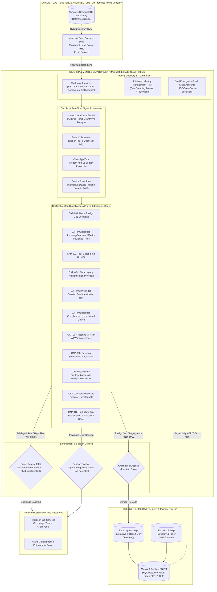

# Enterprise Identity Security & Conditional Access Lab

> **Framework Alignment:** NIST Zero Trust Architecture (SP 800-207) & Microsoft SC-300  
> **Environment:** Microsoft Entra ID (P2) Cloud Tenant *(Live Verified)* + AD DS Hybrid Reference Architecture  
> **Implementation Methodology:** Declarative Identity-as-Code (IaC), Safe Staging & Continuous Governance  
> **Operational Verification:** Automated Verification Checks Passing Across Master Test Suite | 11 Live Policies in Report-Only Mode | SHA-256 Integrity-Checked Snapshots  

---

## 1. Executive Summary

This repository delivers an enterprise **Zero Trust Identity and Access Management (IAM)** reference implementation engineered in **Microsoft Entra ID**. Built on the principle that **Identity is the primary security boundary**, all authentication and authorization requests are evaluated dynamically using real-time signals, adaptive session controls, and least-privilege boundaries.

### Core Implemented Capabilities:
* **Declarative Identity-as-Code (IaC):** 11 report-only Conditional Access baseline policy definitions maintained in version-controlled JSON schemas ([`policies/`](./policies/)) and deployed programmatically via the Microsoft Graph API with pre-flight schema validation ([`validate_schema.ps1`](./scripts/deployment/validate_schema.ps1)).
* **Zero Trust Safe Staging:** All policies deploy in `Report-only` mode (`enabledForReportingButNotEnforced`) to evaluate live sign-in telemetry without risking user disruption.
* **Dual Break-Glass Disaster Recovery:** Two independent, cloud-only emergency accounts (`emergency-admin-01`, `emergency-admin-02`) excluded via `SEC-BreakGlass-Exclusion` with fail-closed programmatic verification to eliminate administrative lockout risk.
* **Privileged Identity Management (PIM):** Implementation of Zero Standing Access (ZSA). Administrative roles require Just-in-Time (JIT) activation with a 4-hour max window, mandatory justification, and phishing-resistant MFA (itemized in [`privileged-role-inventory.md`](./evidence/live-tenant-state/privileged-role-inventory.md)).
* **Verified Snapshot Rollback Engine:** Pre-deployment state captures with SHA-256 integrity checksums and authoritative manifests ([`rollback_policies.ps1`](./scripts/deployment/rollback_policies.ps1)), providing verified rollback with documented failure boundaries upon mid-flight deployment failures.
* **Automated JML Lifecycle Engine:** Deterministic Joiner, Mover, and Leaver workflows ([`identity-lifecycle/`](./identity-lifecycle/)) featuring cryptographic temporary passwords, privilege creep prevention, compensating quarantine actions, and 5-stage offboarding with session revocation requests.
* **Detection Engineering (KQL):** KQL detection queries ([`monitoring/kql/`](./monitoring/kql/)) and incident response playbooks ([`monitoring/playbooks/`](./monitoring/playbooks/)) monitoring break-glass account sign-ins, policy drift, and MFA fatigue.
* **Automated Testing & CI/CD:** Unified master test runner ([`tests/run_all_tests.ps1`](./tests/run_all_tests.ps1)) executing test suites across schema validation, resolution, deployment recovery, lifecycle, and Pester assertions, supported by a GitHub Actions workflow ([`.github/workflows/validate.yml`](./.github/workflows/validate.yml)) enforcing schema validity, linting, and blocking secret scanning.

---

## 2. Architecture & Boundary Specification

To maintain engineering integrity, the platform clearly delineates between the **Live Implemented Cloud Environment** and the **Conceptual Hybrid Reference Architecture**:



---

## 3. Conditional Access Policy Baseline

All 11 policies are deployed and active in the live tenant in **Report-only** (`enabledForReportingButNotEnforced`) mode:

| Policy ID | Policy Display Name | Scoped Target | Signals Evaluated | Grant / Session Controls | Enforcement State |
| :--- | :--- | :--- | :--- | :--- | :---: |
| **CAP-001** | Block Sign-in Outside Allowed Regions | All Users (Excl: `SEC-BreakGlass-Exclusion`) | Location: All locations, Exclude `Allowed-Home-Country` | **Block access** | **Report-only** |
| **CAP-002** | Require Phishing-Resistant MFA for Privileged Roles | 5 Built-in Admin Roles + `SEC-Admins` | All cloud apps, Any device | **Grant: Phishing-Resistant MFA** (`00000000-0000-0000-0000-000000000004`) | **Report-only** |
| **CAP-003** | Risk-Based Step-Up MFA | All Users (Excl: `SEC-BreakGlass-Exclusion`) | Sign-in risk: Medium & High | **Grant: Require MFA** | **Report-only** |
| **CAP-004** | Block Legacy Authentication Protocols | All Users (Excl: `SEC-BreakGlass-Exclusion`) | Client apps: Exchange ActiveSync, Other clients | **Block access** | **Report-only** |
| **CAP-005** | Privileged Session Reauthentication Policy | `SEC-Admins`, `SEC-Contractors` | All cloud apps | **Session: 8-hr Sign-in Frequency, Never Persistent** | **Report-only** |
| **CAP-006** | Require Compliant or Hybrid Joined Device | `SEC-Admins`, `SEC-StandardUsers` | Device platforms: Windows, macOS | **Grant: Compliant Device OR Hybrid Joined** | **Report-only** |
| **CAP-007** | Require MFA for All Workforce Users | `SEC-StandardUsers`, `SEC-Admins` | All cloud apps, All platforms | **Grant: Require MFA** | **Report-only** *(Verified: Success)* |
| **CAP-008** | Securing Security Info Registration | All Users (Excl: `SEC-BreakGlass-Exclusion`) | User action: Register security info | **Block access** outside `Allowed-Home-Country` | **Report-only** |
| **CAP-009** | Restrict Privileged Access to Designated Devices | `SEC-Admins` | All cloud apps | **Block access** unless device matches PAW filter | **Report-only** |
| **CAP-010** | Apply Guest and External User Access Controls | All Guest & External Users | All cloud apps | **Grant: Require MFA** *(Terms of Use planned tenant extension)* | **Report-only** |
| **CAP-012** | High User Risk Remediation & Password Change | All Users (Excl: `SEC-BreakGlass-Exclusion`) | User risk level: High | **Grant: Require MFA + Password Change** | **Report-only** |

---

## 4. Repository Structure

```text
Hybrid Enterprise Identity & Conditional Access Lab/
├── .github/
│   └── workflows/
│       └── validate.yml               # GitHub Actions CI/CD Pipeline
├── config/
│   ├── environment.example.json       # Environment profile abstraction template
│   ├── identity-mapping.example.json  # Tenant identity GUID mapping template
│   └── tenant.example.json            # Tenant configuration abstraction template
├── diagrams/
│   └── architecture.md                # Enterprise Zero Trust Mermaid architecture
├── docs/
│   ├── ARCHITECTURE.md                # Hybrid Identity Reference Architecture
│   ├── IDENTITY_GOVERNANCE.md         # PIM & Zero Standing Access Runbook
│   ├── INCIDENT_RESPONSE.md           # Master IR Framework & Portal Triage Guide
│   ├── JML_WORKFLOW.md                # Identity Lifecycle State-Machine Architecture
│   ├── MASTER_UPGRADE_PLAN.md         # 8-Phase Architectural Evolution Plan
│   ├── POLICY_CATALOGUE.md            # Detailed Specifications for CAP-001 - CAP-012
│   ├── PRODUCTION_READINESS.md        # Live Operational Verification & Failure Drills
│   ├── RUNBOOK.md                     # Operational Deployment Runbook
│   ├── THREAT_MODEL.md                # Threat Model & MITRE ATT&CK Matrix
│   └── USER_GROUP_MODEL.md            # User, Group, and Role Architecture
├── evidence/
│   └── test-results.json              # Machine-readable test verification evidence
├── identity-lifecycle/
│   ├── common/
│   │   ├── audit_logger.ps1           # Structured JSON Lines lifecycle audit logging
│   │   └── identity_validation.ps1    # Password entropy & RBAC department mappings
│   ├── joiner/
│   │   └── onboard_user.ps1           # Automated Joiner with cryptographic credentials
│   ├── mover/
│   │   └── update_user.ps1            # Privilege creep remediation & session flush
│   └── leaver/
│       └── offboard_user.ps1          # 5-stage state-machine termination pipeline
├── monitoring/
│   ├── kql/
│   │   ├── break_glass_alert.kql      # CRITICAL: Emergency break-glass sign-in detection
│   │   ├── mfa_fatigue_alert.kql      # HIGH: Prompt bombing / MFA fatigue detection
│   │   ├── policy_drift_alert.kql     # HIGH: Out-of-band Conditional Access modification
│   │   └── privileged_role_change.kql # HIGH: Standing role assignment & PIM bypass
│   └── playbooks/
│       ├── playbook_account_compromise.md
│       └── playbook_ca_emergency_lockout.md
├── policies/
│   ├── schema/
│   │   └── conditional-access.schema.json # JSON Schema for policy definitions
│   └── CAP-*.json                     # 11 Declarative policy definitions
├── scripts/
│   ├── deployment/
│   │   ├── compare_policies.ps1       # Live vs. Desired drift detection engine
│   │   ├── deploy_ca_policies.ps1     # Core IaC deployment orchestrator
│   │   └── rollback_policies.ps1      # SHA-256 integrity-checked snapshot & rollback engine
│   ├── governance/
│   │   ├── access_review.ps1          # Privileged group attestation audit engine
│   │   ├── configure_pim.ps1          # Programmatic PIM eligibility assignment
│   │   └── privileged_role_audit.ps1  # Zero Standing Access compliance scanner
│   ├── identity/
│   │   ├── resolve_groups.ps1         # Dynamic group reference resolver
│   │   ├── resolve_locations.ps1      # Named location reference resolver
│   │   └── resolve_users.ps1          # User & directory keyword resolver
│   ├── deploy_ca_policies.ps1         # Root pipeline wrapper
│   └── seed_users.ps1                 # Synthetic persona & group provisioning
└── tests/
    ├── deployment/                    # Drift engine unit tests
    ├── governance/                    # Script syntax & token validation tests
    ├── identity/                      # Identity resolver tests
    ├── lifecycle/                     # JML state-machine tests
    ├── schema/                        # Policy JSON schema tests
    ├── lifecycle.Tests.ps1            # Pester lifecycle suite
    ├── policies.Tests.ps1             # Pester policies suite
    ├── run_all_tests.ps1              # Unified master test runner
    └── security_scan.Tests.ps1        # Pester secret scanning suite
```

---

## 5. Operational Commands & Quickstart

### 5.1 Execute Master Test Suite (Locally)
To run all 56 automated verification checks across the 7 specialized suites (including 13 Native Pester Assertions):
```powershell
powershell -ExecutionPolicy Bypass -File .\tests\run_all_tests.ps1
```

### 5.2 Plan & Deploy Conditional Access Policies
```powershell
# 1. Deep schema validation & pre-flight check (No Graph connection needed)
.\scripts\deploy_ca_policies.ps1 -ValidateOnly

# 2. Plan mode: Compare live tenant state against Git and calculate drift
.\scripts\deploy_ca_policies.ps1 -Plan -DeviceCode

# 3. Live deployment (Generates SHA-256 integrity-checked pre-deployment rollback snapshot)
.\scripts\deploy_ca_policies.ps1 -Deploy -Environment Lab -DeviceCode
```

### 5.3 Audit Privileged Roles & PIM Compliance
```powershell
# Scan tenant for standing administrative privileges
.\scripts\governance\privileged_role_audit.ps1 -DeviceCode

# Run access review attestation across privileged groups
.\scripts\governance\access_review.ps1 -DeviceCode
```

### 5.4 Execute Identity Lifecycle Actions (Joiner-Mover-Leaver)
```powershell
# Onboard a new employee (Joiner)
.\identity-lifecycle\joiner\onboard_user.ps1 `
    -GivenName "Elena" -Surname "Rostova" `
    -UserPrincipalName "usr-elena@<DOMAIN>" `
    -Department "Finance" -JobTitle "Financial Analyst" `
    -DeviceCode

# Transfer an employee & purge legacy group permissions (Mover)
.\identity-lifecycle\mover\update_user.ps1 `
    -UserPrincipalName "usr-elena@<DOMAIN>" `
    -NewDepartment "Information Security" -NewJobTitle "Security Analyst" `
    -DeviceCode

# Emergency employee termination with token kill & password scramble (Leaver)
.\identity-lifecycle\leaver\offboard_user.ps1 `
    -UserPrincipalName "usr-elena@<DOMAIN>" `
    -TicketId "HR-TERM-9042" `
    -DeviceCode
```

---

## 6. Project Documentation Index

| Document | Purpose |
| :--- | :--- |
| [**Hybrid Architecture**](./docs/ARCHITECTURE.md) | In-depth Active Directory DS $\leftrightarrow$ Entra ID sync & authentication topologies. |
| [**Identity Governance & PIM**](./docs/IDENTITY_GOVERNANCE.md) | Zero Standing Access, PIM role rules, and portal configuration guide. |
| [**JML Workflow Architecture**](./docs/JML_WORKFLOW.md) | Joiner-Mover-Leaver state-machine specifications and security controls. |
| [**Incident Response Framework**](./docs/INCIDENT_RESPONSE.md) | Master IR guide, KQL detection queries, and Entra portal triage procedures. |
| [**Policy Catalogue**](./docs/POLICY_CATALOGUE.md) | Full technical specifications for policies CAP-001 through CAP-012. |
| [**Threat Model & MITRE Matrix**](./docs/THREAT_MODEL.md) | STRIDE threat model and MITRE ATT&CK technique mitigations. |
| [**Operational Runbook**](./docs/RUNBOOK.md) | Step-by-step reproduction guide and troubleshooting procedures. |
| [**User & Group Model**](./docs/USER_GROUP_MODEL.md) | Synthetic identity directory structure and RBAC group definitions. |
