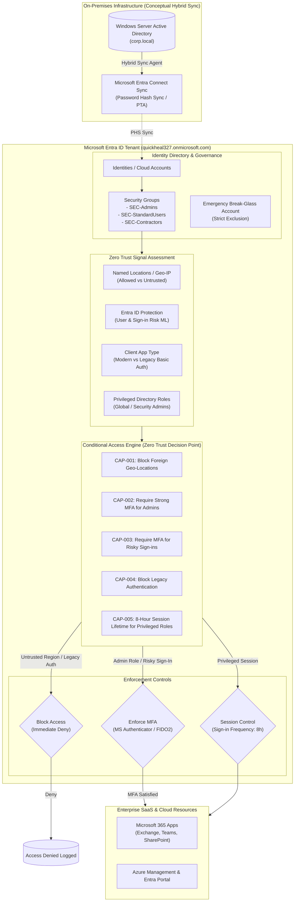

# Enterprise Hybrid Identity & Conditional Access Security Lab

> **Aligned with:** Microsoft SC-300 (Identity and Access Administrator) & Zero Trust Architecture  
> **Tenant:** `quickheal327.onmicrosoft.com` (Microsoft Entra ID P2)  
> **Automation:** Microsoft Graph PowerShell SDK  

---

## 1. Executive Summary

This project implements an enterprise-grade **Zero Trust Identity and Access Management (IAM)** architecture using **Microsoft Entra ID (P2)**. It establishes identity as the primary security perimeter by enforcing context-aware Conditional Access policies, risk-based step-up authentication, session lifetime controls, and automated identity lifecycle management.

All configurations were deployed following real-world SecOps best practices: scripted automation via Microsoft Graph PowerShell, non-disruptive **Report-only** staging, mathematical policy simulation via the Entra ID **What If** engine, and live InPrivate authentication testing.

---

## 2. Architecture Diagram

---

## 3. Conditional Access Policy Catalogue

| Policy ID | Policy Name | Target Scope | Conditions / Signals | Enforcement Control | Threat Mitigated | Staging State |
|---|---|---|---|---|---|---|
| **CAP-001** | Block Sign-in Outside Allowed Regions | All Users (Excl. Break-Glass) | Location: Any, Excl. `Allowed-Home-Country` | **Block access** | Foreign credential-stuffing botnets | Enforced |
| **CAP-002** | Require Strong MFA for Admins | Directory Roles & `SEC-Admins` | All cloud apps | **Grant: Require MFA** | Account takeover of privileged admins | Enforced |
| **CAP-003** | Risk-Based Step-Up MFA | All Users | Sign-in risk: Medium & High | **Grant: Require MFA** | Anomalous IP / token replay attacks | Report-only |
| **CAP-004** | Block Legacy Authentication | All Users | Client apps: POP3, IMAP, ActiveSync | **Block access** | Basic authentication MFA bypass | Enforced |
| **CAP-005** | Privileged Session Frequency (8h) | `SEC-Admins`, `SEC-Contractors` | All cloud apps | **Session: 8hr Re-auth, Never persistent** | Stolen session cookies & PRT replay | Enforced |

---

## 4. Automation & Identity Lifecycle

Rather than manual portal clicks, the entire directory population was scripted using **Microsoft Graph PowerShell SDK** in [`scripts/seed_users.ps1`](file:///c:/Users/yoges/Documents/Security-Engineering-Portfolio/Hybrid%20Enterprise%20Identity%20&%20Conditional%20Access%20Lab/scripts/seed_users.ps1):
- **3 Security Groups:** `SEC-Admins`, `SEC-StandardUsers`, `SEC-Contractors`
- **8 Synthetic Test Personas:** Spread across Information Security, Identity & Access, Finance, Marketing, Engineering, and Human Resources.
- **Break-Glass Emergency Account:** Created and strictly excluded from all blocking and MFA policies to prevent administrative lockout.

---

## 5. Security Validation & Testing Evidence

All policies were rigorously audited using both mathematical simulation and live session testing:

| Evidence Phase | Captured Screenshot | Technical Verification |
|---|---|---|
| **Identity Automation** | [`00-powershell-seed-users.png`](./screenshots/00-powershell-seed-users.png) | Automatic provisioning of 3 security groups and 8 test personas via Microsoft Graph SDK. |
| **Policy Catalogue** | [`01-conditional-access-policies.png`](./screenshots/01-conditional-access-policies.png) | All 5 enterprise policies deployed in Entra ID following structured naming conventions. |
| **Simulation Engine** | [`02-whatif-simulation-block.png`](./screenshots/02-whatif-simulation-block.png) | Entra ID **What If** engine evaluates unapproved regions and legacy apps to **Block access** without service interruption. |
| **Report-Only Audit** | [`03-signin-logs-report-only.png`](./screenshots/03-signin-logs-report-only.png) | Entra Sign-in log telemetry auditing `CAP-005` (8-hour session lifetime) as **Success** while legitimate traffic passes without false positives. |
| **Enforced MFA Gate** | [`04-mfa-challenge-prompt.png`](./screenshots/04-mfa-challenge-prompt.png) | Live InPrivate authentication for `adm-alex@quickheal327.onmicrosoft.com` instantly challenged with mandatory Microsoft Authenticator setup. |
| **Backend Telemetry** | [`05-signin-log-mfa-enforced.png`](./screenshots/05-signin-log-mfa-enforced.png) | Enforced Sign-in log confirming `CAP-002` evaluation status as **Failure** (access token withheld until second factor satisfied). |

---

## 6. Future Work: Full Hybrid Entra Connect Sync

In a full on-premises hybrid deployment, this cloud architecture directly interfaces with physical or virtualized Active Directory Domain Services (AD DS):
1. **Entra Connect Sync Engine:** Deploying the sync agent on Windows Server to replicate on-prem OUs, users, and security groups to Entra ID via Password Hash Synchronization (PHS) or Pass-Through Authentication (PTA).
2. **Hybrid Azure AD Join:** Configuring Group Policy / Intune to automatically register domain-joined Windows endpoints into Entra ID, unlocking device compliance conditions in Conditional Access.
3. **Privileged Identity Management (PIM):** Implementing Just-in-Time (JIT) role elevation with approval workflows for administrative roles.

---

## 7. Project Documentation Index

- [Architecture Diagram](file:///c:/Users/yoges/Documents/Security-Engineering-Portfolio/Hybrid%20Enterprise%20Identity%20&%20Conditional%20Access%20Lab/diagrams/architecture.md)
- [Policy Catalogue Specifications](file:///c:/Users/yoges/Documents/Security-Engineering-Portfolio/Hybrid%20Enterprise%20Identity%20&%20Conditional%20Access%20Lab/docs/POLICY_CATALOGUE.md)
- [User & Group Directory Model](file:///c:/Users/yoges/Documents/Security-Engineering-Portfolio/Hybrid%20Enterprise%20Identity%20&%20Conditional%20Access%20Lab/docs/USER_GROUP_MODEL.md)
- [Threat Model & MITRE ATT&CK Mapping](file:///c:/Users/yoges/Documents/Security-Engineering-Portfolio/Hybrid%20Enterprise%20Identity%20&%20Conditional%20Access%20Lab/docs/THREAT_MODEL.md)
- [Reproduction Runbook](file:///c:/Users/yoges/Documents/Security-Engineering-Portfolio/Hybrid%20Enterprise%20Identity%20&%20Conditional%20Access%20Lab/docs/RUNBOOK.md)
- [Automation Script (`seed_users.ps1`)](file:///c:/Users/yoges/Documents/Security-Engineering-Portfolio/Hybrid%20Enterprise%20Identity%20&%20Conditional%20Access%20Lab/scripts/seed_users.ps1)
