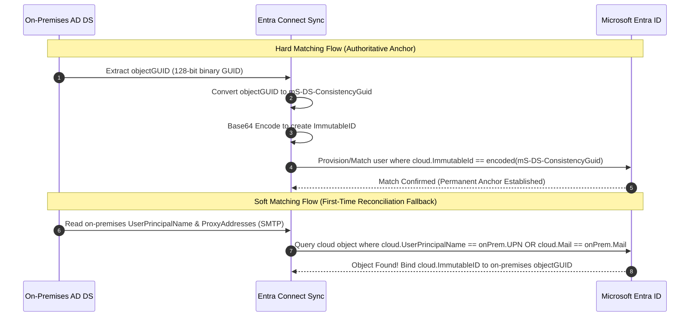

# Enterprise Hybrid Identity & Zero Trust Reference Architecture

## 1. Executive Summary

Enterprise identity architecture operates across a continuum: on-premises Active Directory Domain Services (AD DS) legacy environments and cloud-native Microsoft Entra ID tenants. While cloud-native identity provides dynamic Zero Trust policy orchestration (Conditional Access, PIM, Identity Protection), most large organizations maintain on-premises Active Directory as the authoritative identity source for legacy Kerberos/NTLM workloads.

This document establishes the **Hybrid Identity Reference Architecture**, detailing synchronization mechanics, authentication topologies, object matching algorithms, Tier-0 boundary security, and disaster recovery.

```mermaid
flowchart TB
    subgraph OnPremises["On-Premises AD DS (Authoritative Source of Authority)"]
        DC1[Domain Controller: corp.contoso.com]
        DC2[Domain Controller: Replica]
        ADUsers[(Active Directory Users & OUs)]
        DC1 --- ADUsers
        DC2 --- ADUsers
    end

    subgraph SyncInfrastructure["Hybrid Identity Synchronization Tier (Tier-0 Asset)"]
        ConnectServer["Microsoft Entra Connect Sync Server\n(Windows Server 2022)\n- Staging Mode / Active Agent"]
        ADConnector["AD DS Connector (DirSync Service Account)"]
        Metaverse["Metaverse Synchronization Engine (Sync Rules)"]
        EntraConnector["Entra ID Connector (Graph / Provisioning Service API)"]
        
        ADConnector --> Metaverse
        Metaverse --> EntraConnector
    end

    subgraph EntraCloud["Microsoft Entra ID (Zero Trust Security Control Plane)"]
        CloudDirectory[(Entra ID Cloud Objects)]
        CAPolicyEngine[Conditional Access Policy Engine CAP-001 through CAP-012]
        PIMEngine[Privileged Identity Management - Zero Standing Access]
        IdProtection[Identity Protection - Risk ML Engine]
        CloudApps[Protected SaaS & M365 Workloads]
        
        CloudDirectory --> CAPolicyEngine
        CAPolicyEngine --> CloudApps
        PIMEngine --> CloudDirectory
        IdProtection --> CAPolicyEngine
    end

    subgraph DisasterRecovery["Emergency Break-Glass Plane (Cloud-Only)"]
        BGUsers[Dual Cloud-Only Break-Glass Accounts\nemergency-admin-01 / 02]
        BGUsers -.->|Permanently Excluded from Sync & CA| CloudDirectory
    end

    %% Sync Flows
    ADUsers -->|1. LDAP / RPC Read| ADConnector
    EntraConnector -->|2. HTTPS / TLS 1.3 Outbound (Port 443)| CloudDirectory
    ConnectServer -.->|3. Password Hash Sync (SHA-256 HMAC / 2-minute cycle)| CloudDirectory
```

---

## 2. Authentication Topologies: Comparative Architecture

Enterprise hybrid deployments select between three primary authentication topologies:

| Architecture | Mechanism | Redundancy & Resiliency | Security Considerations | Zero Trust Recommendation |
| :--- | :--- | :--- | :--- | :--- |
| **Password Hash Synchronization (PHS)** *(Recommended)* | On-premises Entra Connect server extracts password hashes from AD, calculates an HMAC-SHA256 hash of the MD4 hash, and pushes it over TLS 443 to Entra ID every 2 minutes. | **Highest Resiliency:** Cloud authenticates directly without relying on on-premises WAN or servers. Operates during complete on-premises datacenter outages. | Enables Entra ID **Leaked Credential Detection** (cross-references hashes against dark web leak repositories). | **Primary Recommendation** for high availability and Identity Protection risk integration. |
| **Pass-Through Authentication (PTA)** | Authentication requests in the cloud are queued in an Azure Service Bus. On-premises lightweight agents poll the queue and validate Kerberos/NTLM against local DCs. | **Medium Resiliency:** Depends on on-premises agent availability and WAN connectivity. Requires minimum 3 redundant PTA agents. | Validates AD account state (e.g., logon hours, immediate domain disablement) in real-time. | Recommended only when compliance strictly forbids cloud password hash storage. |
| **Active Directory Federation Services (AD FS)** | Claims-based SAML / WS-Fed redirect to on-premises ADFS farm with Web Application Proxies (WAPs). | **Lowest Resiliency / Highest Complexity:** Complete cloud outage if ADFS farm or certificates fail. | Large attack surface (Golden SAML attack vector, Solorigate). High operational maintenance overhead. | **Deprecated / Discouraged** for modern Zero Trust deployments. Transition to PHS + Entra ID native SSO. |

---

## 3. Synchronization Mechanics & Object Identity Matching

When synchronizing identities from on-premises AD DS to Microsoft Entra ID, identity reconciliation is governed by two matching mechanisms:



### 3.1 Hard Matching (`ImmutableId` & `mS-DS-ConsistencyGuid`)
* **Authoritative Anchor:** Microsoft Entra Connect uses `mS-DS-ConsistencyGuid` (default since 2017) or `objectGUID` as the immutable anchor (`sourceAnchor`).
* **Format:** The 16-byte binary GUID from Active Directory is Base64 encoded and written to the cloud user's `immutableId` attribute.
* **Resiliency:** Even if a user's UPN, First Name, Last Name, or OU changes (e.g., marriage or transfer), the `immutableId` remains identical, preventing duplicate identity creation or lost access.

### 3.2 Soft Matching (SMTP / UPN Matching)
* **First-Time Match:** If an account was previously created in the cloud and an administrator later introduces Entra Connect, the sync engine matches on `UserPrincipalName` or primary `mail` (ProxyAddresses `SMTP:`).
* **Hardening Security Gate:** Soft matching must be monitored. If soft matching is left unconstrained, an attacker with write access to on-premises AD could set an on-prem account's UPN to match a cloud Global Administrator's UPN, attempting to take over the cloud identity upon next sync. 
* **Zero Trust Rule:** Privileged cloud accounts (e.g., Global Admins and `emergency-admin*`) are **cloud-only** and must never be matched or overwritten by on-premises synchronized objects.

---

## 4. Tier-0 Architecture & Synchronization Security Boundary

In an enterprise Active Directory environment, the **Microsoft Entra Connect Sync server is a Tier-0 asset**. Compromising the Entra Connect server compromises both on-premises AD and the cloud Entra ID tenant.

```
       ================================================================
       TIER-0 SECURITY CONTROL BOUNDARY: HYBRID SYNCHRONIZATION
       ================================================================

       [On-Premises AD DS]                     [Microsoft Entra ID]
       ==================                      ====================
       Domain Controllers                      Global Administrators
       Enterprise Admins                       Privileged Role Admins
       Domain Admins                           Conditional Access Admins
              \                                       /
               \                                     /
                ===> [ENTRA CONNECT SYNC SERVER] <===
                     - Dedicated Windows Server
                     - MSOL_ Synchronization Account
                     - No Interactive Admin Logons
                     - Endpoint Detection & Response (EDR)
                     - Excluded from Internet Browsing
```

### Attack Vectors & Mitigations:

1. **DCSync via MSOL_ Account:**
   * *Threat:* The on-premises synchronization account (`MSOL_xxxxxxxxxxxx`) possesses `Replicating Directory Changes` and `Replicating Directory Changes All` permissions to read password hashes for PHS.
   * *Mitigation:* Restrict logon rights (`SeDenyInteractiveLogonRight`, `SeDenyNetworkLogonRight`). Monitor Event ID 4662 for DCSync reconnaissance originating from non-DC IPs.
2. **Cloud Privilege Escalation via On-Premises Impersonation:**
   * *Threat:* An on-prem administrator attempts to add high-privilege directory roles to a synced account or sync an account into a cloud administrative group.
   * *Mitigation:* In Microsoft Entra ID, directory roles cannot be assigned to on-premises synced groups unless explicitly enabled for role-assignment. Privileged roles in this portfolio are governed strictly by **PIM** with **CAP-002** phishing-resistant MFA.
3. **Emergency Break-Glass Separation:**
   * *Architecture:* Break-glass accounts (`emergency-admin-01@<LAB_DOMAIN>` and `emergency-admin-02`) are **strictly cloud-only** and created directly in Entra ID. They have no corresponding on-premises AD object, ensuring they cannot be manipulated, disabled, or locked out via on-premises attacks or synchronization failures.

---

## 5. Synchronization Scope & Filtering Strategy

To maintain least privilege and optimize performance, synchronization is partitioned using multi-tier filtering:

1. **Domain- and OU-Based Filtering:**
   * Only designated Organizational Units (OUs) are synchronized (e.g., `OU=CorpUsers,DC=corp,DC=contoso,DC=com`).
   * Administrative OUs (`OU=DomainAdmins`, `OU=ServiceAccounts`, `OU=Staging`) are explicitly excluded from sync.
2. **Attribute-Based Filtering:**
   * Objects containing `extensionAttribute15 = "NoSync"` or disabled accounts pending physical disposal are filtered at the Metaverse rule level.
3. **Group-Based Staged Filtering:**
   * Used during pilot migrations to synchronize only members of a pilot security group before broader rollout.

---

## 6. High Availability & Disaster Recovery (Staging Mode)

Microsoft Entra Connect does not support an active-active cluster. High availability is achieved through an **Active / Staging Mode** configuration:

* **Primary Active Server:** Processes scheduled delta syncs (every 30 minutes) and password hash syncs (every 2 minutes). Imports from AD and Entra ID, evaluates sync rules, and exports changes to both directories.
* **Secondary Staging Server:** Imports from AD and Entra ID and runs synchronization rules, but **suppresses exports**. Its Metaverse matches the active server's state continuously.
* **Failover Procedure:**
  1. Primary server goes down or undergoes maintenance.
  2. Run `Set-ADSyncScheduler -SyncCycleEnabled $false` on primary (if accessible).
  3. Run `Set-ADSyncServerConfiguration -StagingMode $false` on the staging server to promote it to active in under 3 minutes.
