# Enterprise Identity Governance & Privileged Access Architecture

## 1. Executive Summary

In a modern enterprise Zero Trust architecture, identity is the primary security boundary. Legacy identity architectures permitted administrative accounts to possess **permanent, standing privileges**—meaning an attacker or compromised credential could abuse high-tier privileges at any time.

This project implements **Zero Standing Access (ZSA)** through **Microsoft Entra Privileged Identity Management (PIM)**, structured role tiering, automated access attestation, and break-glass emergency isolation.

```mermaid
flowchart TD
    subgraph Zero_Standing_Access["Zero Standing Access (ZSA) Workflow"]
        Admin[Corporate Admin Identity] -->|Standard State: No Active Roles| Entra[Microsoft Entra ID]
        Admin -->|1. Request Elevation| PIM[Privileged Identity Management]
        PIM -->|2. Verify Identity & MFA| CA[Conditional Access CAP-002]
        CA -->|3. Phishing-Resistant MFA| Auth[FIDO2 / Passkey Validated]
        Auth -->|4. Business Justification + Change Ticket| Approver{Peer Approval / Auto-Grant}
        Approver -->|Approved| ActiveRole[Active Role Granted: 4h Max]
        ActiveRole -->|5. Telemetry & Audit Logs| Sentinel[SIEM / Monitoring Log Analytics]
        ActiveRole -.->|6. Automatic Expiration after 4h| Zero[Reverts to Zero Privileges]
    end

    subgraph Break_Glass["Disaster Recovery (Break-Glass)"]
        BG[Dual Cloud-Only Break-Glass] -->|Emergency Outage / PIM Failure| StandGlobal[Permanent Global Admin]
        StandGlobal -->|Excluded from CA Policies| DirectAccess[Emergency Break-Glass Recovery]
        StandGlobal -->|High-Priority Alert Triggered| SecOps[SecOps 24/7 Page]
    end
```



---

## 2. Privileged Role Tiering & Policy Matrix

Administrative roles in this enterprise architecture are partitioned into strict tiers. Standing active permissions for human operators are prohibited; all roles require Just-in-Time (JIT) activation with strict controls:

| Role Name | Tier | Assignment Type | Max Duration | Step-Up MFA | Justification / Ticket | Approver Required |
| :--- | :---: | :---: | :---: | :---: | :---: | :---: |
| **Global Administrator** | Tier-0 | **Eligible** (PIM) | 2 Hours | Phishing-Resistant | Mandatory Ticket # | Dual Approval (SecOps Lead) |
| **Privileged Role Admin** | Tier-0 | **Eligible** (PIM) | 4 Hours | Phishing-Resistant | Mandatory Ticket # | Dual Approval |
| **Security Administrator** | Tier-0 | **Eligible** (PIM) | 4 Hours | Phishing-Resistant | Mandatory Justification | Single Approver |
| **Conditional Access Admin**| Tier-0 | **Eligible** (PIM) | 4 Hours | Phishing-Resistant | Mandatory Justification | Self-Approved with Audit |
| **User Administrator** | Tier-1 | **Eligible** (PIM) | 8 Hours | Standard MFA | Mandatory Justification | None |
| **Exchange / SharePoint** | Tier-1 | **Eligible** (PIM) | 8 Hours | Standard MFA | Mandatory Justification | None |
| **Emergency Break-Glass** | Tier-0 | **Active (Permanent)** | Permanent | Excluded from CA* | Physical Safe Procedure | Excluded from PIM |

> [!IMPORTANT]
> **Break-Glass Exemption Rationale:**
> `emergency-admin-01` and `emergency-admin-02` are intentionally assigned **Active (permanent)** Global Administrator and excluded from PIM and Conditional Access. In the event of a total PIM service degradation, CA policy misconfiguration, or federated IdP failure, these accounts ensure recovery capability. Their credentials are split into separate physical safes with HSM-backed FIDO2 hardware tokens.

---

## 3. Microsoft Entra ID Admin Center (UI) Configuration Guide

For administrators configuring or verifying PIM settings within the **Microsoft Entra admin center** (`https://entra.microsoft.com`):

### Step 1: Configure PIM Role Settings (Rules)
1. Sign in to [Microsoft Entra admin center](https://entra.microsoft.com) as a **Privileged Role Administrator** or **Global Administrator**.
2. Navigate to **Identity Governance** > **Privileged Identity Management** > **Microsoft Entra roles**.
3. Under **Manage**, select **Settings**.
4. In the role list, locate and click **Conditional Access Administrator** (and repeat for **Security Administrator**, **Global Administrator**):
   - Click **Edit** at the top of the pane.
   - **Activation Tab**:
     - *Activation maximum duration (hours)*: Set to `4`.
     - *On activation, require*: Select `Azure MFA` (or `Conditional Access authentication strength`).
     - *Require justification on activation*: Checked `Yes`.
     - *Require ticket information on activation*: Checked `Yes`.
   - **Assignment Tab**:
     - *Allow permanent eligible assignment*: Checked `Yes` (for trusted engineers) or capped at 1 year.
     - *Allow permanent active assignment*: **Uncheck** `No` (Disallow permanent active role assignments).
   - **Notification Tab**:
     - Configure alert notifications to SecOps on role activation.
   - Click **Update**.

### Step 2: Transition Standing Admins to PIM Eligible
1. In **Privileged Identity Management** > **Microsoft Entra roles**, select **Roles**.
2. Select the target role (e.g., **Conditional Access Administrator**).
3. Click **+ Add assignments**.
4. Under **Membership**, select the administrative users (e.g., members of `SEC-Admins`).
5. Under **Setting**, verify **Assignment type** is set to **Eligible** (NOT *Active*).
6. Click **Assign**.
7. If the user previously had an *Active* standing assignment under **Active assignments**, select it and click **Remove**.

### Step 3: Configure Automated Access Reviews
1. Navigate to **Identity Governance** > **Access Reviews**.
2. Click **+ New access review**.
3. Configure the review:
   - *Review type*: **Teams + Groups** (Select `SEC-Admins` and `SEC-BreakGlass-Exclusion`) or **Microsoft Entra roles**.
   - *Reviewers*: Selected managers or Group owners.
   - *Recurrence*: **Quarterly**, duration **14 days**.
   - *Upon completion*: Auto-apply results to remove unapproved access.
4. Click **Create**.

---

## 4. Governance & Audit Automation Engines

This repository provides three PowerShell automation tools for enterprise identity governance:

### 1. Zero Standing Access Audit Engine (`privileged_role_audit.ps1`)
Inspects active directory role assignments across all tenant users and service principals. Flags any human account retaining standing, permanent Tier-0 privileges without PIM:

```powershell
.\scripts\governance\privileged_role_audit.ps1 -DeviceCode
```

**Output Generated:**
- Console compliance scorecard highlighting violations.
- JSON and CSV reports exported to `reports/privileged_role_audit_<timestamp>.[json|csv]`.

### 2. Privileged Access Review & Attestation Engine (`access_review.ps1`)
Automates periodic access attestation for security groups (`SEC-Admins`, `SEC-BreakGlass-Exclusion`):

```powershell
.\scripts\governance\access_review.ps1 -MaxInactiveDays 90 -DeviceCode
```

**Checks Performed:**
- Detects disabled accounts that retain group memberships.
- Identifies stale accounts (>90 days without sign-in).
- Detects guest accounts holding internal privileged group memberships.
- Verifies that only designated break-glass accounts exist in `SEC-BreakGlass-Exclusion`.

### 3. Programmatic PIM Assignment Engine (`configure_pim.ps1`)
Assigns PIM Eligible roles programmatically via Microsoft Graph:

```powershell
.\scripts\governance\configure_pim.ps1 -AssignEligible -UserPrincipalName "admin.user@company.com" -RoleName "Conditional Access Administrator" -DurationHours 4 -DeviceCode
```

---

## 5. Security & Audit Telemetry

All PIM activations, approvals, and eligibility modifications are logged immutably in Microsoft Entra Audit Logs. Key events monitored by our detection engineering baseline:

| Operation Name | Category | Description | Severity |
| :--- | :--- | :--- | :--- |
| `Add member to role in PIM completed` | RoleManagement | Identity activated an eligible role | Low (Normal) / Medium (After Hours) |
| `Add eligible member to role in PIM completed` | RoleManagement | Administrator assigned PIM eligibility | High |
| `Add active member to role outside PIM` | RoleManagement | **Standing assignment bypass detected** | **CRITICAL** |
| `Break-glass account sign-in` | Sign-in | Emergency account logged in | **CRITICAL (Page SecOps)** |
