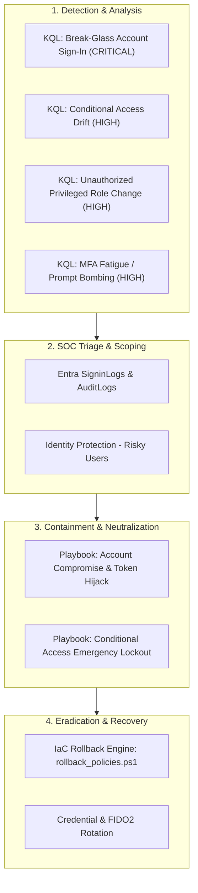

# Enterprise Identity Incident Response & Monitoring Architecture

## 1. Executive Summary

This document establishes the operational **Incident Response (IR) and Security Operations (SecOps) framework** for Microsoft Entra ID, Conditional Access, and Privileged Identity Governance. 

The framework aligns with **NIST SP 800-61 Rev. 2** (Computer Security Incident Handling Guide), providing detection engineering rules, playbooks, and step-by-step triage procedures within the Microsoft Entra admin center.

---

## 2. Detection Engineering Baseline (Kusto Query Language - KQL)

The detection rules located in [`monitoring/kql/`](file:///c:/Users/yoges/Documents/Security-Engineering-Portfolio/Hybrid%20Enterprise%20Identity%20&%20Conditional%20Access%20Lab/monitoring/kql) monitor security-critical events across Microsoft Entra ID:

| Detection Rule | Target Telemetry | MITRE ATT&CK | Alert Severity | Key Behavior Detected |
| :--- | :--- | :--- | :---: | :--- |
| [`break_glass_alert.kql`](file:///c:/Users/yoges/Documents/Security-Engineering-Portfolio/Hybrid%20Enterprise%20Identity%20&%20Conditional%20Access%20Lab/monitoring/kql/break_glass_alert.kql) | `SigninLogs`, `AADNonInteractiveUserSignInLogs` | T1078.004 | **CRITICAL** | Any interactive or non-interactive logon by `emergency-admin*`. Requires immediate physical safe verification. |
| [`policy_drift_alert.kql`](file:///c:/Users/yoges/Documents/Security-Engineering-Portfolio/Hybrid%20Enterprise%20Identity%20&%20Conditional%20Access%20Lab/monitoring/kql/policy_drift_alert.kql) | `AuditLogs` (Category: Policy) | T1562.001 | **HIGH** | Out-of-band manual changes or policy deletions made in Entra Portal bypassing the GitOps pipeline. |
| [`privileged_role_change.kql`](file:///c:/Users/yoges/Documents/Security-Engineering-Portfolio/Hybrid%20Enterprise%20Identity%20&%20Conditional%20Access%20Lab/monitoring/kql/privileged_role_change.kql) | `AuditLogs` (Category: RoleManagement) | T1098 | **HIGH** | Standing permanent assignments to Tier-0 roles or unauthorized PIM policy rule changes. |
| [`mfa_fatigue_alert.kql`](file:///c:/Users/yoges/Documents/Security-Engineering-Portfolio/Hybrid%20Enterprise%20Identity%20&%20Conditional%20Access%20Lab/monitoring/kql/mfa_fatigue_alert.kql) | `SigninLogs` | T1621 | **HIGH** | Multiple rejected push notifications followed by an approved challenge within 15 minutes. |

---

## 3. Microsoft Entra Admin Center (UI) Triage Procedures

When an alert triggers, follow these step-by-step procedures in the [Microsoft Entra admin center](https://entra.microsoft.com/):

### Step 1: Investigating User Sign-in Logs
1. Sign in to [Microsoft Entra admin center](https://entra.microsoft.com/).
2. Navigate to: **Identity** > **Monitoring & health** > **Sign-in logs**.
3. In the top filter bar:
   - Click **Add filter** > Select **User** > Enter the suspect UPN (e.g., `adm-alex@<LAB_DOMAIN>` or `emergency-admin-01`).
   - Click **Date** > Select **Last 24 hours**.
4. Click on any suspicious sign-in event row:
   - **Basic info tab:** Inspect IP address, Location, Client app, and Device state.
   - **Conditional Access tab:** Check which policies evaluated (`Success`, `Failure`, `Not Applied`, or `Report-only`).
   - **Authentication Details tab:** Verify the exact MFA method (FIDO2, Authenticator push, or Password).

### Step 2: Investigating Directory Audit Logs
1. Navigate to: **Identity** > **Monitoring & health** > **Audit logs**.
2. Filter by:
   - **Service:** `Conditional Access` (to trace policy edits) or `Core Directory` (to trace user/group changes).
   - **Initiated by (actor):** Enter the administrator's UPN.
3. Inspect the **Target(s)** and **Modified Properties** tabs to view exact before/after JSON diffs of the changed attributes.

### Step 3: Triaging Identity Protection Alerts (Risky Users)
1. Navigate to: **Protection** > **Identity Protection** > **Risky users**.
2. Click on the flagged user to inspect their Risk Level (`Low`, `Medium`, `High`) and Risk State (`At risk`).
3. Under **Risk history**, view individual detection items (*Atypical travel*, *Anonymous IP address*, *Token issuer anomaly*).
4. Actions available:
   - **Reset password:** Forces user password reset.
   - **Dismiss user risk:** Clears risk score if determined to be false positive.
   - **Confirm user compromised:** Immediately elevates risk score to High, triggering **CAP-012** (User Risk Remediation) block or secure self-remediation.

### Step 4: Configuring Diagnostic Settings (Log Analytics Export)
To enable automated alerting with KQL:
1. Navigate to: **Identity** > **Monitoring & health** > **Diagnostic settings**.
2. Click **+ Add diagnostic setting**.
3. Under **Logs**, check:
   - `SignInLogs`
   - `NonInteractiveUserSignInLogs`
   - `AuditLogs`
   - `RiskyUsers`
   - `UserRiskEvents`
4. Under **Destination details**, select **Send to Log Analytics workspace**.
5. Save the configuration.

---

## 4. Incident Response Playbooks

Detailed containment and eradication workflows are documented in [`monitoring/playbooks/`](file:///c:/Users/yoges/Documents/Security-Engineering-Portfolio/Hybrid%20Enterprise%20Identity%20&%20Conditional%20Access%20Lab/monitoring/playbooks):

1. **[Account Compromise & Token Hijack Playbook](file:///c:/Users/yoges/Documents/Security-Engineering-Portfolio/Hybrid%20Enterprise%20Identity%20&%20Conditional%20Access%20Lab/monitoring/playbooks/playbook_account_compromise.md):**
   * Rapid T=0 session invalidation via `Revoke-MgUserSignInSession`.
   * High-entropy password scrambling.
   * Registered MFA credential stripping.
2. **[Conditional Access Emergency Lockout Playbook](file:///c:/Users/yoges/Documents/Security-Engineering-Portfolio/Hybrid%20Enterprise%20Identity%20&%20Conditional%20Access%20Lab/monitoring/playbooks/playbook_ca_emergency_lockout.md):**
   * Secure physical safe retrieval of `emergency-admin-01` credentials.
   * Bypassing Conditional Access via `SEC-BreakGlass-Exclusion`.
   * Executing automated rollback via `scripts/deployment/rollback_policies.ps1`.
