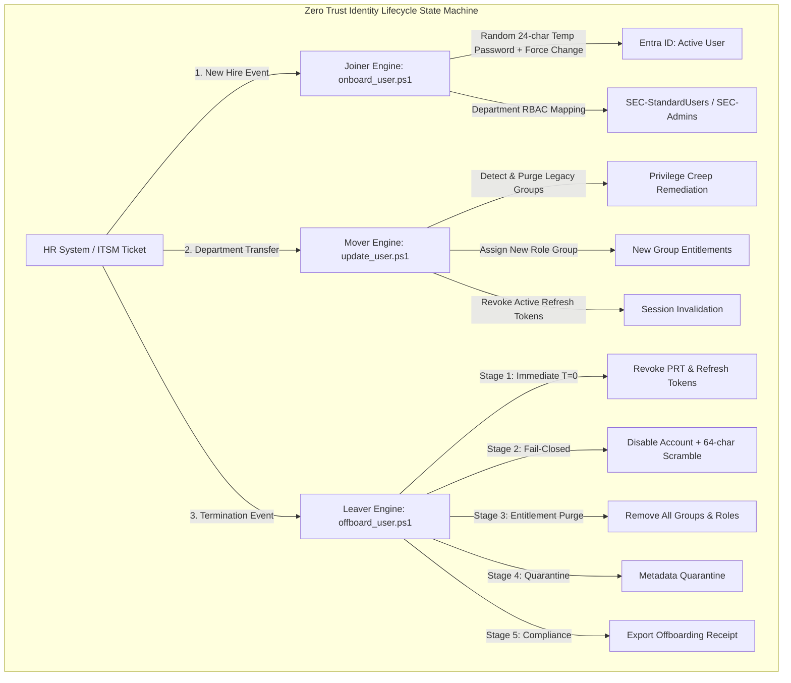

# Enterprise Joiner-Mover-Leaver (JML) Identity Lifecycle Architecture

## 1. Executive Summary

Identity lifecycle management is a foundational pillar of Zero Trust architecture. Unmanaged or manual lifecycle workflows introduce significant enterprise vulnerabilities:
* **Orphaned Accounts:** Dormant accounts left active after employee departure are prime targets for credential stuffing and lateral movement.
* **Privilege Creep:** Employees accumulating access rights across multiple roles without revocation of former entitlements.
* **Session Persistence:** Disabling an account in directory services without revoking active Primary Refresh Tokens (PRTs) and OAuth sessions allows an adversary to continue accessing cloud resources for hours.

This laboratory implements a **fully automated, state-machine JML engine** integrated with Microsoft Entra ID and Conditional Access:



---

## 2. Joiner Workflow (Secure Onboarding)

The Joiner workflow ([identity-lifecycle/joiner/onboard_user.ps1](file:///c:/Users/yoges/Documents/Security-Engineering-Portfolio/Hybrid%20Enterprise%20Identity%20&%20Conditional%20Access%20Lab/identity-lifecycle/joiner/onboard_user.ps1)) guarantees that no identity is provisioned with default or insecure settings:

### Security Controls Enforced:
1. **Cryptographic Temporary Password:** Generates a 24-character high-entropy secret using `System.Security.Cryptography.RandomNumberGenerator`.
2. **Mandatory First-Logon Change:** Enforces `forceChangePasswordNextSignIn = true`.
3. **Dynamic RBAC Group Assignment:** Automatically maps the employee's department to the appropriate enterprise security group:
   - `Information Security`, `Cybersecurity`, `Identity & Access` $\rightarrow$ `SEC-Admins`
   - `External Contractors`, `Consulting`, `Temporary Staff` $\rightarrow$ `SEC-Contractors`
   - All standard business units (`Finance`, `Engineering`, `Marketing`) $\rightarrow$ `SEC-StandardUsers`
4. **Conditional Access Integration:** New identities are immediately scoped by **CAP-007** (Workforce MFA) and **CAP-008** (Secured Security Info Registration).
5. **Memory Sanitation:** Cleartext passwords are wiped from PowerShell runtime memory immediately after transmission.

### Command Execution:
```powershell
.\identity-lifecycle\joiner\onboard_user.ps1 `
    -GivenName "Elena" `
    -Surname "Rostova" `
    -UserPrincipalName "usr-elena@company.onmicrosoft.com" `
    -Department "Finance" `
    -JobTitle "Senior Financial Analyst" `
    -DeviceCode
```

---

## 3. Mover Workflow (Privilege Creep Remediation)

When an identity changes roles, legacy manual operations frequently add new permissions without removing former ones. The Mover workflow ([identity-lifecycle/mover/update_user.ps1](file:///c:/Users/yoges/Documents/Security-Engineering-Portfolio/Hybrid%20Enterprise%20Identity%20&%20Conditional%20Access%20Lab/identity-lifecycle/mover/update_user.ps1)) enforces automatic reconciliation:

### Security Controls Enforced:
1. **Legacy Entitlement Purging:** Inspects current security group memberships and strips former managed RBAC groups (`SEC-StandardUsers`, `SEC-Admins`, `SEC-Contractors`).
2. **New Entitlement Provisioning:** Assigns the new department's baseline security group.
3. **Session Invalidation & Token Revocation:** Calls `revokeSignInSessions`. Existing OAuth access tokens and PRTs cached on the user's endpoints are invalidated. The user is forced to re-authenticate, ensuring that Conditional Access re-evaluates their newly assigned group claims immediately.

### Command Execution:
```powershell
.\identity-lifecycle\mover\update_user.ps1 `
    -UserPrincipalName "usr-elena@company.onmicrosoft.com" `
    -NewDepartment "Information Security" `
    -NewJobTitle "Security Operations Analyst" `
    -DeviceCode
```

---

## 4. Leaver Workflow (Zero Trust Offboarding State Machine)

The Leaver workflow ([identity-lifecycle/leaver/offboard_user.ps1](file:///c:/Users/yoges/Documents/Security-Engineering-Portfolio/Hybrid%20Enterprise%20Identity%20&%20Conditional%20Access%20Lab/identity-lifecycle/leaver/offboard_user.ps1)) follows a strict 5-stage order of operations:

| Stage | Operation | Security Rationale |
| :---: | :--- | :--- |
| **Stage 1** | **Session Revocation (`revokeSignInSessions`)** | **T=0 Immediate Defense:** Kills PRT and session tokens before directory replication finishes. Prevents adversary from retaining active access. |
| **Stage 2** | **Account Disablement & Password Scramble** | Sets `accountEnabled = false`. Overwrites the password with a random 64-character entropy string, preventing credential reuse if the account is ever erroneously re-enabled. |
| **Stage 3** | **Security Group Stripping** | Removes user from all corporate, cloud, and administrative security groups. |
| **Stage 4** | **Directory Role Revocation** | Revokes direct active directory role assignments and PIM eligibility. |
| **Stage 5** | **Audit Receipt Generation** | Exports a cryptographically timestamped offboarding receipt (`reports/leaver_receipt_<UPN>_<timestamp>.json`). |

### Command Execution:
```powershell
.\identity-lifecycle\leaver\offboard_user.ps1 `
    -UserPrincipalName "usr-elena@company.onmicrosoft.com" `
    -TicketId "HR-TERM-9042" `
    -Reason "Voluntary Resignation" `
    -DeviceCode
```

---

## 5. Fail-Safe Safeguard Architecture

To prevent catastrophic administrative outages, the JML engine incorporates automated safety gates:

1. **Break-Glass Immunity:** Automated JML actions targeting emergency break-glass accounts (`emergency-admin*`) are hard-blocked by `Assert-SafeIdentityTarget`.
2. **Operator Self-Lockout Prevention:** The Leaver engine verifies that the authenticated operator identity does not match the target identity being terminated.
3. **Dry-Run Validation (`-WhatIf`):** All lifecycle commands support PowerShell `-WhatIf` mode to simulate actions prior to production execution.
