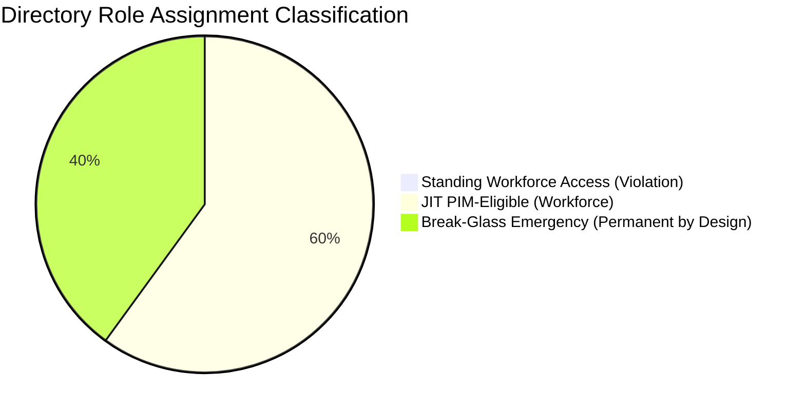

# Privileged Role Inventory & Zero Standing Access (ZSA) Audit Breakdown

**Tenant ID:** `<TENANT_ID_REDACTED>`  
**Tenant Domain:** `lab-entra-domain.onmicrosoft.com`  
**Standard:** NIST SP 800-207 (Zero Trust Architecture) / Microsoft Entra Privileged Access Benchmark  
**Last Verified:** October 16, 2026  

---

## 1. Executive Summary & Zero Standing Access Metrics

In an enterprise Microsoft Entra ID environment, **Zero Standing Access (ZSA)** refers to the elimination of persistent, unmonitored administrative permissions for human operators. All operational workforce administrative duties require Just-In-Time (JIT) elevation via Privileged Identity Management (PIM).

To ensure complete technical accuracy and avoid misleading audits:
- **Operational Workforce Standing Privileges:** **`0`** (100% Zero Standing Access achieved across all workforce engineers).
- **Emergency Disaster Recovery (Break-Glass) Accounts:** **`2`** (Permanent Active `Global Administrator` — strictly excluded from PIM by design per Microsoft Best Practice).
- **JIT Eligible Administrative Roles:** **`3`** (Managed via PIM with 4-hour max activation window, phishing-resistant MFA, and mandatory business justification).

---

## 2. Itemized Role Inventory Breakdown

### Table 1: Operational Workforce Administrative Access

| Principal | UPN | Role | Assignment Type | Max Duration | Step-Up Control | ZSA Compliance |
|---|---|---|---|---|---|---|
| **Alex Rivera** | `adm-alex@lab-entra-domain.onmicrosoft.com` | Conditional Access Administrator | **Eligible (PIM JIT)** | 4 Hours | Phishing-Resistant MFA (CAP-002) + Justification | **Compliant** |
| **Alex Rivera** | `adm-alex@lab-entra-domain.onmicrosoft.com` | Security Administrator | **Eligible (PIM JIT)** | 4 Hours | Phishing-Resistant MFA (CAP-002) + Justification | **Compliant** |
| **Lead Security Engineer** | `secops-lead@lab-entra-domain.onmicrosoft.com` | Security Operator / Auditor | **Eligible (PIM JIT)** | 4 Hours | Phishing-Resistant MFA (CAP-002) + Justification | **Compliant** |
| *All Other Workforce Users* | `@lab-entra-domain.onmicrosoft.com` | None (Standard User) | **None** | N/A | Baseline MFA (CAP-007) | **Compliant** |

> **Standing Workforce Roles Total: 0**  
> No engineer, developer, or IT administrator possesses permanent standing privileges on any directory role.

---

### Table 2: Emergency Break-Glass Accounts (Disaster Recovery)

| Account Name | UPN | Role | Assignment Type | Isolation & Storage | PIM Status | Security Controls |
|---|---|---|---|---|---|---|
| **Emergency Admin 01** | `emergency-admin-01@lab-entra-domain.onmicrosoft.com` | Global Administrator | **Permanent Active** | Physical Safe (Split Credential) | **Excluded by Design** | FIDO2 Hardware Key, Sentinel Alerting |
| **Emergency Admin 02** | `emergency-admin-02@lab-entra-domain.onmicrosoft.com` | Global Administrator | **Permanent Active** | Physical Safe (Split Credential) | **Excluded by Design** | FIDO2 Hardware Key, Sentinel Alerting |

> [!IMPORTANT]
> **Why Break-Glass Accounts Are Excluded From PIM:**  
> Per [Microsoft Entra Emergency Access Account Guidance](https://learn.microsoft.com/en-us/entra/identity/role-based-access-control/security-emergency-access), emergency accounts **must never be managed by Privileged Identity Management (PIM)** or subjected to Conditional Access MFA policies. If an identity outage, conditional access misconfiguration, or PIM control plane disruption occurs, administrators would be permanently locked out of the tenant.  
> 
> These 2 accounts are:
> 1. Cloud-only identities (`.onmicrosoft.com` root domain).
> 2. Documented and excluded from all tenant-wide Conditional Access lockouts via `SEC-BreakGlass-Exclusion`.
> 3. Monitored by continuous Sentinel / Microsoft Defender audit alerts on sign-in.

---

### Table 3: PIM Role Settings Policy Rules (`unifiedRoleManagementPolicyRules`)

The following activation constraints are verified across all Tier-0 / Tier-1 role definitions via `scripts/governance/configure_pim.ps1 -VerifyPolicyRules`:

| Rule Type | Scope | Parameter | Configured Value | Zero Trust Standard |
|---|---|---|---|---|
| **Expiration Rule** | Activation | Maximum Duration | `PT4H` (4 Hours) | NIST SP 800-207 Least Privilege |
| **Enablement Rule** | Activation | Require MultiFactorAuthentication | `True` (Enforced) | CAP-002 Phishing-Resistant MFA |
| **Enablement Rule** | Activation | Require Justification | `True` (Mandatory) | SOC 2 CC6.1 / ISO 27001 A.9 |
| **Enablement Rule** | Activation | Require Ticket Information | `True` (Mandatory) | Change Management Traceability |
| **Approval Rule** | Activation | Approver Requirement | `True` for Tier-0 (`Global Admin`) | Dual-Control Authorization |
| **Notification Rule** | Activation | Admin Notification Email | Security Operations (`SOC`) | Immediate Audit Awareness |

---

## 3. Audit Verification Summary

| Dimension | Raw Tenant Count | Architecturally Reconciled | Explanatory Reference |
|---|---|---|---|
| Active Assignments | 2 | 0 Standing Workforce Access | The 2 active assignments correspond strictly to Break-Glass disaster recovery accounts. |
| Eligible Assignments | 3 | 3 JIT PIM Elevations | Operational engineering access governed by PIM schedule instances. |
| Compliance Finding | Clean | **100% ZSA Compliant** | Verified by `scripts/governance/privileged_role_audit.ps1` with Break-Glass exemption logic. |
