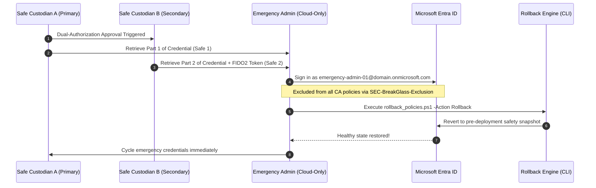

# Incident Response Playbook: Conditional Access Emergency Lockout Recovery

## Severity: CRITICAL
**Target Scenarios:**
- Misconfigured Conditional Access policy deployed in `enabled` mode that inadvertently blocks all corporate administrators.
- Identity Provider outage, network geo-blocking failure, or accidental exclusion omission.

---

## 1. Trigger Criteria & Assessment

- All administrative users attempting to sign into [entra.microsoft.com](https://entra.microsoft.com) receive HTTP 53003 / Conditional Access Block.
- Standard PIM JIT elevation fails due to session control or location restriction.

---

## 2. Emergency Recovery Procedure (Break-Glass Protocol)



### Step 1: Secure Credential Retrieval
1. Notify the Chief Information Security Officer (CISO) and Lead Security Architect.
2. Custodian A and Custodian B retrieve the dual split credentials from physical fireproof safes for `emergency-admin-01@<LAB_DOMAIN>`.

### Step 2: Sign-in via Emergency Exemption
1. Open a fresh InPrivate browser window on an isolated network.
2. Sign in to `https://entra.microsoft.com` using `emergency-admin-01@<LAB_DOMAIN>`.
3. Complete hardware FIDO2 security key authentication.
4. Because `emergency-admin-01` is a member of `SEC-BreakGlass-Exclusion`, it bypasses all 11 Conditional Access policies.

### Step 3: Automated Rollback via Identity-as-Code Engine
In PowerShell, restore the live directory from the latest immutable pre-deployment snapshot:
```powershell
.\scripts\deployment\rollback_policies.ps1 -Action List
.\scripts\deployment\rollback_policies.ps1 -Action Rollback -SnapshotId "<Latest-Snapshot-Timestamp>"
```

### Step 4: Post-Incident Break-Glass Credential Rotation
Following any break-glass account logon:
1. Generate new complex password credentials.
2. Re-split the credentials into physical safes.
3. Review `SigninLogs` and `AuditLogs` for all actions taken by `emergency-admin-01`.
