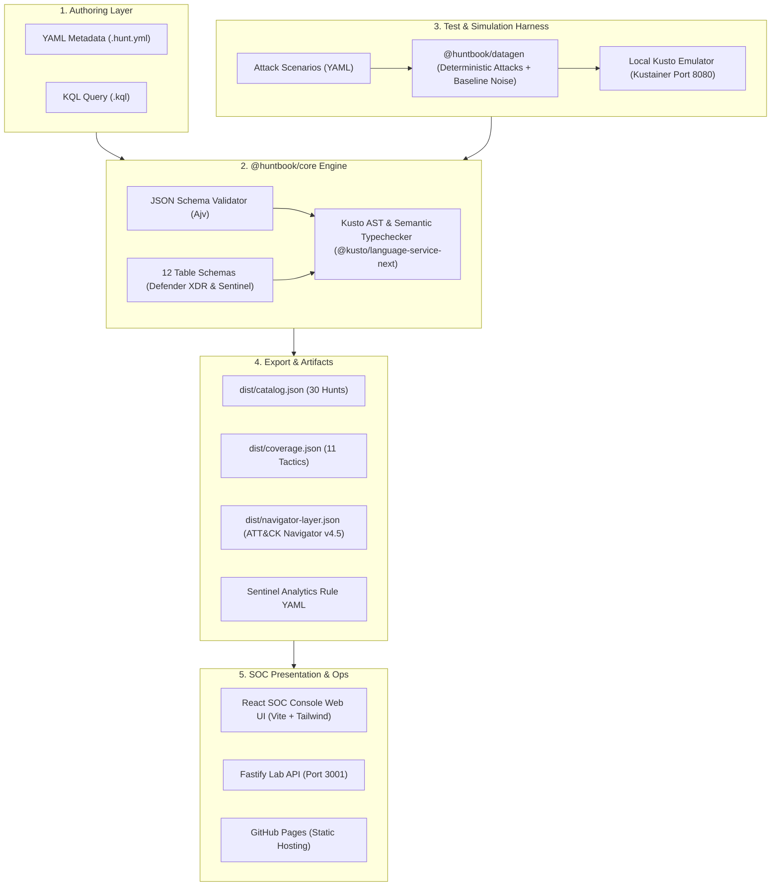

# HuntBook System Architecture & Detection-as-Code Pipeline

**Project:** HuntBook  
**Author:** Yogesh Thakur  
**Revision:** v1.0.0

---

## 1. Architectural Vision & Scope

HuntBook is an enterprise-grade Detection-as-Code platform for Microsoft Defender XDR and Microsoft Sentinel. It decouples threat hunting logic from proprietary console interfaces, bringing software engineering rigor (AST parsing, schema checking, automated synthetic testing, CI/CD) to detection engineering.



---

## 2. Monorepo Structure

```
KQL Threat Hunting/
├── packages/
│   ├── core/           # AST validation, schema loading, catalog & Sentinel exporters
│   ├── cli/            # Node CLI (huntbook validate, test, build, export, generate)
│   ├── datagen/        # Deterministic synthetic attack and baseline telemetry generator
│   ├── lab-api/        # Fastify service proxying Kusto emulator queries & datasets
│   └── web/            # SOC Console React 18 SPA (Vite + Tailwind CSS + Lucide)
├── hunts/              # 30 Detection-as-Code hunts (.hunt.yml + .kql)
├── schemas/            # hunt.schema.json, scenario.schema.json, and 12 table schemas
├── scenarios/          # Attack scenario definitions (password spray, phish, ransomware)
├── docs/               # Architecture, ADRs, hunt notes, demo script, interview FAQ
└── docker-compose.yml  # Local lab (Kustainer emulator + lab-api)
```

---

## 3. Abstract Syntax Tree (AST) & Semantic Verification

HuntBook executes Microsoft's official Kusto Language Parser (`@kusto/language-service-next`) in a pure Node.js headless runtime:

1. **Table Schema Registration:** 12 Microsoft table schemas (including `DeviceProcessEvents`, `SigninLogs`, `DeviceNetworkEvents`) are loaded. Column names and scalar types (`datetime`, `string`, `int`, `dynamic`) are translated into native Bridge.NET `Symbols.TableSymbol` instances.
2. **Database Context:** Tables are wrapped in a `Symbols.DatabaseSymbol` called `HuntBookDb` and injected into `GlobalState`.
3. **AST Traversal:** The KQL query is parsed into a syntax tree (`KustoCode.ParseAndAnalyze`).
4. **Diagnostic Analysis:** Any syntax error, non-existent column, type mismatch, or undeclared variable is collected into diagnostic messages. If any severity `Error` is present, the pipeline rejects the hunt.

---

## 4. Trust Boundaries & Security Model

- **No Remote Network Execution:** The CLI and core validator run 100% offline and do not send query text or telemetry to third parties.
- **Emulator Sandbox Isolation:** The local Kusto container runs isolated via Docker with no external database connections.
- **Lab API Safeguards:**
  - Fastify endpoint enforces a strict 10-second query timeout.
  - Limits returned rows to maximum 1,000.
  - Rejects administrative dot-commands (`.drop`, `.alter`, `.create`) to prevent emulator tampering.
- **Synthetic Telemetry Only:** HuntBook generates and tests exclusively on deterministic synthetic data. Zero customer or production data is ever stored or processed.

---

## 5. Continuous Integration & Deployment (CI/CD)

The GitHub Actions workflows (`.github/workflows/ci.yml` and `release.yml`):
- Run on push to `main` and Pull Requests.
- Execute `pnpm install`, `pnpm build`, `pnpm test`.
- Run `node packages/cli/dist/cli.js validate` (asserting 30/30 hunts pass).
- Run `node packages/cli/dist/cli.js build` (generating distribution JSON artifacts).
- Deploy `@huntbook/web` production static bundle to GitHub Pages automatically.

