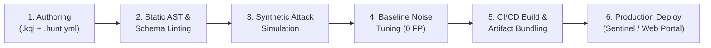

# Detection Engineering Masterclass: Building HuntBook from First Principles

**Project:** HuntBook (Detection-as-Code Library & Threat Hunting Lab)  
**Target Roles:** Detection Engineer, Lead Threat Hunter, Senior SOC Analyst, Security Architect  
**Author:** Yogesh Thakur  
**Version:** 1.0.0 (Production Guide)

---

## Table of Contents
1. [Pillar 1: The Detection-as-Code (DaC) Paradigm & Philosophy](#pillar-1-the-detection-as-code-dac-paradigm--philosophy)
2. [Pillar 2: KQL & The Kusto Execution Engine Internals](#pillar-2-kql--the-kusto-execution-engine-internals)
3. [Pillar 3: Microsoft Telemetry Architecture (Defender XDR vs Sentinel)](#pillar-3-microsoft-telemetry-architecture-defender-xdr-vs-sentinel)
4. [Pillar 4: Software Architecture & Technical Stack Deep-Dive](#pillar-4-software-architecture--technical-stack-deep-dive)
5. [Pillar 5: Step-by-Step Blueprint to Build It from Scratch](#pillar-5-step-by-step-blueprint-to-build-it-from-scratch)
6. [Pillar 6: How to Ace Senior / Lead Technical Interviews](#pillar-6-how-to-ace-senior--lead-technical-interviews)
7. [Pillar 7: Bridging the Gap: Syntactic vs. Operational Detection Validation](#pillar-7-bridging-the-gap-syntactic-vs-operational-detection-validation)

---

# Pillar 1: The Detection-as-Code (DaC) Paradigm & Philosophy

### 1. The Real-World SOC Problem: The "Wiki / Spreadsheet" Anti-Pattern
In traditional enterprise Security Operations Centers (SOCs), threat hunting queries and detection rules suffer from systemic engineering neglect:
- **Scattered Knowledge:** Queries live across personal OneNote tabs, private text documents, or browser bookmarks.
- **Silent Breakage:** When cloud providers update table schemas, deprecate column names, or change data types, hunting queries break silently. Teams only discover the failure after an incident is missed.
- **Alert Fatigue & Untested Deployments:** Rules are pushed directly into production SIEMs without baseline tuning, creating false-positive storms that burn out tier-1 triage analysts.
- **Lack of Governance:** No Git version control, peer review, pull requests, automated regression testing, or rollback mechanisms.

### 2. The Detection-as-Code Lifecycle
Detection-as-Code (DaC) treats detection rules and hunting hypotheses as first-class software products:



1. **Version Controlled Repository:** Every detection consists of a matched pair:
   - `<TechniqueID>-<slug>.kql`: Pure, optimized Kusto query logic.
   - `<TechniqueID>-<slug>.hunt.yml`: Structured metadata (MITRE ATT&CK mapping, threat hypothesis, required tables, tuning instructions, false positives, triage playbooks).
2. **Automated Static Analysis:** Every query is analyzed by an Abstract Syntax Tree (AST) parser in CI to ensure valid syntax and verify that referenced tables and columns exist in Microsoft schemas.
3. **Automated Regression Testing:** Detections are evaluated against deterministic synthetic attack telemetry (to guarantee true-positive detection) and against benign baseline noise (to ensure zero false alarms).
4. **The "Honesty Rule":** A detection can only claim the level of verification it has actually undergone:
   - `syntax`: AST and schema validated in CI.
   - `synthetic`: Verified against simulated attack data in a local emulator or test harness.
   - `tenant`: Verified against live telemetry in a real Microsoft Sentinel or Defender tenant.

---

# Pillar 2: KQL & The Kusto Execution Engine Internals

To write high-performance KQL, an engineer must understand how **Azure Data Explorer (ADX)**—the big-data engine powering Microsoft Sentinel and Defender XDR Advanced Hunting—executes queries.

```
┌─────────────────────────────────────────────────────────────┐
│                 Kusto Cluster Memory / Cache                │
│  ┌───────────────────────┐       ┌───────────────────────┐  │
│  │     Extent Shard 1    │       │     Extent Shard 2    │  │
│  │ MinUtc: 2026-11-01    │       │ MinUtc: 2026-11-03    │  │
│  │ MaxUtc: 2026-11-03    │       │ MaxUtc: 2026-11-05    │  │
│  │ [Columnar Data Store] │       │ [Columnar Data Store] │  │
│  │ [Inverted Term Index] │       │ [Inverted Term Index] │  │
│  └───────────────────────┘       └───────────────────────┘  │
└─────────────────────────────────────────────────────────────┘
```

### 1. Extents & Partition Pruning (The "Line 1 Rule")
- **Extents:** Kusto stores table data in immutable, compressed horizontal shards called **extents**. Each extent metadata tracks `MinUtcTime` and `MaxUtcTime`.
- **Partition Pruning:** When a query begins with a time filter:
  ```kql
  SigninLogs
  | where TimeGenerated > ago(7d)
  ```
  The Kusto query planner inspects extent headers and completely skips reading any extent files outside the requested window. If you apply string manipulations, regex, or joins *before* filtering on the time column, the engine must decompress and scan petabytes of data, causing CPU throttling, high query costs, or `E_MEMORY_LIMIT_EXCEEDED` errors.

### 2. Inverted Indexing: `has` vs `contains`
- **`has` (Indexed Term Match):** Kusto automatically creates an inverted index of alphanumeric tokens (words of 3+ characters). When matching:
  ```kql
  | where ProcessCommandLine has "powershell"
  ```
  Kusto looks up `"powershell"` directly in its inverted index in microseconds ($O(1)$ complexity).
- **`contains` (Sub-string Byte Scan):** `contains` performs an unindexed substring search equivalent to `LIKE '%powershell%'` in SQL. It bypasses the index and reads every byte in the column across millions of rows ($O(N)$ complexity).
- **Rule of Thumb:** Always use `has` or `has_any()`. Reserve `contains` solely for partial tokens, GUID fragments, or mid-string substrings.

### 3. Essential KQL Operators & Advanced Patterns

#### A. Parameterization with `let` Blocks
Keep parameters at the top of the file so analysts can tune search windows and thresholds without modifying core query logic:
```kql
let lookback = 24h;
let minConnections = 15;
let maxJitterRatio = 0.35;
```

#### B. Aggregation Operators: `summarize` & Advanced Functions
- `count()`: Total rows.
- `countif(predicate)`: Counts matching rows without requiring a prior `where` filter:
  ```kql
  | summarize 
      SuccessCount = countif(ResultType == "0"),
      FailureCount = countif(ResultType != "0")
      by UserPrincipalName
  ```
- `make_set(col, [maxSize])`: Returns a distinct array of values. Always provide `maxSize` to prevent unbounded array expansion.
- `arg_max(exprToMaximize, * | cols)`: Retrieves the exact row where an expression is highest while preserving all other column values, eliminating costly self-joins:
  ```kql
  DeviceInfo
  | summarize arg_max(Timestamp, OSPlatform, OSBuild) by DeviceName
  ```

#### C. Stateful Row-by-Row Windowing: `sort` + `serialize` + `prev()`
In SQL, comparing row $N$ to row $N-1$ requires complex self-joins. KQL handles this in linear $O(N)$ streaming time:
1. `sort by DeviceName asc, Timestamp asc` orders the records.
2. `serialize` instructs the Kusto engine to preserve the row order in memory.
3. `prev(col)` accesses the value from the preceding row.

**Flagship Example: Command & Control Periodic Beaconing Detection (Hunt `HB-C2-001`):**
```kql
DeviceNetworkEvents
| where Timestamp > ago(24h) and ActionType == "ConnectionSuccess"
| where not(ipv4_is_private(RemoteIP))
| project Timestamp, DeviceName, InitiatingProcessFileName, RemoteIP, RemotePort, RemoteUrl
| sort by DeviceName asc, InitiatingProcessFileName asc, RemoteIP asc, RemotePort asc, Timestamp asc
| serialize
| extend PrevDevice = prev(DeviceName),
         PrevProc = prev(InitiatingProcessFileName),
         PrevIP = prev(RemoteIP),
         PrevPort = prev(RemotePort),
         PrevTime = prev(Timestamp)
| extend TimeDelta = datetime_diff('second', Timestamp, PrevTime)
| where DeviceName == PrevDevice 
    and InitiatingProcessFileName == PrevProc 
    and RemoteIP == PrevIP 
    and RemotePort == PrevPort 
    and TimeDelta > 0
| summarize 
    FirstSeen = min(Timestamp),
    LastSeen = max(Timestamp),
    TotalConnections = count(),
    AvgDelta = avg(TimeDelta),
    StdDevDelta = stdev(TimeDelta),
    MinDelta = min(TimeDelta),
    MaxDelta = max(TimeDelta),
    RemoteUrls = make_set(RemoteUrl, 3)
    by DeviceName, InitiatingProcessFileName, RemoteIP, RemotePort
| where TotalConnections >= 15
| extend JitterRatio = iff(AvgDelta > 0, round(StdDevDelta / AvgDelta, 3), 1.0)
| where JitterRatio <= 0.35
```
- **The Mathematical Foundation:** The **Coefficient of Variation** ($CV = \frac{\sigma}{\mu}$) measures the dispersion of inter-arrival connection times. Benign human traffic exhibits high variation ($CV > 0.8$), while automated C2 implants (Cobalt Strike, Mythic, Sliver) maintain regular callbacks ($CV \le 0.35$).
> [!NOTE]
> Jitter thresholds ($0.35$ vs $0.80$) are **experimental heuristic parameters**, not universal constants. In production, they must be calibrated against specific endpoint application profiles and baseline noise datasets.
- **Process-Correlation Integrity:** Sorting and serializing per `(DeviceName, InitiatingProcessFileName, RemoteIP, RemotePort)` ensures that distinct processes connecting to the same destination on the same host do not interleave or corrupt each other's inter-arrival intervals.

#### D. Dynamic / JSON Parsing
Dynamic columns (e.g. `AdditionalFields`, `LocationDetails`, `Properties`) store nested JSON:
```kql
// Dot notation
| extend ConsumerName = tostring(AdditionalFields.ConsumerName)

// Array indexing
| extend FileExtension = tostring(split(FileName, ".")[-1])

// Case branching
| extend Classification = case(
    SuccessCount > 0 and FailureCount > 20, "Compromise Likely",
    FailureCount > 20, "Probing Only",
    "Benign"
)
```

---

# Pillar 3: Microsoft Telemetry Architecture (Defender XDR vs Sentinel)

```
                    ┌────────────────────────────────────────┐
                    │       Microsoft Unified Security       │
                    └───────────────────┬────────────────────┘
                                        │
           ┌────────────────────────────┴────────────────────────────┐
           ▼                                                         ▼
┌──────────────────────────────────────┐  ┌──────────────────────────────────────┐
│       Microsoft Sentinel (SIEM)      │  │      Microsoft Defender XDR (XDR)    │
│  • Azure Monitor / Log Analytics     │  │  • Defender for Endpoint (MDE)       │
│  • Multi-cloud, Entra ID, SaaS, ARM  │  │  • Defender for Office 365 (MDO)     │
│  • Primary time column:              │  │  • Primary time column:              │
│    TimeGenerated                     │  │    Timestamp                         │
└──────────────────────────────────────┘  └──────────────────────────────────────┘
```

### Table Reference Cheat Sheet

| Platform | Table Name | Time Column | Purpose / Telemetry Captured | Key Columns |
| :--- | :--- | :--- | :--- | :--- |
| **Sentinel** | `SigninLogs` | `TimeGenerated` | Entra ID (Azure AD) user authentication | `UserPrincipalName`, `IPAddress`, `ResultType`, `RiskDetail` |
| **Sentinel** | `AuditLogs` | `TimeGenerated` | Entra ID directory modifications & admin changes | `OperationName`, `TargetResources`, `InitiatedBy` |
| **Sentinel** | `AzureActivity` | `TimeGenerated` | Azure Resource Manager (ARM) control plane | `OperationNameValue`, `ActivityStatusValue`, `Caller` |
| **Defender** | `DeviceProcessEvents`| `Timestamp` | Process creation, command lines, hashes | `FileName`, `ProcessCommandLine`, `InitiatingProcessFileName` |
| **Defender** | `DeviceNetworkEvents`| `Timestamp` | Outbound/inbound TCP/UDP network connections | `RemoteIP`, `RemotePort`, `RemoteUrl`, `InitiatingProcessFileName` |
| **Defender** | `DeviceFileEvents` | `Timestamp` | File creation, modification, deletion, rename | `ActionType`, `FileName`, `PreviousFileName`, `FolderPath` |
| **Defender** | `DeviceRegistryEvents`| `Timestamp` | Registry key creation, modification, deletion | `ActionType`, `RegistryKey`, `RegistryValueName`, `RegistryValueData` |
| **Defender** | `DeviceEvents` | `Timestamp` | Endpoint security events (LSASS access, WMI) | `ActionType`, `AdditionalFields`, `InitiatingProcessCommandLine` |
| **Defender** | `DeviceLogonEvents` | `Timestamp` | OS-level logons (Interactive, RDP, Network) | `LogonType`, `AccountName`, `RemoteIP` |
| **Defender** | `CloudAppEvents` | `Timestamp` | Defender for Cloud Apps / M365 activity | `ActionType`, `AccountDisplayName`, `RawEventData` |
| **Defender** | `EmailAttachmentInfo`| `Timestamp` | Inbound emails and attachment metadata | `SenderFromAddress`, `FileName`, `FileType`, `SHA256` |
| **Defender** | `UrlClickEvents` | `Timestamp` | Safe Links clicks and user navigation actions | `Url`, `AccountUpn`, `ActionType` |

---

# Pillar 4: Software Architecture & Technical Stack Deep-Dive

HuntBook is engineered as a TypeScript 5.x monorepo orchestrated with `pnpm workspaces`:

```
HuntBook Monorepo (pnpm workspaces)
├── packages/
│   ├── core/           # Kusto AST Engine, Ajv Validators, Sentinel Exporter
│   ├── cli/            # Commander CLI (validate, test, build, export, generate)
│   ├── datagen/        # Deterministic Attack Graph + Baseline Noise Generator
│   ├── lab-api/        # Fastify Microservice (Proxying Kusto Emulator queries)
│   └── web/            # React 18 + Vite + Tailwind CSS SOC Web Console
├── hunts/              # 30 Detection-as-Code Hunt Pairs (.kql + .hunt.yml)
├── schemas/            # hunt.schema.json, scenario.schema.json, 12 table schemas
├── scenarios/          # Multi-stage Attack Stories (YAML)
└── docker-compose.yml  # Kusto emulator container (kustainer-linux)
```

### 1. Headless Kusto AST & Semantic Engine in Node.js
Microsoft's `@kusto/language-service-next` compiles C# Kusto language parsers into JavaScript using Bridge.NET. Running it headlessly in Node.js requires initializing the Bridge environment:

```typescript
// packages/core/src/kusto-engine.ts
// 1. Load Bridge.NET runtime globals before Kusto Bridge module
const bridgePath = require.resolve('@kusto/language-service-next/bridge.min.js');
require(bridgePath);

// 2. Load the C#-compiled Kusto language runtime
const kustoBridgePath = require.resolve('@kusto/language-service-next/Kusto.Language.Bridge.min.js');
const Kusto = require(kustoBridgePath);

// 3. Register table schemas into Kusto GlobalState
const symbols = Kusto.Kusto.Language.Symbols;
const tableSymbols = schemas.map(schema => {
  const colSymbols = schema.columns.map(col => {
    const scalarType = getKustoScalarType(col.type); // map 'string' -> symbols.ScalarTypes.String
    return new symbols.ColumnSymbol.$ctor1(col.name, scalarType);
  });
  return new symbols.TableSymbol.$ctor4(schema.name, colSymbols);
});

// 4. Parse query and inspect AST for syntax and semantic diagnostics
const db = new symbols.DatabaseSymbol.ctor("HuntBookDb", tableSymbols);
const globals = symbols.GlobalState.Default.WithDatabase(db);
const code = Kusto.Kusto.Language.KustoCode.ParseAndAnalyze(queryText, globals);
const diagnostics = code.GetDiagnostics();
```

### 2. Deterministic Attack & Baseline Telemetry Generation
- **Seedable PRNG:** Using Mulberry32 so generator runs output identical, reproducible timestamps and GUIDs across environments.
- **Attack Graphs:** Scenarios define multi-stage attack chains (password spray $\rightarrow$ mailbox rule; phishing $\rightarrow$ PowerShell $\rightarrow$ persistence; ransomware precursor $\rightarrow$ recovery disable $\rightarrow$ encryption).
- **Benign Baseline Noise:** Queries are evaluated against thousands of legitimate background events (e.g. standard developer builds, SCCM updates, routine admin sessions) to ensure zero false positives.

### 3. Lab API & Security Guardrails
When executing user-submitted queries against the local Kusto emulator:
- **10-Second Execution Timeout:** Prevents queries with Cartesian joins from exhausting container CPU.
- **Row Clamping:** Limits returned results to a maximum of 1,000 rows.
- **Dot-Command Injection Guard:** Blocks administrative commands (`.drop`, `.alter`, `.create`) before sending queries to Kusto.

---

# Pillar 5: Step-by-Step Blueprint to Build It from Scratch

If you were rebuilding HuntBook from scratch, follow this phased implementation order:

### Phase 0: Foundations & Spikes
1. Initialize repository with `pnpm init` and configure `pnpm-workspace.yaml`.
2. Configure `tsconfig.base.json` (`target: ES2022`, `moduleResolution: NodeNext`, `strict: true`).
3. Author Architecture Decision Records (ADRs) in `docs/adr/` to lock tech decisions early.
4. Run proof-of-concept spikes verifying `@kusto/language-service-next` AST parsing in Node.js and validating the local Kusto emulator (`kustainer-linux`).

### Phase 1: Content MVP & Static Validation
1. Author `schemas/hunt.schema.json` using JSON Schema Draft-07.
2. Author JSON schemas for the 12 Microsoft Defender and Sentinel tables under `schemas/tables/`.
3. In `packages/core`, implement `schema-loader.ts`, `kusto-engine.ts`, and `metadata-validator.ts`.
4. In `packages/cli`, build the `huntbook validate` command.

### Phase 2: Test Harness & Synthetic Data
1. Author `schemas/scenario.schema.json` and create attack scenarios in `scenarios/`.
2. Build `@huntbook/datagen` with seedable PRNG to produce attack graphs and baseline noise.
3. Configure `docker-compose.yml` for Kusto emulator execution.
4. Implement `huntbook generate` and `huntbook test` (evaluating `min_rows`, `max_rows`, and `contains` assertions).

### Phase 3: Catalog, Coverage & Exporters
1. In `packages/core`, build `catalog-builder.ts` generating `dist/catalog.json`.
2. Build `coverage-engine.ts` generating `dist/coverage.json` and `dist/navigator-layer.json` for MITRE ATT&CK Navigator v4.5.
3. Build `sentinel-exporter.ts` to export hunts into Azure Resource Manager (ARM) Sentinel Scheduled Alert Rule YAML templates.

### Phase 4: Web UI SOC Console
1. Scaffold `packages/web` using React 18, Vite, Tailwind CSS, and Lucide icons.
2. Design SOC dark mode tokens (`#0B0F14`, `#111821`, `#243040`, `#3B82F6`).
3. Build 7 core screens: Overview, Catalog, Hunt Detail, Coverage Heatmap, Scenarios, Validation Status, About.
4. Add Command Palette (`Ctrl+K`) modal and an embedded Monaco Editor for query inspection.

### Phase 5: Lab Mode Runtime
1. Build `packages/lab-api` Fastify service with endpoints (`GET /health`, `GET /datasets`, `POST /datasets/:id/load`, `POST /run`).
2. Add query execution timeout (10s), row limit (1,000), and block administrative dot-commands.
3. Wire the Web UI "Run in Lab" button to the Lab API with graceful fallback warnings.

### Phase 6: Polish, 30 Hunts & Interview Kit
1. Expand hunt library to 30 hunts covering all 8 domain areas.
2. Ensure 100% test pass rate across all hunts and scenarios.
3. Author flagship hunt engineering notes, 3-minute demo script, top 10 technical interview FAQ, and system architecture docs.

---

# Pillar 6: How to Ace Senior / Lead Technical Interviews

### 1. The 3-Minute Elevator Pitch
> *"Most SOCs manage threat hunting queries haphazardly—they live in personal notes, break silently when Microsoft updates schemas, and flood tier-1 analysts with false positives.
>
> I designed and built **HuntBook**, an enterprise Detection-as-Code framework containing 30 production hunts for Microsoft Defender XDR and Sentinel.
>
> What sets HuntBook apart is software engineering rigor: every KQL query is parsed into an Abstract Syntax Tree in our CI pipeline using Microsoft's official language service, verifying column existence and semantic types against 12 Microsoft table schemas. We test our queries against deterministic synthetic attack graphs and high-volume baseline noise to prove zero false-positive rates before deployment.
>
> Everything compiles to a React SOC Console, exports 1-click Sentinel analytics rules, and maps dynamically to MITRE ATT&CK Navigator v4.5."*

### 2. High-Yield Interview Questions & Tactical Answers

#### Q: "Why did you build this in TypeScript instead of Python?"
> **Answer:** *"In modern detection engineering, consistency and static type safety matter. Microsoft’s official Kusto language parser (`@kusto/language-service-next`) and Monaco editor are natively written for JavaScript/TypeScript. By staying in a pure TypeScript monorepo, we could run identical AST semantic verification in both our Node.js CI validator and our browser-based SOC console, without maintaining brittle Python bindings or running external microservices."*

#### Q: "How does your C2 beaconing hunt handle jitter without ML?"
> **Answer:** *"Machine learning models are black boxes that SOC analysts cannot easily debug or tune during an incident. Instead, our hunt `HB-C2-001` uses pure statistical dispersion in KQL. Using `sort`, `serialize`, and `prev()`, we calculate the inter-arrival time deltas between consecutive connections in linear time. We then compute the **Coefficient of Variation**—standard deviation divided by mean delta. While benign browsing has high variation ($CV > 0.8$), C2 frameworks like Cobalt Strike have tight jitter ($CV \le 0.35$). It runs in sub-second time directly inside Kusto without needing external Python or R plugins."*

#### Q: "What is your philosophy on false positives and tuning?"
> **Answer:** *"In our framework, every hunt has a dedicated `tuning` and `false_positives` section in its metadata schema. For example, in our password spray hunt (`HB-ID-001`), legitimate enterprise VPN gateways or proxy NATs will fail authentication across multiple users. Rather than simply raising the threshold—which lets slow-and-low attacks slip through—we tune by requiring a subsequent successful sign-in (`ResultType == 0`) and calculating the ratio of distinct target accounts to total attempts, excluding internal corporate egress CIDRs using `ipv4_is_private()`."*

---

# Pillar 7: Bridging the Gap: Syntactic vs. Operational Detection Validation

A critical insight that separates a junior query author from a senior Detection Engineer or Threat Hunter is recognizing the boundary between **syntactic/semantic correctness** and **operational telemetry resilience**:

```
┌─────────────────────────────────────────────────────────────┐
│                 Detection Engineering Layers                │
│                                                             │
│  [ Layer 1: Syntactic Validity ]                            │
│  • Does the query follow KQL grammar?                       │
│  • Validated by: Static AST Lexer & Parser                  │
│                                                             │
│  [ Layer 2: Semantic Type Checking ]                        │
│  • Do the table names and column names exist?               │
│  • Are scalar types compatible with functions used?         │
│  • Validated by: @kusto/language-service-next Symbol Engine │
│                                                             │
│  [ Layer 3: Operational Telemetry Resilience ]              │
│  • Are dynamic JSON properties reliably populated?          │
│  • Does logic survive schema variations across OS builds?   │
│  • Does sequence correlation handle sliding windows?        │
│  • Validated by: Defensive Extraction + Synthetic Harness  │
└─────────────────────────────────────────────────────────────┘
```

### 1. The Dynamic Field Fragility Problem
A static AST parser guarantees that `DeviceEvents.AdditionalFields` or `AuditLogs.TargetResources` is a valid `dynamic` column. However, it cannot guarantee that:
- `AdditionalFields.ServiceFileName` is always present (in some Windows builds it is emitted as `ImagePath` or in `FileName`).
- `TargetResources[0].modifiedProperties[0]` actually contains the OAuth scope (the 0th element might be `ConsentType` or `AppId`).

#### Defensive KQL Solution: Coalesced Dynamic Extraction
Never rely on fragile single-property or fixed-index assumptions:
```kql
// Fragile: Fails silently if Defender names the property ImagePath
| extend ServiceBinary = tostring(AdditionalFields.ServiceFileName)

// Resilient: Coalesces multiple possible emitter schemas across OS builds
| extend ServiceBinary = coalesce(
    tostring(AdditionalFields.ServiceFileName),
    tostring(AdditionalFields.ImagePath),
    FileName
)
```

### 2. Sequence Correlation vs. Naive Fixed-Window Binning
Grouping failures and successes into the same fixed time bucket (`bin(TimeGenerated, 1h)`) introduces a classic detection blind spot:
- An attacker sends 15 brute-force attempts from `11:50` to `11:59` (Bucket 1).
- The attacker successfully logs in at `12:01` (Bucket 2).
- **Result:** The fixed-window hunt fails to correlate the event because the failure burst and the successful login fell into separate buckets!

#### Chronological Sequence Correlation Pattern:
Always correlate failure clusters with subsequent successes over a sliding follow-up window:
```kql
let BruteForceFailures = SigninLogs
| where TimeGenerated > ago(1d) and ResultType in ("50126", "50053")
| summarize FailureCount = count(), LastFailure = max(TimeGenerated), FailureIPs = make_set(IPAddress, 5)
    by UserPrincipalName, bin(TimeGenerated, 1h)
| where FailureCount >= 10;
let SuccessfulLogins = SigninLogs
| where TimeGenerated > ago(1d) and ResultType == "0"
| project SuccessTime = TimeGenerated, UserPrincipalName, SuccessIP = IPAddress;
BruteForceFailures
| join kind=inner (SuccessfulLogins) on UserPrincipalName
| where SuccessTime between (LastFailure .. (LastFailure + 2h))
| extend SuccessFromAttackIP = set_has_element(FailureIPs, SuccessIP)
```

### 3. Geodesic Calculations vs. Naive String Matching
Comparing raw string labels (`Location != PrevLocation`) flags normal office-to-home transitions or adjacent city ISP changes. Real impossible travel detection requires:
1. Extracting latitude and longitude from `LocationDetails.geoCoordinates`.
2. Calculating geodesic physical distance via `geo_distance_2points(Lat1, Lon1, Lat2, Lon2)`.
3. Calculating implied travel velocity:
   $$\text{Velocity (km/h)} = \frac{\text{Distance (km)}}{\Delta t \text{ (hours)}}$$
4. Requiring velocity $> 800\text{ km/h}$ (faster than a commercial aircraft), while incorporating VPN/proxy gateway watchlist exclusions.

### 4. Behavioral Indicators vs. Absolute Proof
In ransomware detection, renaming hundreds of files is an urgent **behavioral indicator**, not absolute proof of encryption. Legitimate applications (e.g. compilers renaming `.tmp` $\rightarrow$ `.obj`, backup software, or cloud synchronization engines) alter file extensions regularly.
Senior detection engineering pairs behavioral heuristics (extension churn) with:
- Target document specificity: previous extension must be a document (`.docx`, `.xlsx`, `.pdf`).
- Known ransomware extension lists (`.locked`, `.lockbit`, `.crypted`).
- Precursor correlation: Volume Shadow Copy deletion (`vssadmin delete shadows`) or boot recovery tampering (`bcdedit /set {default} recoveryenabled no`).


