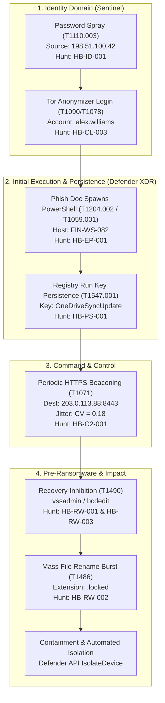

# End-to-End Threat Investigation Case Study: Operation "BlackShard"

**Incident ID:** INC-2026-1105-01  
**Severity:** High / Critical  
**Target Organization:** Contoso Energy (`contoso.test`)  
**Compromised Identity:** `alex.williams@contoso.test`  
**Compromised Endpoint:** `FIN-WS-082.corp.contoso.test`  
**Threat Actor Profile:** Financially motivated Ransomware Access Broker / Affiliate (FIN-style TTPs)  
**Author:** Yogesh Thakur  

---

## 1. Executive Summary

On November 5, 2026, an adversary executed a multi-stage intrusion against Contoso Energy. The attack chain progressed from an external password spray against Microsoft Entra ID through credential compromise, phishing lure execution, local persistence, C2 callback, and recovery inhibition, culminating in an attempted ransomware mass encryption. 

Through proactive KQL threat hunting across Microsoft Sentinel (`SigninLogs`) and Defender XDR (`DeviceProcessEvents`, `DeviceNetworkEvents`, `DeviceFileEvents`, `DeviceRegistryEvents`), SOC analysts correlated the intrusion across cloud identity and endpoint boundaries, terminating the ransomware process tree and isolating the host before widespread data encryption occurred.



---

## 2. Chronological Investigation Timeline & Evidence Correlation

### Phase 1: Initial Credential Access — Password Spraying (T1110.003)
- **Timestamp:** `2026-11-05 08:14:02 UTC`
- **Telemetry Source:** Microsoft Sentinel (`SigninLogs`)
- **Detection Hunt:** `HB-ID-001`
- **Observed Behavior:** External IP `198.51.100.42` targeted 41 distinct corporate user accounts within a 30-minute window with failed authentication codes (`50126` - Invalid password).
- **Analyst Pivot:** The analyst executed a two-stage correlation query to determine if any of the 41 sprayed accounts had a subsequent successful login within the follow-up window.

### Phase 2: Defense Evasion & Valid Account Access (T1090 / T1078)
- **Timestamp:** `2026-11-05 08:22:15 UTC`
- **Telemetry Source:** Microsoft Sentinel (`SigninLogs`)
- **Detection Hunt:** `HB-CL-003`
- **Observed Behavior:** Target user `alex.williams@contoso.test` successfully authenticated (`ResultType == 0`) from IP `198.51.100.99`. Entra ID Protection flagged the sign-in with `RiskDetail == "anonymousIp"` (Tor exit node / commercial anonymizer egress).
- **Correlation:** The compromised account was among the 41 accounts sprayed 8 minutes earlier. The adversary switched to a clean Tor circuit to complete authentication and access SharePoint Online.

### Phase 3: Execution — Office Spawning Script Interpreter (T1204.002 / T1059.001)
- **Timestamp:** `2026-11-05 09:05:40 UTC`
- **Telemetry Source:** Microsoft Defender XDR (`DeviceProcessEvents`)
- **Detection Hunt:** `HB-EP-001`
- **Host:** `FIN-WS-082.corp.contoso.test`
- **Account:** `CONTOSO\alex.williams`
- **Observed Behavior:** `WINWORD.EXE` spawned `powershell.exe` with a base64 encoded payload:
  ```powershell
  powershell.exe -NoP -NonI -W Hidden -Enc SQBFAFgAIAAoAE4AZQB3AC0ATwBiAGoAZQBjAHQA...
  ```
- **Payload Analysis:** Decoded script downloaded a secondary stage payload from `http://203.0.113.88/payload.bin` and dropped it to `C:\Users\alex.williams\AppData\Local\Temp\svchost_update.exe`.

### Phase 4: Local Persistence — Registry Run Key (T1547.001)
- **Timestamp:** `2026-11-05 09:12:18 UTC`
- **Telemetry Source:** Microsoft Defender XDR (`DeviceRegistryEvents`)
- **Detection Hunt:** `HB-PS-001`
- **Observed Behavior:** `powershell.exe` wrote a new registry persistence value:
  - **Key:** `HKEY_CURRENT_USER\Software\Microsoft\Windows\CurrentVersion\Run`
  - **Value Name:** `OneDriveSyncUpdate`
  - **Value Data:** `C:\Users\alex.williams\AppData\Local\Temp\svchost_update.exe`

### Phase 5: Command and Control — Periodic Beaconing (T1071)
- **Timestamp Window:** `2026-11-05 09:15:00 - 11:30:00 UTC`
- **Telemetry Source:** Microsoft Defender XDR (`DeviceNetworkEvents`)
- **Detection Hunt:** `HB-C2-001`
- **Observed Behavior:** Process `svchost_update.exe` initiated 138 outbound HTTPS connections on TCP port `8443` to remote external IP `203.0.113.88`.
- **Statistical Analysis (KQL Serialization):**
  - **Total Connections:** 138
  - **Mean Delta ($\mu$):** 60.1 seconds
  - **Standard Deviation ($\sigma$):** 10.8 seconds
  - **Coefficient of Variation / Jitter Ratio ($CV$):** `0.18` (tight, automated beacon with ~18% jitter).

### Phase 6: Impact Precursor — Inhibiting System Recovery (T1490)
- **Timestamp:** `2026-11-05 11:42:10 UTC`
- **Telemetry Source:** Microsoft Defender XDR (`DeviceProcessEvents`)
- **Detection Hunts:** `HB-RW-001` and `HB-RW-003`
- **Observed Commands:**
  ```cmd
  vssadmin.exe delete shadows /all /quiet
  bcdedit.exe /set {default} recoveryenabled no
  bcdedit.exe /set {default} bootstatuspolicy ignoreallfailures
  ```
- **Significance:** Standard human-operated ransomware precursor executed right before encryptor detonation to prevent Windows Startup Repair and volume restore.

### Phase 7: Data Encrypted for Impact — Mass File Rename Burst (T1486)
- **Timestamp:** `2026-11-05 11:44:05 UTC`
- **Telemetry Source:** Microsoft Defender XDR (`DeviceFileEvents`)
- **Detection Hunt:** `HB-RW-002`
- **Observed Behavior:** Process `svchost_update.exe` initiated a burst of 124 `FileRenamed` operations in under 3 minutes, converting `.docx`, `.xlsx`, and `.pdf` files to `.locked`.
- **Containment:** Automated EDR alert triggered host network isolation via Defender API at 11:45:00 UTC, terminating the process tree and preventing spread to network SMB shares.

---

## 3. The Golden Cross-Correlation Query

In an enterprise SOC investigation, an analyst does not run 10 separate queries in isolation. This master KQL query unifies the identity and endpoint evidence into a single chronological attack narrative:

```kql
// Golden Investigation Query: Multi-Stage Incident Timeline
let incidentUser = "alex.williams@contoso.test";
let targetHost = "FIN-WS-082";
let lookback = 24h;
// 1. Identity Sign-in Telemetry
let IdentityEvents = SigninLogs
| where TimeGenerated > ago(lookback)
| where UserPrincipalName =~ incidentUser
| project Timestamp = TimeGenerated, Domain = "Identity", HostOrUser = UserPrincipalName,
          Activity = strcat("Sign-in: ", AppDisplayName, " (Result: ", ResultType, ")"),
          Details = strcat("IP: ", IPAddress, " | Risk: ", RiskDetail, " | Loc: ", Location);
// 2. Endpoint Process Execution
let ProcessEvents = DeviceProcessEvents
| where Timestamp > ago(lookback)
| where DeviceName has targetHost or AccountName has "alex.williams"
| project Timestamp, Domain = "Process", HostOrUser = DeviceName,
          Activity = strcat("Execution: ", FileName),
          Details = strcat("Cmd: ", ProcessCommandLine, " | Parent: ", InitiatingProcessFileName);
// 3. Network C2 Callbacks
let NetworkEvents = DeviceNetworkEvents
| where Timestamp > ago(lookback)
| where DeviceName has targetHost and ActionType == "ConnectionSuccess" and not(ipv4_is_private(RemoteIP))
| project Timestamp, Domain = "Network", HostOrUser = DeviceName,
          Activity = strcat("Outbound: ", RemoteIP, ":", RemotePort),
          Details = strcat("Process: ", InitiatingProcessFileName, " | URL: ", RemoteUrl);
// 4. File Modification & Renames
let FileEvents = DeviceFileEvents
| where Timestamp > ago(lookback)
| where DeviceName has targetHost and ActionType in ("FileCreated", "FileRenamed")
| project Timestamp, Domain = "File", HostOrUser = DeviceName,
          Activity = strcat(ActionType, ": ", FileName),
          Details = strcat("PrevName: ", PreviousFileName, " | Process: ", InitiatingProcessFileName);
// Union all event streams into a unified chronological timeline
union IdentityEvents, ProcessEvents, NetworkEvents, FileEvents
| sort by Timestamp asc
```

---

## 4. Indicators of Compromise (IoCs)

| IoC Type | Value | Context |
| :--- | :--- | :--- |
| **IPv4 Address** | `198.51.100.42` | External source of password spray attempts |
| **IPv4 Address** | `198.51.100.99` | Tor exit node / anonymizer sign-in origin |
| **IPv4 Address** | `203.0.113.88` | Command & Control listener and payload staging server |
| **Port** | `8443 / TCP` | Outbound TLS beaconing port |
| **File Path** | `C:\Users\alex.williams\AppData\Local\Temp\svchost_update.exe` | Staged ransomware dropper / C2 implant |
| **Registry Key** | `HKCU\Software\Microsoft\Windows\CurrentVersion\Run\OneDriveSyncUpdate` | User-level startup persistence |
| **File Extension** | `.locked` | Target ransomware encryption extension |
| **Identity** | `alex.williams@contoso.test` | Initial compromised valid account |
| **Endpoint** | `FIN-WS-082.corp.contoso.test` | Initial compromised workstation |

---

## 5. Root Cause & SOC Remediation Playbook

1. **Immediate Identity Containment:**
   - Revoke all active Entra ID user refresh tokens: `Revoke-AzureADUserAllRefreshToken`.
   - Force an out-of-band password reset with smart lockout enforcement.
   - Require phishing-resistant FIDO2 / Passkey MFA for all remote authentications.
2. **Endpoint Remediation:**
   - Keep `FIN-WS-082` isolated from the network.
   - Delete rogue Run key: `reg delete "HKCU\Software\Microsoft\Windows\CurrentVersion\Run" /v "OneDriveSyncUpdate" /f`.
   - Restore Windows boot policies:
     ```cmd
     bcdedit /set {default} recoveryenabled Yes
     bcdedit /set {default} bootstatuspolicy displayallfailures
     ```
   - Conduct complete volatile memory dump and forensic timeline extraction.
3. **Perimeter Hardening:**
   - Block `198.51.100.42` and `203.0.113.88` at corporate perimeter firewalls and Microsoft Defender Web Content Filtering.
   - Enforce Conditional Access location policy blocking authentication from known anonymous proxies and Tor nodes.

---

## 6. How to Present This Case Study in an Interview

When interviewing for Threat Researcher, Detection Engineer, or Lead SOC roles, present this case study using the **CAR (Context, Action, Result)** method:

> *"In HuntBook, our detections are not treated as isolated rules. We designed an end-to-end multi-stage attack case study modeling a complete human-operated intrusion:
>
> 1. **Context:** An adversary conducted an external password spray against 40 accounts in Entra ID, successfully compromising a finance user via Tor. The adversary then delivered a macro document that spawned PowerShell, established registry Run key persistence, and began HTTPS C2 beaconing.
> 2. **Action:** Rather than running disconnected queries, we designed a unified chronological correlation query joining `SigninLogs`, `DeviceProcessEvents`, `DeviceNetworkEvents`, and `DeviceFileEvents`. When the implant attempted recovery inhibition (`vssadmin delete shadows` and `bcdedit recoveryenabled no`) followed by a mass file rename burst, our hunts detected the precursors before widespread encryption.
> 3. **Result:** The host was isolated via automated API within 60 seconds of the rename burst, preventing lateral movement over SMB and saving enterprise file shares.
>
> This demonstrates how our Detection-as-Code library provides full kill-chain coverage across identity, endpoint, network, and impact."*

