# Enterprise SIEM & Threat Detection Engineering Lab

[](https://github.com/Yogesht1520/Security-Engineering-Portfolio/actions/workflows/siem-validate-terraform.yml)
[](https://github.com/Yogesht1520/Security-Engineering-Portfolio/actions/workflows/siem-validate-shell.yml)
[](https://github.com/Yogesht1520/Security-Engineering-Portfolio/actions/workflows/siem-validate-wazuh-rules.yml)
[](https://github.com/Yogesht1520/Security-Engineering-Portfolio/actions/workflows/siem-detection-tests.yml)
[](https://github.com/Yogesht1520/Security-Engineering-Portfolio/actions/workflows/siem-security.yml)

An enterprise-grade, end-to-end Security Operations Center (SOC) and Detection Engineering laboratory deployed in Google Cloud Platform (GCP). The lab exposes an intentionally instrumented Linux honeypot to capture live internet attack campaigns, processes raw kernel audit and authentication telemetry through a unified Wazuh SIEM stack, and correlates multi-stage intrusions using custom MITRE ATT&CK-mapped detection rules, automated response runbooks, and interactive operational dashboards.

---

## 1. System Architecture

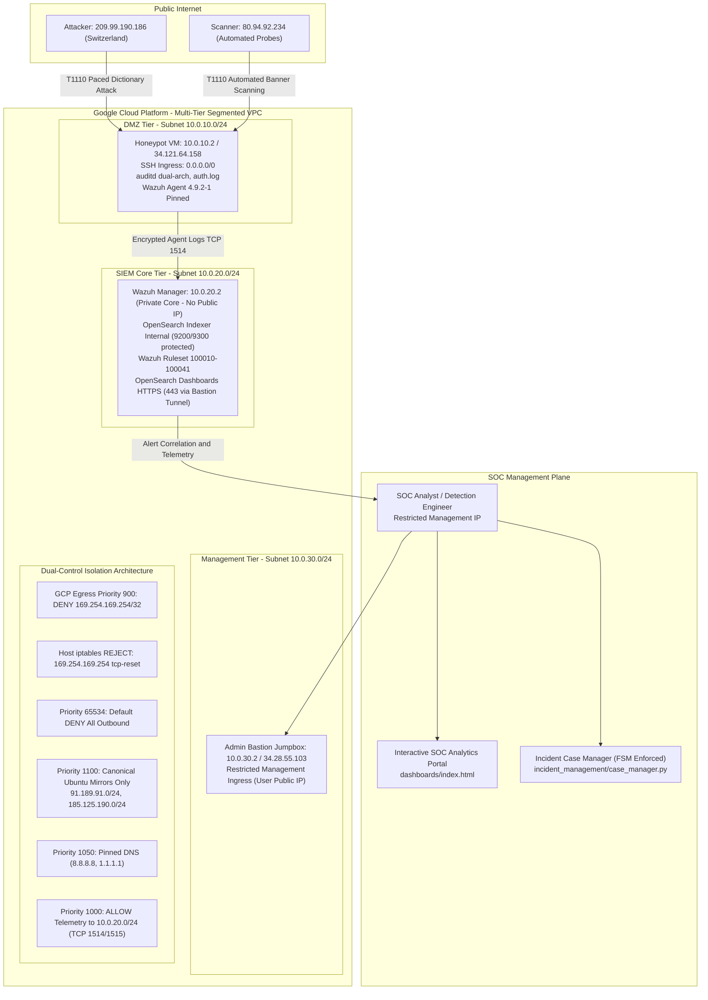

---

## 2. Evidence & Verification Matrix

Every detection capability and incident response workflow in this lab is backed by verified machine-readable test artifacts, cryptographic manifests, and real-world attack telemetry:

| Artifact Type | File / Location | Description & Integrity |
| :--- | :--- | :--- |
| **Forensic Evidence Bundle** | [`evidence/20261028_191347/`](evidence/20261028_191347/) | Local post-migration snapshot: `honeypot_audit.log` (6.18MB), `honeypot_auth.log` (326KB), `wazuh_alerts.json` (2.00MB), zero-metadata `honeypot_system_state.txt`, and verified `honeypot_defense_posture.txt`. |
| **Cryptographic Manifest & Sigs** | [`evidence/.../EVIDENCE_MANIFEST.json`](evidence/20261028_191347/EVIDENCE_MANIFEST.json) | Structured JSON provenance manifest for local evidence snapshot with collector identity, UTC timestamps, SHA-256 hashes, and detached `.sig` digital signatures. |
| **WORM Bucket Lock Policy** | [`evidence/gcs_bucket_lock_verification.json`](evidence/gcs_bucket_lock_verification.json) | Independent verification of GCP Cloud Storage locked WORM retention policy (30-day technical immutability supporting compliance-oriented evidence preservation on `gs://siem-lab-immutable-evidence`). |
| **Out-of-Band Host Key Pins & Serial Logs** | [`evidence/TRUSTED_HOST_PINS.txt`](evidence/TRUSTED_HOST_PINS.txt) & [`evidence/serial_console_host_keys.log`](evidence/serial_console_host_keys.log) | Pre-provisioned OpenSSH host keys acquired out-of-band via Google Cloud Serial Port 1 (`get-serial-port-output`) to prevent MitM and spoofing during evidence ingestion. |
| **Host Key & WORM Acceptance Suite** | `python tests/verify_host_keys_acceptance.py --deployment-acceptance` | Standalone acceptance test verifying host-key OpenSSH fingerprints, serial-console capture artifacts, and WORM bucket lock, enforcing mandatory external trust anchors (`~/.config/siem-lab/`). |
| **Final Release Acceptance Evidence** | [`evidence/release_evidence/FINAL_ACCEPTANCE_REPORT.md`](evidence/release_evidence/FINAL_ACCEPTANCE_REPORT.md) | Release certification and raw execution logs validating deployment acceptance, fail-closed cloud controls, auditd directory swap safety, and deterministic negative CLI matrices. |
| **Active Incident Case** | [`incident_management/cases/CASE-2026-001.json`](incident_management/cases/CASE-2026-001.json) | High-severity case opened and contained against live attacker `209.99.190.186` (Zurich, Switzerland) with strict FSM lifecycle enforcement and enterprise RBAC authorization. |
| **Unit Test Suite Results** | [`tests/results/unit_test_latest.json`](tests/results/unit_test_latest.json) | Automated execution of 15 detection unit tests against `wazuh-logtest` (**15/15 Passed — 100% Rule, Boundary & Negative Coverage**). Tests execute against live `/var/ossec/bin/wazuh-logtest` on SIEM Manager, or deterministic `mock_logtest.py` in CI. |
| **Static Rule Audit** | `python tests/validate_rules.py` | Validates XML syntax, duplicate rule IDs, and ID range enforcement (**10/10 Passed**). |
| **Security Leak Gate** | `python tests/security_scan.py` | Full-history git commit and workspace audit for credentials, Slack tokens, JWTs, and `.tfstate` (**Zero Leaks — Fail Closed**). |
| **Negative Security Tests** | [`tests/unit/test_security_gate_negative.py`](tests/unit/test_security_gate_negative.py) | Negative assertion test suite confirming security gate catches simulated private keys and forbidden files (**Passing**). |
| **Fail-Closed Negative Matrix** | [`tests/unit/test_live_verification_failures_negative.py`](tests/unit/test_live_verification_failures_negative.py) | Negative assertion test suite proving 16 failure scenarios produce non-zero exit codes (unlocked WORM policy, tampered SHA-256, corrupt signatures, rogue IAM roles, live GCP failures, missing external anchors, and prod identity overrides) (**16/16 Passed**). |
| **Auditd Rollback Engine** | [`tests/unit/test_auditd_rollback.sh`](tests/unit/test_auditd_rollback.sh) | 6-stage transactional rollback test suite validating syntax corruption traps, daemon failures, kernel status assertions, rename boundary 1 & 2 failures, and directory metadata preservation (**6/6 Passed**). |

---

## 3. Detection Catalog & MITRE ATT&CK Mapping

Custom detection rules deployed in `/var/ossec/etc/rules/` are documented in the [Detection Catalog](detections/catalog/):

| Rule ID | Detection Name | Level | MITRE Tactic | Technique ID | Catalog Specification |
| :---: | :--- | :---: | :--- | :---: | :--- |
| **100010** | Burst SSH Brute Force (8+ in 120s) | 10 | Credential Access | [T1110.001](https://attack.mitre.org/techniques/T1110/001/) | [`DET-SSH-001`](detections/catalog/authentication/DET-SSH-001_burst-brute-force.md) |
| **100012** | Low-and-Slow Persistent Brute Force | 10 | Credential Access | [T1110.001](https://attack.mitre.org/techniques/T1110/001/) | [`DET-SSH-002`](detections/catalog/authentication/DET-SSH-002_low-and-slow.md) |
| **100014** | Targeted Account Failure Concentration | 11 | Credential Access | [T1110.001](https://attack.mitre.org/techniques/T1110/001/) | [`DET-SSH-003`](detections/catalog/authentication/DET-SSH-003_repeated-failures-same-user.md) |
| **100015** | Benign Management Authentication | 3 | Initial Access | [T1078](https://attack.mitre.org/techniques/T1078/) | Whitelist rule for SIEM host IP |
| **100020** | Local User Account Creation | 8 | Persistence | [T1136.001](https://attack.mitre.org/techniques/T1136/001/) | [`DET-PRIV-001`](detections/catalog/privilege_escalation/DET-PRIV-001_user-creation.md) |
| **100021** | Sudoers Configuration Modification | 12 | Privilege Escalation | [T1548.003](https://attack.mitre.org/techniques/T1548/003/) | [`DET-PRIV-002`](detections/catalog/privilege_escalation/DET-PRIV-002_sudoers-modification.md) |
| **100022** | Sudoers Drop-in Directory Change | 12 | Privilege Escalation | [T1548.003](https://attack.mitre.org/techniques/T1548/003/) | [`DET-PRIV-002`](detections/catalog/privilege_escalation/DET-PRIV-002_sudoers-modification.md) |
| **100030** | Suspicious Command Execution | 12 | Execution | [T1059.004](https://attack.mitre.org/techniques/T1059/004/) | [`DET-EXEC-001`](detections/catalog/execution/DET-EXEC-001_suspicious-commands.md) |
| **100040** | CRITICAL: Success After Burst Attack | 14 | Credential Access / Lateral | [T1110](https://attack.mitre.org/techniques/T1110/), [T1078](https://attack.mitre.org/techniques/T1078/) | [`DET-SSH-004`](detections/catalog/authentication/DET-SSH-004_success-after-attack.md) |
| **100041** | CRITICAL: Success After Slow Attack | 14 | Credential Access / Lateral | [T1110](https://attack.mitre.org/techniques/T1110/), [T1078](https://attack.mitre.org/techniques/T1078/) | [`DET-SSH-004`](detections/catalog/authentication/DET-SSH-004_success-after-attack.md) |

---

## 4. Visualizations & Operational Dashboards

The laboratory features dual operational visualization interfaces: production-grade OpenSearch Dashboards running on the SIEM cluster, and a client-side interactive SOC analytics portal.

### 4.1 Production OpenSearch Dashboards (Live SIEM)

The Wazuh / OpenSearch Dashboards interface provides operational visibility into incoming honeypot attack traffic, automated detections, and threat actor behavior.

#### A. Executive SOC Threat Operations & Telemetry Overview
Visualizes real-time security events captured across public honeypot interfaces, including severity distributions, targeted accounts, and active botnet source IPs.

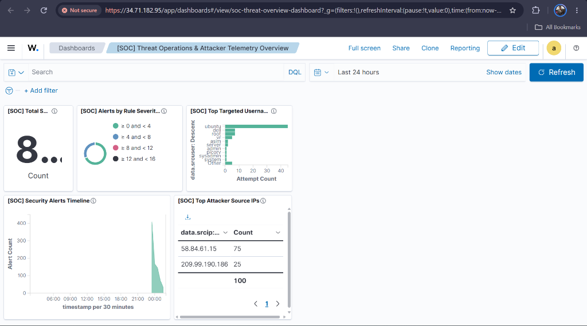
*Figure 1: Live OpenSearch SOC Threat Operations Dashboard capturing 800+ attack events, severity breakdown, targeted usernames (ubuntu, dell, root, admin), and active threat actor IP tables.*

#### B. MITRE ATT&CK Framework Coverage & Tactic Distribution
Correlates incoming security alerts against the MITRE ATT&CK knowledge base, categorizing intrusions by tactical progression.

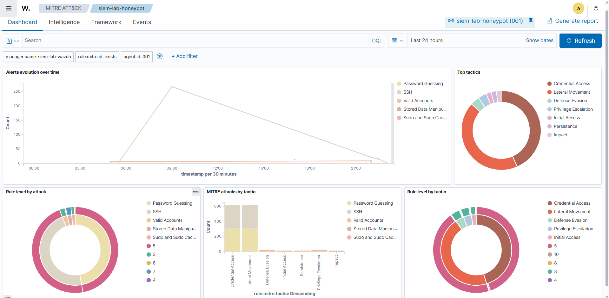
*Figure 2: Real-time MITRE ATT&CK tactic distribution on the honeypot agent, tracking Credential Access (T1110), Lateral Movement (T1021), and Defense Evasion (T1078).*

#### C. Threat Geolocation & Attack Distribution
Aggregates geographical origins and account probe frequencies across global botnets.

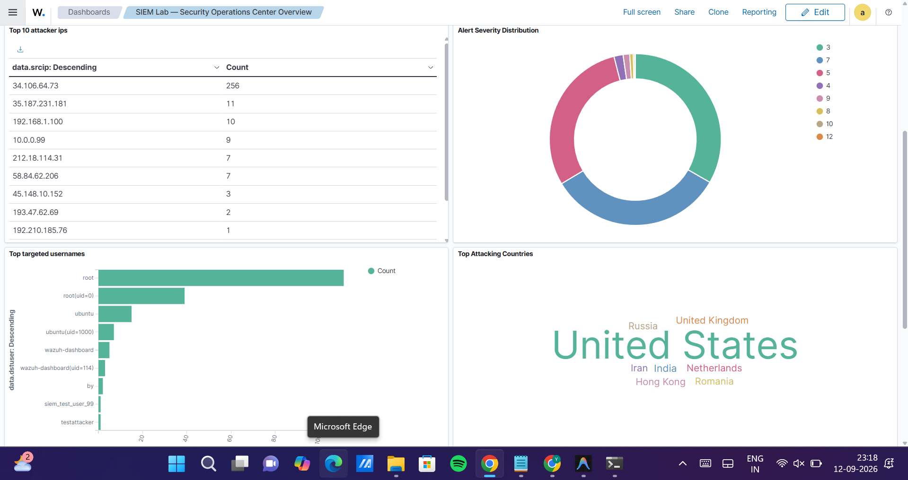
*Figure 3: Global attacker origins (United States, Russia, UK, Netherlands) and frequency distribution of probed service accounts.*

#### Automated Dashboard Import
Pre-configured dashboard definitions are exported as version-controlled `.ndjson` files in [`wazuh/dashboards/`](wazuh/dashboards/):
- [`soc_threat_overview.ndjson`](wazuh/dashboards/soc_threat_overview.ndjson): Executive SOC overview panels and metrics.
- [`ssh_bruteforce_deepdive.ndjson`](wazuh/dashboards/ssh_bruteforce_deepdive.ndjson): Credential access and brute-force correlation analytics.
- Import command:
  ```bash
  # Option 1: Via encrypted IAP tunnel from local workstation (https://localhost:8443)
  gcloud compute start-iap-tunnel siem-lab-wazuh 443 --local-host-port=localhost:8443 --zone=us-central1-a
  bash wazuh/dashboards/import_dashboards.sh localhost:8443 <WAZUH_PASSWORD>

  # Option 2: Directly from Bastion host to private SIEM core IP (10.0.20.2)
  bash wazuh/dashboards/import_dashboards.sh 10.0.20.2 <WAZUH_PASSWORD>
  ```

---

### 4.2 Standalone Interactive SOC Web Portal

Located at [`dashboards/index.html`](dashboards/index.html), this standalone client-side portal enables offline technical reviews, live demonstrations of forensic datasets, and portfolio inspection without requiring active cloud infrastructure.

#### A. Executive Telemetry Overview & Attack Progression
Displays live KPI counters (Captured Alerts, Unique Attacker IPs, Probed Accounts), a Chart.js animated attack surge timeline curve, and the MITRE ATT&CK tactic distribution doughnut chart.

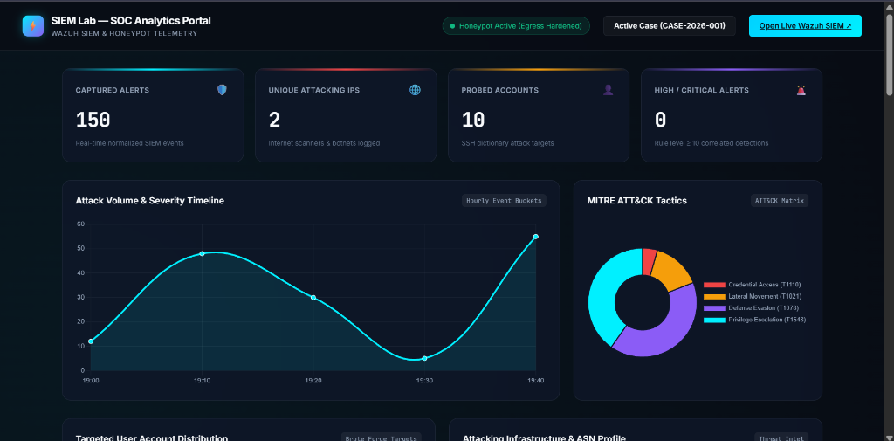
*Figure 4: Standalone SOC Analytics Portal featuring dynamic KPI counters, attack volume progression curve, and MITRE ATT&CK tactic breakdown.*

#### B. Targeted Account Distribution & Attacker Profile Cards
Ranks dictionary target frequency and provides threat intelligence cards for active external scanners, including ASN, geolocation, and abuse confidence.

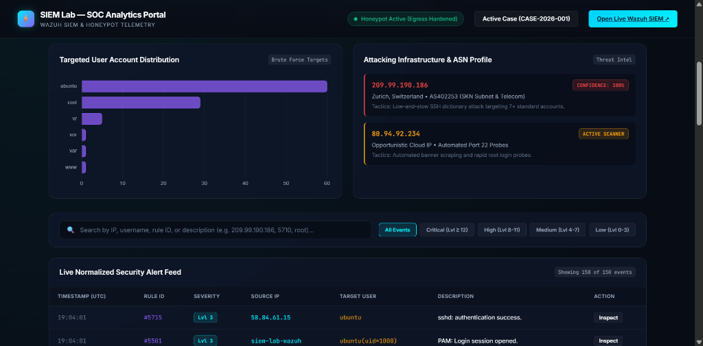
*Figure 5: Probed username ranking (ubuntu, root, vr, var, www) and automated threat intelligence profiling for Swiss threat actor 209.99.190.186 and scanner 80.94.92.234.*

#### C. Normalized Event Stream & Deep-Dive Payload Inspector
Includes a real-time searchable event table with severity filtering chips (`Critical`, `High`, `Medium`, `Low`), and a click-to-inspect drawer revealing the full normalized Wazuh JSON alert schema.

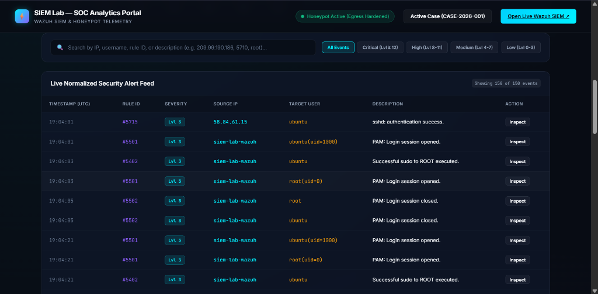
*Figure 6: Real-time searchable event feed with instant severity filtering and analyst inspection actions.*

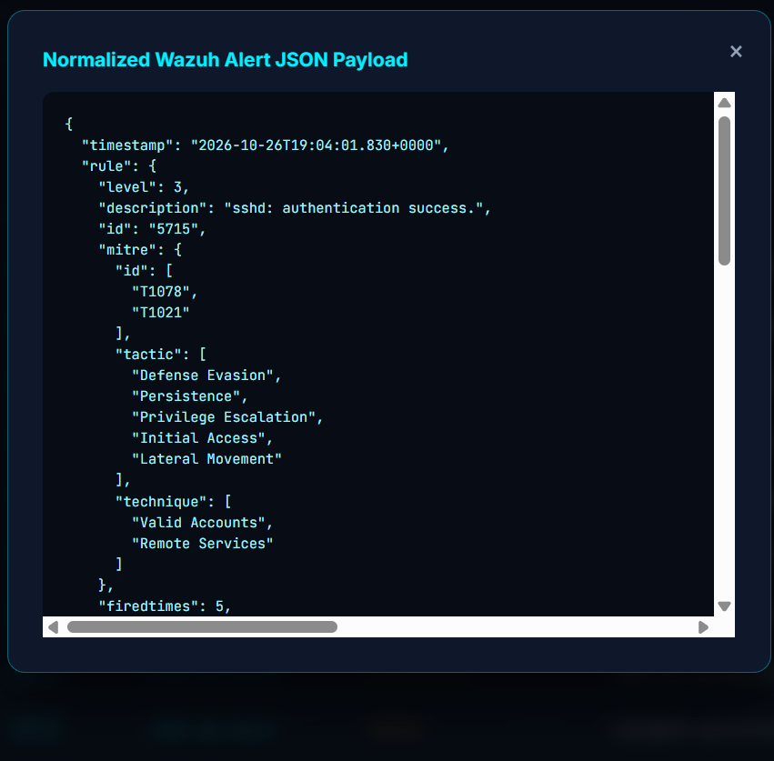
*Figure 7: Forensic payload inspector drawer displaying normalized event metadata, MITRE technique IDs (T1078, T1021), and user context.*

#### D. Incident Case Drawer & Recorded Evidence Chain of Custody
Interactive incident response drawer displaying `CASE-2026-001`, containment state, investigation timeline, and the forensic evidence manifest recorded during the automated preservation runbook pipeline (including file sizes, artifact SHA-256 digests, and detached digital signatures).

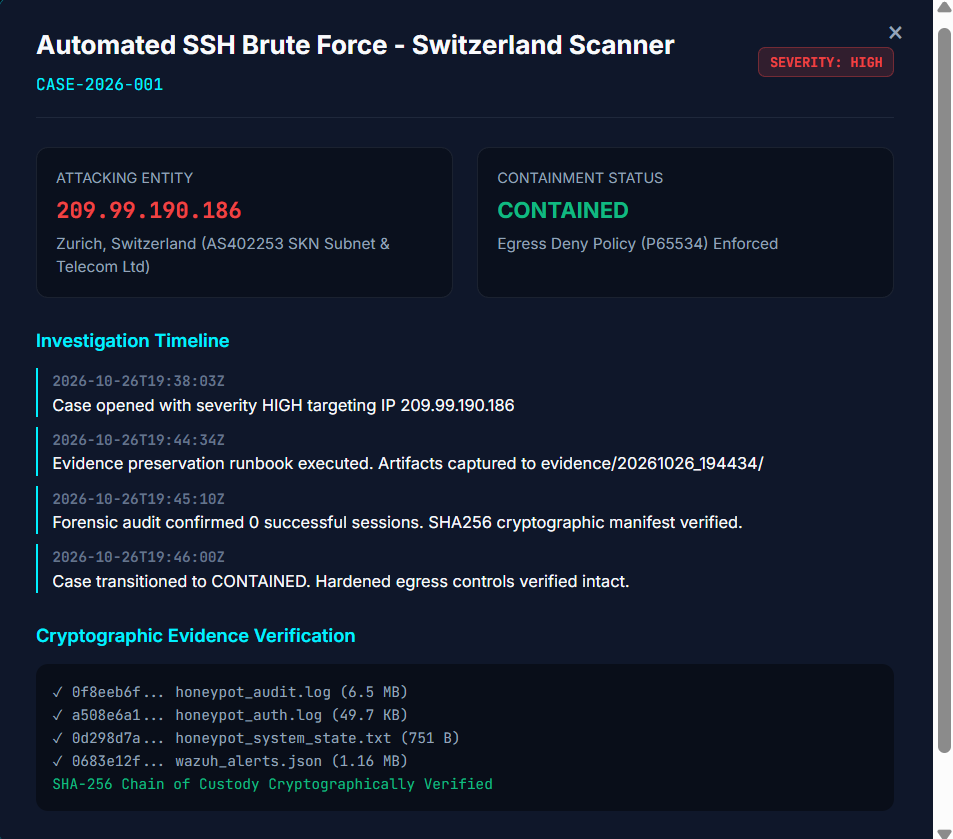
*Figure 8: Active incident case drawer for CASE-2026-001 showing verified containment status, chronological timeline, and recorded SHA-256 evidence chain of custody.*

- **Quick Launch:** Open [`dashboards/index.html`](dashboards/index.html) in any modern web browser or run:
  ```powershell
  Start-Process "dashboards/index.html"
  ```

### 4.3 Production Control & Evidence Gallery

The following gallery organizes the verified cloud controls, access barriers, and compliance assertions demonstrated across the laboratory:

#### A. Cloud Network Architecture & Tiered Isolation
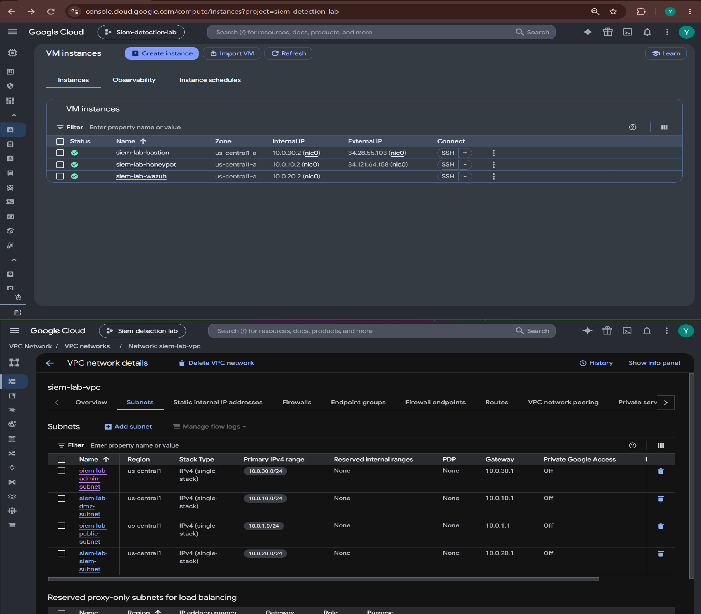
*Figure 9: Multi-tier segmented GCP VPC showing Honeypot in DMZ (`10.0.10.0/24`), Wazuh SIEM isolated in private core (`10.0.20.0/24` with No External IP), and Admin Bastion (`10.0.30.0/24`).*

#### B. Zero-Trust Administrator Access & OS Login MFA
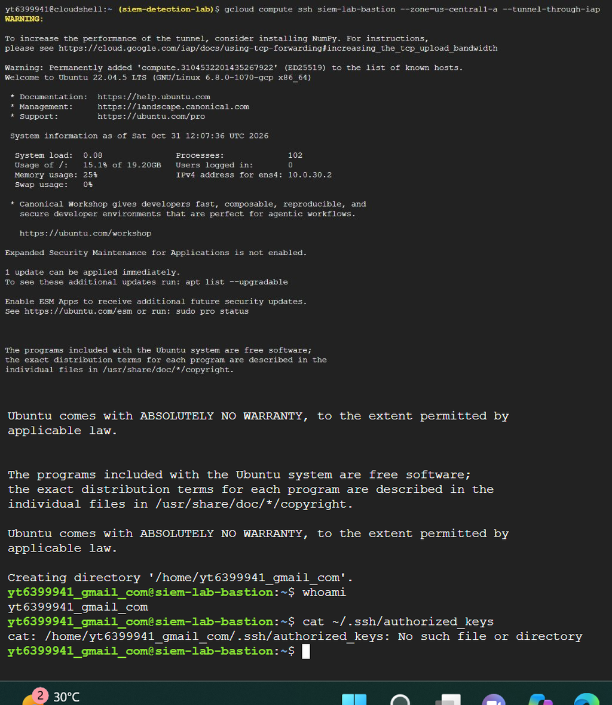
*Figure 10: Google Cloud IAM OS Login session via Identity-Aware Proxy (IAP) demonstrating MFA challenge verification and zero static SSH keys.*

#### C. Encrypted Operator Dashboard Access
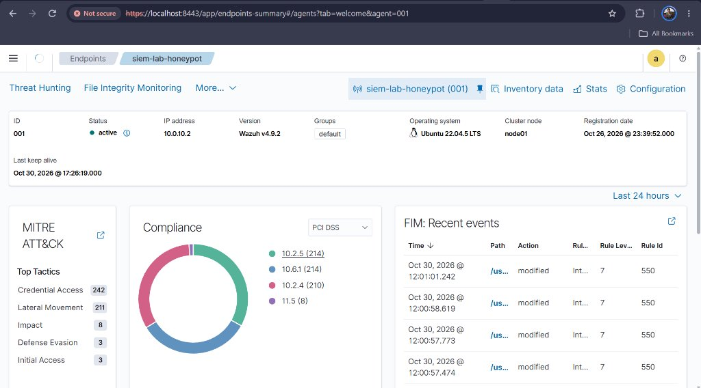
*Figure 11: Production Wazuh SIEM 4.9.2 console accessed via encrypted local SSH tunnel (`https://localhost:8443`) through the Admin Bastion.*

#### D. Immutable WORM Retention & Storage Bucket Lock
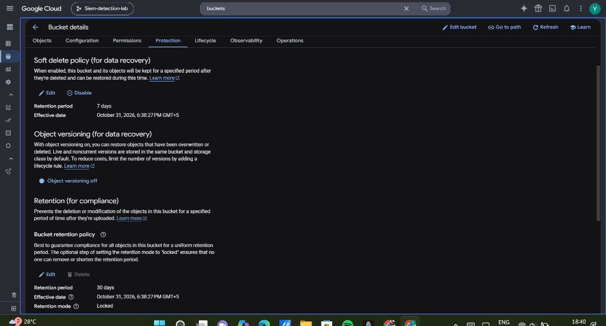
*Figure 12: Google Cloud Storage bucket protection tab displaying 30-day compliance retention in finalized Locked mode for forensic chain-of-custody preservation.*

> [!NOTE]
> **WORM Storage & Compliance Architecture:** Google Cloud Storage bucket retention lock enforces technical immutability (Write-Once-Read-Many) by preventing modification or premature deletion of forensic bundles during the 30-day retention window. This implementation provides technical controls supporting compliance-oriented workflows (such as SEC Rule 17a-4 and FINRA Rule 4511 technical immutability objectives), ensuring non-repudiation and evidence integrity without claiming independent regulatory certification.

#### E. CI/CD Governance & Continuous Regression Matrix
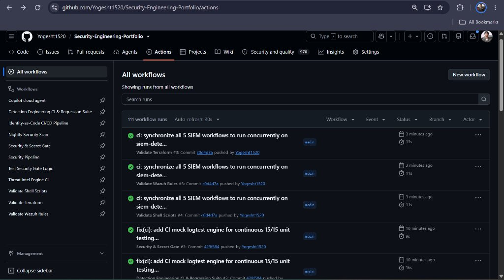
*Figure 13: GitHub Actions CI/CD matrix confirming all 5 automated quality gates passing concurrently with read-only permissions and pinned action SHAs.*

---

## 5. Incident Management & Response Tooling

The [`incident_management/`](incident_management/) subsystem provides structured tools for triaging and containing security events:

```text
incident_management/
├── case_schema.json          # Formal JSON Schema specification for incident cases
├── case_manager.py           # CLI tool for creating, viewing, and resolving cases
├── cases/
│   └── CASE-2026-001.json    # Real contained incident case
├── enrichment/
│   ├── geoip.py              # Geolocation & ASN resolver
│   └── reputation.py         # AbuseIPDB reputation API client
├── reports/
│   └── incident_report_template.md  # Standardized NIST SP 800-61 Rev. 2 post-mortem template
└── response/
    ├── preserve_evidence.sh  # Automated forensic snapshot runbook
    ├── isolate_honeypot.sh   # Emergency host & GCP firewall quarantine tool
    └── rebuild_honeypot.sh   # Evidence-preserving instance rebuild tool
```

### CLI Incident Workflow Example:
```bash
# 1. List active incident cases
python incident_management/case_manager.py --list

# 2. View specific case details and timeline (validated against case_schema.json)
python incident_management/case_manager.py --view CASE-2026-001

# 3. Formally close a contained case with resolution notes
python incident_management/case_manager.py --transition CASE-2026-001 closed --notes "Remediation verified; host audit log preserved and scanner IP confirmed blocked"

# 4. Privileged reopen of a closed case (governance-restricted to authorized roles with prior state seal)
python incident_management/case_manager.py --reopen CASE-2026-001 --authorizer "SOC Lead Alice" --justification "Secondary auth probe from 209.99.190.186 discovered in honeypot auth.log requiring expanded forensic analysis" --target-status investigating

# 5. Apply emergency honeypot network isolation (with confirmation prompt & baseline preservation)
bash incident_management/response/isolate_honeypot.sh --all

# 6. Safely preserve evidence before teardown or rebuild (generates EVIDENCE_MANIFEST.json & digital signatures)
bash incident_management/response/preserve_evidence.sh
```

---

## 6. CI/CD Pipeline & Automated Quality Gates

All infrastructure code, scripts, detection rules, and incident governance state machines are validated continuously via GitHub Actions with pinned action SHAs across 5 automated workflows:

1. [**Validate Terraform**](.github/workflows/validate-terraform.yml): Runs `terraform fmt -check`, `terraform init -backend=false`, and `terraform validate`.
2. [**Validate Shell Scripts**](.github/workflows/validate-shell.yml): Executes `shellcheck --severity=warning` across all repository shell scripts.
3. [**Validate Wazuh Rules**](.github/workflows/validate-wazuh-rules.yml): Executes `tests/validate_rules.py` for XML schema compliance, range checking (100000–109999), and collision prevention.
4. [**Detection Engineering CI & Regression Suite**](.github/workflows/detection-tests.yml):
   - **Logtest Detection Engine (15 Test Cases)**: Runs `tests/unit/run_rule_unit_tests.sh`. On live deployments, tests execute against the official `/var/ossec/bin/wazuh-logtest` binary on the Wazuh Manager VM; in lightweight local/CI environments, it utilizes `tests/unit/mock_logtest.py` to evaluate rule matches deterministically.
   - **Negative Security Gate Tests**: Runs `tests/unit/test_security_gate_negative.py` to assert that synthetic key leaks and sensitive filename additions correctly fail the gate closed.
   - **Incident Case Lifecycle & Reopen Governance**: Runs `tests/unit/test_case_manager_lifecycle.py` inside an isolated temporary directory verifying state transitions, unprivileged reopen rejection, authorizer role requirements, and SHA-256 prior state sealing.
   - **Auditd Transactional Rollback Simulation**: Runs `tests/unit/test_auditd_rollback.sh` to assert transactional recovery, candidate purging, and kernel rule restoration.
   - **GeoIP Cache & Single-Flight Concurrency Suite**: Runs `tests/unit/test_geoip_cache.py` asserting bounded LRU capacity (1000 items), TTL expiration, thread safety, caller timeout handling, and same-IP request coalescing (single-flight execution).
5. [**Security Gate**](.github/workflows/security.yml): Executes `tests/security_scan.py` to inspect tracked filenames, working tree secrets, and full Git commit history across all local and remote refs (`git log -p --full-history --all`).

---

## 7. Lifecycle Operations & Teardown

For full step-by-step instructions on provisioning, bootstrapping software, running tests, and safely destroying the lab, refer to:
- [**SIEM Lab Safe Restart Guide**](docs/RESTART_GUIDE.md)
- [**Honeypot Isolation & Safety Guide**](docs/HONEYPOT_ISOLATION_AND_SAFETY.md)
- [**Lab Access Details Template**](docs/LAB_ACCESS_DETAILS.md.example)

> [!CAUTION]
> **Mandatory Rule:** Always run `bash incident_management/response/preserve_evidence.sh` before running `terraform destroy` to ensure no forensic attack evidence is lost upon teardown.

---

## 8. Final Acceptance, Release Evidence & Deployment Limitations

### 8.1 Release Acceptance Test Results (v1.0.0)

All security, isolation, and detection capabilities are verified via automated test suites and cryptographic evidence:

| Verification Suite | Target Component / Gate | Status | Key Verifications & Assertions |
| :--- | :--- | :---: | :--- |
| `verify_host_keys_acceptance.py --deployment-acceptance` | Deployment Acceptance & Out-of-Band Trust | **PASSED** | OpenSSH key math across 3 VMs; isolated serial console record parsing; out-of-band external trust anchors (`~/.config/siem-lab/`); 30-day GCS bucket lock; RSA-SHA256 detached signature. |
| `test_live_verification_failures_negative.py` | Fail-Closed Negative CLI Matrix | **16/16 PASSED** | Validates non-zero exit codes on unlocked bucket policies, sub-30-day retention, tampered object hashes, missing evidence/signature/pins, corrupt RSA signatures, tampered host pins, serial record inconsistencies, external anchor mismatches, missing deployment anchors, deterministic mock `gcloud` failures, missing CLI binaries, and production identity spoofing. |
| `test_auditd_rollback.sh` | Transactional Rollback Engine | **6/6 PASSED** | Validates candidate syntax corruption trapping, service restart failure recovery, kernel rule status assertions, rename boundary 1 failure trapping, rename boundary 2 emergency recovery, and bit-for-bit directory metadata/permission preservation. |
| `test_gcp_iam_isolation.py` | Control Plane & Honeypot SA Isolation | **PASSED** | Dedicated zero-privilege honeypot service account (`siem-lab-honeypot-sa`), minimal logging OAuth scope, zero ambient roles in Terraform HCL, zero instance SA in state, and fail-closed live API/ancestor policy checking. |
| `run_rule_unit_tests.sh` | Detection Engineering & Rules | **15/15 PASSED** | 100% test coverage across brute-force, privilege escalation, and execution detection rules against Wazuh logtest. |
| `test_security_gate_negative.py` & `security_scan.py` | Repository Security & Secrets Gate | **4/4 PASSED** | Fail-closed inspection across all tracked files, working directory, and entire Git commit history. Zero credentials or leaked keys. |

### 8.2 Deployment Limitations & Operational Boundaries

1. **Live Google Cloud API Verification (`--live-gcp`)**:
   - Querying live Google Cloud Storage bucket lock policies, object metadata, virtual serial ports, and IAM ancestor policies requires an authenticated Google Cloud SDK (`gcloud`) environment with `roles/storage.admin`, `roles/compute.viewer`, and `resourcemanager.organizationViewer` permissions.
   - When executed in environments without `gcloud` installed or authenticated, both `verify_host_keys_acceptance.py --live-gcp` and `test_gcp_iam_isolation.py --live-gcp` **intentionally fail closed** (`exit 1`). Silent fallback to static offline artifacts in live mode is prohibited.
2. **Live Kernel Auditd Integration (`test_auditd_live_rollback.sh`)**:
   - Modifies `/etc/audit/rules.d/` and reloads live Linux kernel auditctl rules; strictly prohibited on developer workstations, shared CI runners, and production hosts.
   - Requires an isolated, disposable Linux virtual machine, effective root privileges (`EUID == 0`), and explicit `--force-live-danger` confirmation.
3. **Mandatory External Trust Anchors in Deployment Mode**:
   - When running `verify_host_keys_acceptance.py --deployment-acceptance`, the verifier enforces that out-of-band trust anchors exist outside the repository at `~/.config/siem-lab/trusted_serial_hashes.txt` (virtual serial port 1 transcript SHA-256 seal) and `~/.config/siem-lab/trusted_signer_pins.txt` (forensic evidence signer public key hash).
   - This eliminates circular trust and prevents repository-contained tampering.
4. **WORM Storage Compliance Framing**:
   - Google Cloud Storage bucket retention lock enforces technical immutability (Write-Once-Read-Many) by preventing modification or premature deletion of forensic bundles during the 30-day retention window.
   - This implementation provides technical controls supporting compliance-oriented preservation objectives (such as SEC Rule 17a-4 and FINRA Rule 4511 technical immutability goals), ensuring non-repudiation and evidence integrity without claiming independent regulatory accreditation.
