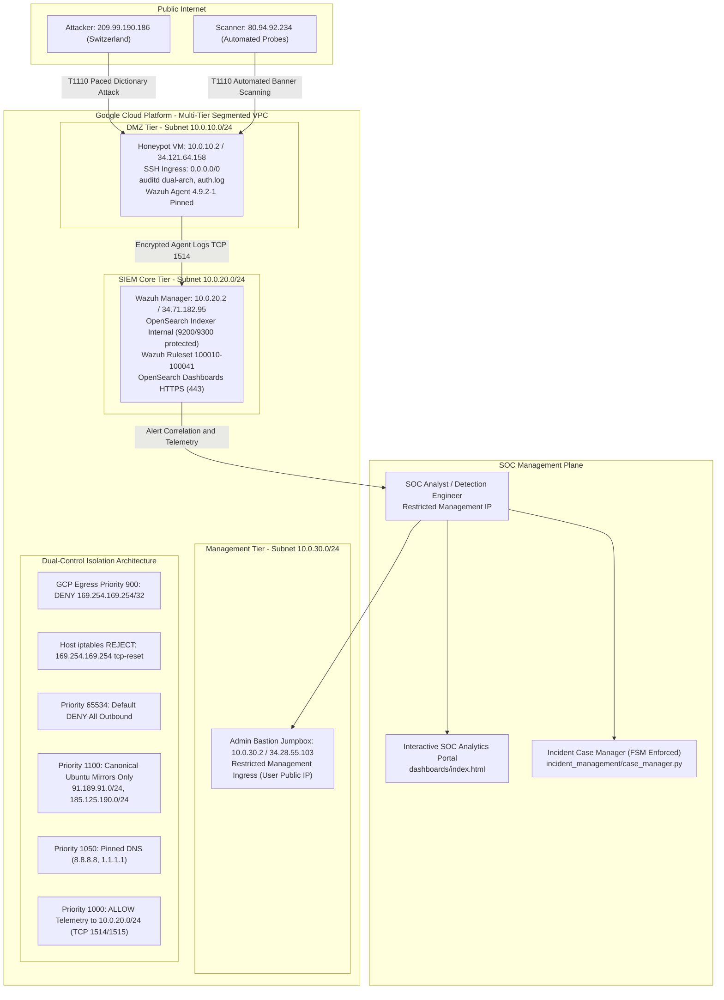
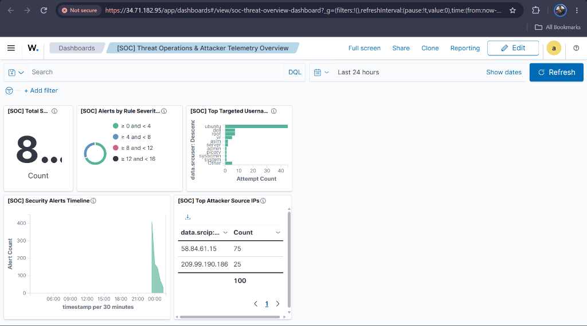
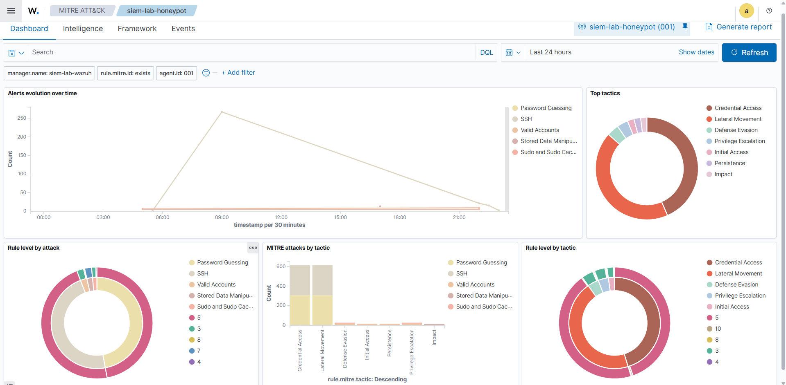
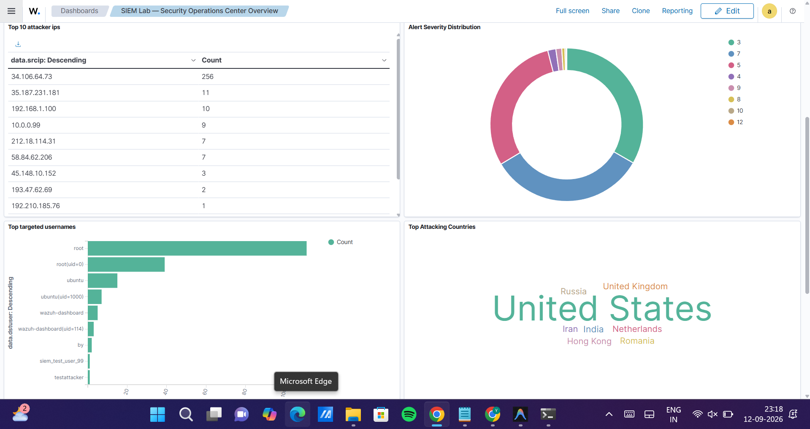
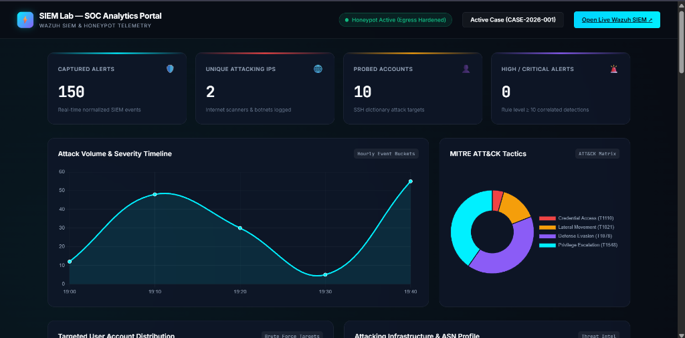
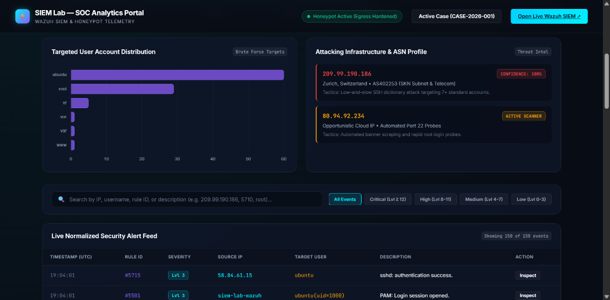
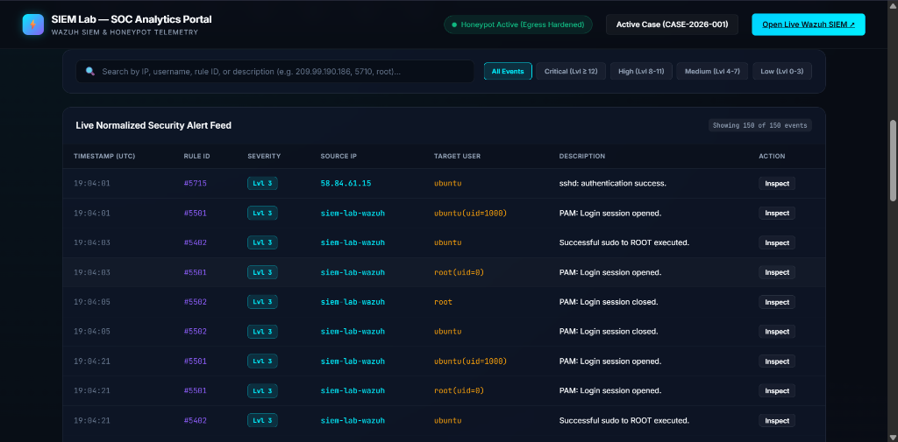
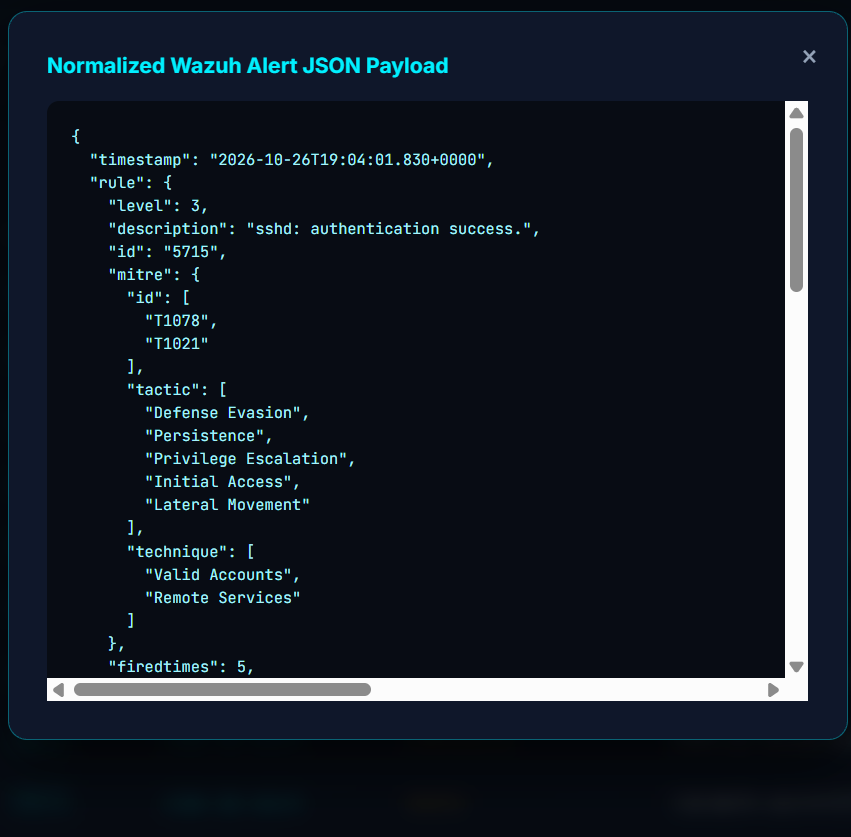
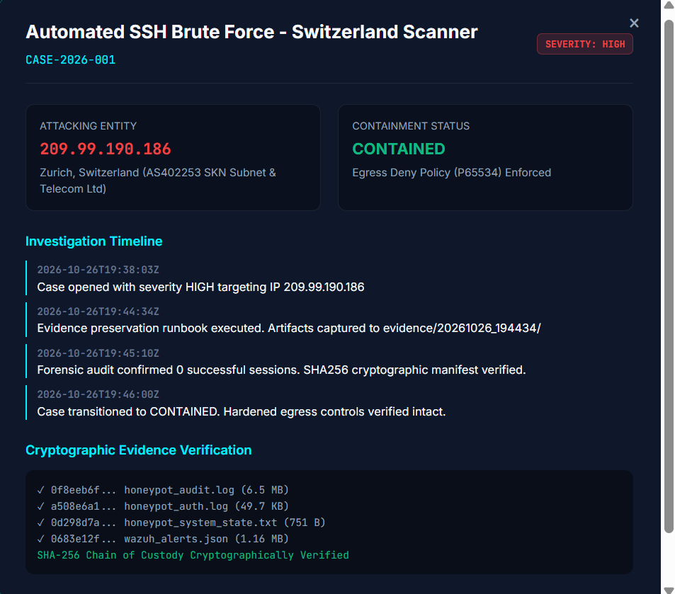

# Enterprise SIEM & Threat Detection Engineering Lab

[](.github/workflows/validate-terraform.yml)
[](.github/workflows/validate-shell.yml)
[](.github/workflows/validate-wazuh-rules.yml)
[](.github/workflows/security.yml)

An enterprise-grade, end-to-end Security Operations Center (SOC) and Detection Engineering laboratory deployed in Google Cloud Platform (GCP). The lab exposes an intentionally instrumented Linux honeypot to capture live internet attack campaigns, processes raw kernel audit and authentication telemetry through a unified Wazuh SIEM stack, and correlates multi-stage intrusions using custom MITRE ATT&CK-mapped detection rules, automated response runbooks, and interactive operational dashboards.

---

## 1. System Architecture



---

## 2. Evidence & Verification Matrix

Every detection capability and incident response workflow in this lab is backed by verified machine-readable test artifacts, cryptographic manifests, and real-world attack telemetry:

| Artifact Type | File / Location | Description & Integrity |
| :--- | :--- | :--- |
| **Forensic Evidence Bundle** | [`evidence/20261028_191347/`](evidence/20261028_191347/) | Post-migration snapshot: `honeypot_audit.log` (6.18MB), `honeypot_auth.log` (326KB), `wazuh_alerts.json` (2.00MB), zero-metadata `honeypot_system_state.txt`, and verified `honeypot_defense_posture.txt`. |
| **Cryptographic Manifest & Sigs** | [`evidence/.../EVIDENCE_MANIFEST.json`](evidence/20261028_191347/EVIDENCE_MANIFEST.json) | Structured JSON provenance manifest with collector identity, UTC timestamps, SHA-256 hashes, and detached `.sig` digital signatures. |
| **Active Incident Case** | [`incident_management/cases/CASE-2026-001.json`](incident_management/cases/CASE-2026-001.json) | High-severity case opened and contained against live attacker `209.99.190.186` (Zurich, Switzerland) with strict FSM lifecycle enforcement. |
| **Unit Test Suite Results** | [`tests/results/unit_test_latest.json`](tests/results/unit_test_latest.json) | Automated execution of 15 detection unit tests against `wazuh-logtest` (**15/15 Passed — 100% Rule, Boundary & Negative Coverage**). |
| **Static Rule Audit** | `python tests/validate_rules.py` | Validates XML syntax, duplicate rule IDs, and ID range enforcement (**10/10 Passed**). |
| **Security Leak Gate** | `python tests/security_scan.py` | Full-history git commit and workspace audit for credentials, Slack tokens, JWTs, and `.tfstate` (**Zero Leaks — Fail Closed**). |
| **Negative Security Tests** | [`tests/unit/test_security_gate_negative.py`](tests/unit/test_security_gate_negative.py) | Negative assertion test suite confirming security gate catches simulated private keys and forbidden files (**Passing**). |

---

## 3. Detection Catalog & MITRE ATT&CK Mapping

Custom detection rules deployed in `/var/ossec/etc/rules/` are documented in the [Detection Catalog](detections/catalog/):

| Rule ID | Detection Name | Level | MITRE Tactic | Technique ID | Catalog Specification |
| :---: | :--- | :---: | :--- | :---: | :--- |
| **100010** | Burst SSH Brute Force (8+ in 120s) | 10 | Credential Access | [T1110.001](https://attack.mitre.org/techniques/T1110/001/) | [`DET-SSH-001`](detections/catalog/authentication/DET-SSH-001_burst-brute-force.md) |
| **100012** | Low-and-Slow Persistent Brute Force | 10 | Credential Access | [T1110.001](https://attack.mitre.org/techniques/T1110/001/) | [`DET-SSH-002`](detections/catalog/authentication/DET-SSH-002_low-and-slow.md) |
| **100014** | Targeted Account Failure Concentration | 11 | Credential Access | [T1110.001](https://attack.mitre.org/techniques/T1110/001/) | [`DET-SSH-003`](detections/catalog/authentication/DET-SSH-003_repeated-failures-same-user.md) |
| **100015** | Benign Management Authentication | 3 | Initial Access | [T1078](https://attack.mitre.org/techniques/T1078/) | Whitelist rule for SIEM host IP |
| **100020** | Local User Account Creation | 8 | Persistence | [T1136.001](https://attack.mitre.org/techniques/T1136/001/) | [`DET-PRIV-001`](detections/catalog/privilege_escalation/DET-PRIV-001_user-creation.md) |
| **100021** | Sudoers Configuration Modification | 12 | Privilege Escalation | [T1548.003](https://attack.mitre.org/techniques/T1548/003/) | [`DET-PRIV-002`](detections/catalog/privilege_escalation/DET-PRIV-002_sudoers-modification.md) |
| **100022** | Sudoers Drop-in Directory Change | 12 | Privilege Escalation | [T1548.003](https://attack.mitre.org/techniques/T1548/003/) | [`DET-PRIV-002`](detections/catalog/privilege_escalation/DET-PRIV-002_sudoers-modification.md) |
| **100030** | Suspicious Command Execution | 12 | Execution | [T1059.004](https://attack.mitre.org/techniques/T1059/004/) | [`DET-EXEC-001`](detections/catalog/execution/DET-EXEC-001_suspicious-commands.md) |
| **100040** | CRITICAL: Success After Burst Attack | 14 | Credential Access / Lateral | [T1110](https://attack.mitre.org/techniques/T1110/), [T1078](https://attack.mitre.org/techniques/T1078/) | [`DET-SSH-004`](detections/catalog/authentication/DET-SSH-004_success-after-attack.md) |
| **100041** | CRITICAL: Success After Slow Attack | 14 | Credential Access / Lateral | [T1110](https://attack.mitre.org/techniques/T1110/), [T1078](https://attack.mitre.org/techniques/T1078/) | [`DET-SSH-004`](detections/catalog/authentication/DET-SSH-004_success-after-attack.md) |

---

## 4. Visualizations & Operational Dashboards

The laboratory features dual operational visualization interfaces: production-grade OpenSearch Dashboards running on the SIEM cluster, and a client-side interactive SOC analytics portal.

### 4.1 Production OpenSearch Dashboards (Live SIEM)

The Wazuh / OpenSearch Dashboards interface provides operational visibility into incoming honeypot attack traffic, automated detections, and threat actor behavior.

#### A. Executive SOC Threat Operations & Telemetry Overview
Visualizes real-time security events captured across public honeypot interfaces, including severity distributions, targeted accounts, and active botnet source IPs.


*Figure 1: Live OpenSearch SOC Threat Operations Dashboard capturing 800+ attack events, severity breakdown, targeted usernames (ubuntu, dell, root, admin), and active threat actor IP tables.*

#### B. MITRE ATT&CK Framework Coverage & Tactic Distribution
Correlates incoming security alerts against the MITRE ATT&CK knowledge base, categorizing intrusions by tactical progression.


*Figure 2: Real-time MITRE ATT&CK tactic distribution on the honeypot agent, tracking Credential Access (T1110), Lateral Movement (T1021), and Defense Evasion (T1078).*

#### C. Threat Geolocation & Attack Distribution
Aggregates geographical origins and account probe frequencies across global botnets.


*Figure 3: Global attacker origins (United States, Russia, UK, Netherlands) and frequency distribution of probed service accounts.*

#### Automated Dashboard Import
Pre-configured dashboard definitions are exported as version-controlled `.ndjson` files in [`wazuh/dashboards/`](wazuh/dashboards/):
- [`soc_threat_overview.ndjson`](wazuh/dashboards/soc_threat_overview.ndjson): Executive SOC overview panels and metrics.
- [`ssh_bruteforce_deepdive.ndjson`](wazuh/dashboards/ssh_bruteforce_deepdive.ndjson): Credential access and brute-force correlation analytics.
- Import command:
  ```bash
  bash wazuh/dashboards/import_dashboards.sh <SIEM_PUBLIC_IP> <WAZUH_PASSWORD>
  ```

---

### 4.2 Standalone Interactive SOC Web Portal

Located at [`dashboards/index.html`](dashboards/index.html), this standalone client-side portal enables offline technical reviews, live demonstrations of forensic datasets, and portfolio inspection without requiring active cloud infrastructure.

#### A. Executive Telemetry Overview & Attack Progression
Displays live KPI counters (Captured Alerts, Unique Attacker IPs, Probed Accounts), a Chart.js animated attack surge timeline curve, and the MITRE ATT&CK tactic distribution doughnut chart.


*Figure 4: Standalone SOC Analytics Portal featuring dynamic KPI counters, attack volume progression curve, and MITRE ATT&CK tactic breakdown.*

#### B. Targeted Account Distribution & Attacker Profile Cards
Ranks dictionary target frequency and provides threat intelligence cards for active external scanners, including ASN, geolocation, and abuse confidence.


*Figure 5: Probed username ranking (ubuntu, root, vr, var, www) and automated threat intelligence profiling for Swiss threat actor 209.99.190.186 and scanner 80.94.92.234.*

#### C. Normalized Event Stream & Deep-Dive Payload Inspector
Includes a real-time searchable event table with severity filtering chips (`Critical`, `High`, `Medium`, `Low`), and a click-to-inspect drawer revealing the full normalized Wazuh JSON alert schema.


*Figure 6: Real-time searchable event feed with instant severity filtering and analyst inspection actions.*


*Figure 7: Forensic payload inspector drawer displaying normalized event metadata, MITRE technique IDs (T1078, T1021), and user context.*

#### D. Incident Case Drawer & Evidence Chain of Custody
Interactive incident response drawer displaying `CASE-2026-001`, containment state, investigation timeline, and verified SHA-256 cryptographic evidence hashes.


*Figure 8: Active incident case drawer for CASE-2026-001 showing verified containment status, chronological timeline, and SHA-256 evidence chain of custody.*

- **Quick Launch:** Open [`dashboards/index.html`](dashboards/index.html) in any modern web browser or run:
  ```powershell
  Start-Process "dashboards/index.html"
  ```

---

## 5. Incident Management & Response Tooling

The [`incident_management/`](incident_management/) subsystem provides structured tools for triaging and containing security events:

```text
incident_management/
├── case_schema.json          # Formal JSON Schema specification for incident cases
├── case_manager.py           # CLI tool for creating, viewing, and resolving cases
├── cases/
│   └── CASE-2026-001.json    # Real contained incident case
├── enrichment/
│   ├── geoip.py              # Geolocation & ASN resolver
│   └── reputation.py         # AbuseIPDB reputation API client
├── reports/
│   └── incident_report_template.md  # Standardized NIST SP 800-61 Rev. 2 post-mortem template
└── response/
    ├── preserve_evidence.sh  # Automated forensic snapshot runbook
    ├── isolate_honeypot.sh   # Emergency host & GCP firewall quarantine tool
    └── rebuild_honeypot.sh   # Evidence-preserving instance rebuild tool
```

### CLI Incident Workflow Example:
```bash
# 1. List active incident cases
python incident_management/case_manager.py --list

# 2. View specific case details and timeline (validated against case_schema.json)
python incident_management/case_manager.py --view CASE-2026-001

# 3. Transition case lifecycle (enforcing valid state machine transitions)
python incident_management/case_manager.py --transition CASE-2026-001 RESOLVED --comment "Remediation verified; firewall quarantine lifted."

# 4. Apply emergency honeypot network isolation (with confirmation prompt & baseline preservation)
bash incident_management/response/isolate_honeypot.sh --all

# 5. Safely preserve evidence before teardown or rebuild (generates EVIDENCE_MANIFEST.json)
bash incident_management/response/preserve_evidence.sh
```

---

## 6. CI/CD Pipeline & Automated Quality Gates

All infrastructure code, scripts, and detection rules are validated via GitHub Actions with pinned action SHAs:

1. [**Validate Terraform**](.github/workflows/validate-terraform.yml): Runs `terraform fmt -check`, `terraform init -backend=false`, and `terraform validate`.
2. [**Validate Shell Scripts**](.github/workflows/validate-shell.yml): Executes `shellcheck --severity=warning` across all shell scripts.
3. [**Validate Wazuh Rules**](.github/workflows/validate-wazuh-rules.yml): Executes `tests/validate_rules.py` for XML syntax and duplicate ID prevention.
4. [**Security Gate**](.github/workflows/security.yml): Executes `tests/security_scan.py` to prevent accidental credential or `.tfstate` leaks.

---

## 7. Lifecycle Operations & Teardown

For full step-by-step instructions on provisioning, bootstrapping software, running tests, and safely destroying the lab, refer to:
- [**SIEM Lab Safe Restart Guide**](docs/RESTART_GUIDE.md)
- [**Honeypot Isolation & Safety Guide**](docs/HONEYPOT_ISOLATION_AND_SAFETY.md)
- [**Lab Access Details Template**](docs/LAB_ACCESS_DETAILS.md.example)

> [!CAUTION]
> **Mandatory Rule:** Always run `bash incident_management/response/preserve_evidence.sh` before running `terraform destroy` to ensure no forensic attack evidence is lost upon teardown.
