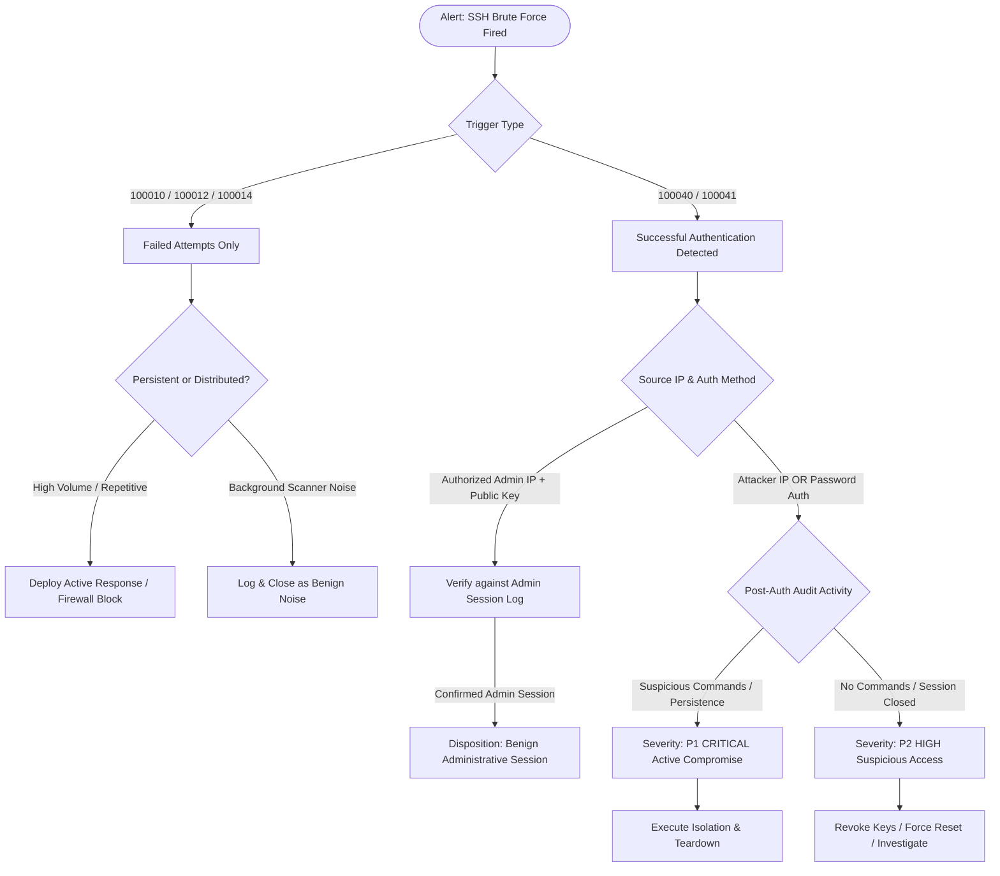

# SOC Playbook: SSH Brute Force & Credential Access

**Document ID:** PB-SOC-001  
**Version:** 2.0  
**Trigger Rules:** `100010` (Burst Brute Force), `100012` (Low & Slow Brute Force), `100014` (Password Spray), `100040`/`100041` (Success After Brute Force)  
**MITRE ATT&CK:** [T1110.001](https://attack.mitre.org/techniques/T1110/001/) (Password Guessing), [T1110.003](https://attack.mitre.org/techniques/T1110/003/) (Password Spraying), [T1078](https://attack.mitre.org/techniques/T1078/) (Valid Accounts)  

---

## 1. Triage Decision Workflow



---

## 2. Step-by-Step Triage & Validation

### Step 1: Alert Classification & Extraction
Extract key fields from the Wazuh alert payload:
- **Source IP (`data.srcip`):** The remote host initiating authentication.
- **Target User (`data.dstuser`):** The account targeted (`root`, `ubuntu`, service accounts).
- **Authentication Method:** Check whether authentication failed via `password` or `publickey`.

### Step 2: Correlate Authentication Success vs. Known Admin Baseline
> [!IMPORTANT]
> A successful authentication (`5715`) immediately following brute-force attempts is a high-priority correlation, but **not conclusive proof of compromise**. (e.g., An administrator logging in during an ongoing automated botnet scan).

1. **Verify Source IP Alignment:**
   - Did the successful authentication originate from the **exact same IP** that generated the failures?
   - Or did the success originate from the authorized administrative IP (e.g., the analyst's workstation)?
2. **Examine Authentication Mechanism:**
   - `Accepted password`: High probability of brute-force success if password auth was targeted.
   - `Accepted publickey`: Typical of authorized administrative access unless private key exfiltration occurred.
3. **Check Change / Administrative Baseline:**
   - Cross-reference against scheduled maintenance or authorized administrative logins (e.g., the 13 authorized sessions logged in the 24-hour observation report).

---

## 3. Post-Authentication Behavioral Analysis

If authentication succeeded from an unverified or external IP, query Wazuh for subsequent telemetry within a **30-minute window**:

| Detection Rule | Check | Evidence of Compromise |
|:---|:---|:---|
| **Rule `100030`** | Living-off-the-land commands | Execution of `wget`, `curl`, `nc`, `ncat`, or base64 decoding |
| **Rule `100020`** | Account creation | Execution of `/usr/sbin/useradd` or `/usr/sbin/adduser` |
| **Rule `100021`** | Sudoers modification | Modification of `/etc/sudoers` or `/etc/sudoers.d/*` |
| **auditd execve** | Interactive shell activity | Execution of `bash -i`, python reverse shells, reconnaissance commands (`uname -a`, `id`, `whoami`, `cat /etc/shadow`) |

---

## 4. Incident Disposition & Classification

| Disposition | Criteria | Action & SLA |
|:---|:---|:---|
| **P1 — Confirmed Malicious (Active Compromise)** | External attacker IP successfully authenticated via password or stolen key, followed by interactive commands or persistence. | Immediate host isolation. Eradicate and destroy instance via Terraform. Re-issue credentials. (SLA: < 15 mins) |
| **P2 — Suspicious / Unresolved** | External or unexpected IP successfully authenticated, but session dropped before post-exploitation activity was logged. | Lock targeted user account, invalidate active sessions, inspect bash history, monitor perimeter. (SLA: < 1 hour) |
| **P3 — Persistent Adversary Scanning** | Aggressive brute-force scanner (e.g. `34.106.64.73` with 250+ attempts) targeting valid system accounts without success. | Add source IP to host firewall / Wazuh Active Response blocklist. (SLA: < 4 hours) |
| **P4 — Benign / Background Noise** | Opportunistic scanners targeting invalid users (`by`, `admin`, `guest`) with low frequency. | Retain in SIEM index; no manual analyst intervention required. |
| **P4 — Benign Administrative Activity** | Authorized administrator authenticated via public key from known management IP coincident with automated scanner activity. | Close alert as False Positive / Authorized Activity; record in change tracking log. |

---

## 5. Containment, Eradication & Recovery

### For P1 (Confirmed Compromise on Honeypot VM):
1. **Network Isolation:** Update cloud firewall to isolate the honeypot instance, preventing any outbound egress:
   ```bash
   gcloud compute instances remove-tags siem-lab-honeypot --tags=honeypot
   ```
2. **Forensic Evidence Capture:**
   - Preserve Wazuh Indexer alerts for the incident timeline.
   - Capture memory dump and disk snapshot if deep forensics is required.
3. **Disposable Teardown (Immutable Infrastructure):**
   - Because the honeypot VM is disposable by design, destroy and re-provision using Terraform:
     ```bash
     cd infra/terraform
     terraform destroy -target=google_compute_instance.honeypot -auto-approve
     terraform apply -target=google_compute_instance.honeypot -auto-approve
     ```
4. **Credential Rotation:** Rotate SSH key pairs associated with any accounts present on the image.
